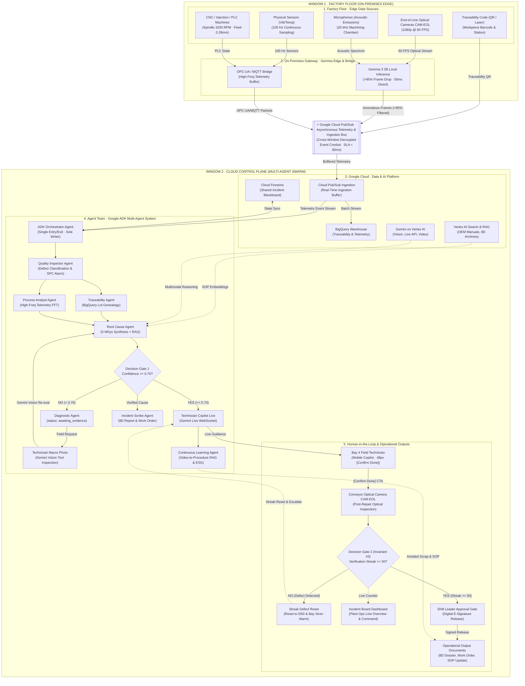
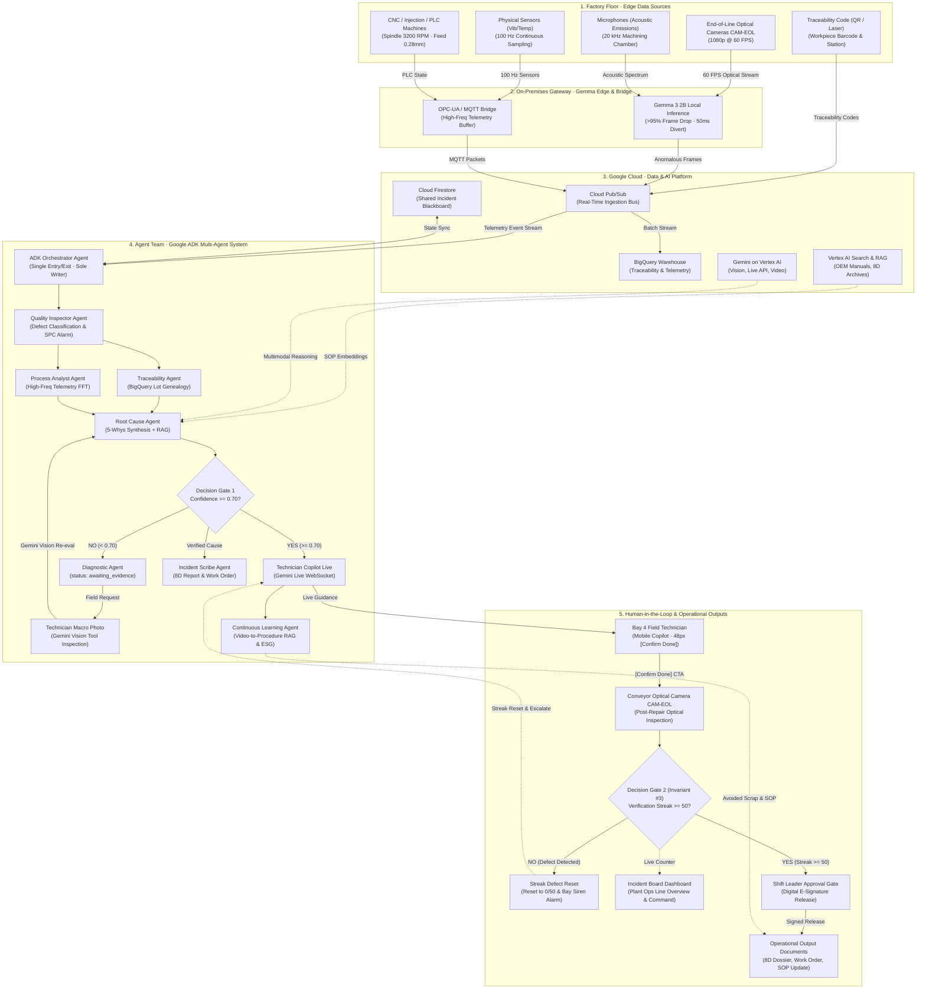

# System Topology Workflow Wireframe & Architecture Specification

> **Feature Tickets:** `TKT-045` / `FEAT-SYSTEM-TOPOLOGY-WORKFLOW-REDESIGN` ([#211](https://github.com/vanduc2514/hackathon-builder-cup-manufacturing-anomaly/issues/211)), `TKT-050` / `[UI/UX] Design Visual Boundaries for Window 1 vs Window 2, Phase Stepper Bar & Calm Tech Alert Glow` ([#225](https://github.com/vanduc2514/hackathon-builder-cup-manufacturing-anomaly/issues/225))  
> **GitHub Issues:** [#225](https://github.com/vanduc2514/hackathon-builder-cup-manufacturing-anomaly/issues/225) (Linked to [#211](https://github.com/vanduc2514/hackathon-builder-cup-manufacturing-anomaly/issues/211), [#218](https://github.com/vanduc2514/hackathon-builder-cup-manufacturing-anomaly/issues/218), [#220](https://github.com/vanduc2514/hackathon-builder-cup-manufacturing-anomaly/issues/220))  
> **Target Viewport:** Desktop Primary `1440 × 900 px` (Responsive Tablet/Mobile `< 1024 px`)  
> **Primary Personas:** Shift Leader, Plant Operations Manager, Automation & Systems Architect  
> **Design Standard:** [`docs/DESIGN.md`](../DESIGN.md) (Lumina Slate — Liquid Glass, Light Mode)  
> **Core Architectural Paradigms:** Two-Window Decoupled Model, Product-First Reactive Swarm, Top-to-Bottom Vertical Execution Flow, Tier 1 Glance Phase Stepper Bar, Dual Decision Gates, Calm Tech Breathing Alert Glow, Invariant #3 Strict Enforcement.

---

## 1. Executive Summary & Design Rationale

The previous System Topology interface presented system components as horizontal swimlanes (`grid-template-columns: repeat(4, 1fr)`), which did not align with shop-floor cognitive intuition where physical production and reactive swarm incidents flow sequentially through time from **Top to Bottom**.

Following user and product design feedback, this redesign transforms the page into a complete **5-Layer Industrial Architecture Execution Pipeline** matching [`docs/kaizen-agent-architecture.mmd`](../kaizen-agent-architecture.mmd):
1. **5-Layer Continuous Vertical Execution Flow:** Replaces simplified swimlanes with the complete 5 architectural layers of the Kaizen industrial manufacturing platform:
   - **Layer 1: Factory Floor · Edge Data Sources** (CNC / Injection Machines, End-of-Line Optical Cameras CAM-EOL, Vibration/Temp Sensors, Chamber Microphones, Traceability QR/Laser Marking).
   - **Layer 2: On-Premises Gateway · Gemma Edge & Bridge** (Gemma 3 2B Local Inference with >95% frame pre-filtering & 50ms rejector, Industrial OPC-UA / MQTT 100Hz telemetry bridge).
   - **Layer 3: Google Cloud · Data & AI Platform** (Cloud Pub/Sub real-time bus, BigQuery lot genealogy warehouse, Cloud Firestore reactive blackboard, Vertex AI Search / RAG defect library, Gemini 2.5 foundation models).
   - **Layer 4: Agent Team · Google ADK Multi-Agent System** (ADK Orchestrator single entry/exit & sole blackboard writer, Quality Inspector Agent, Traceability Agent, Process Analyst Agent, Root Cause Agent, Diagnostic Agent, Technician Photo Gemini Vision, Technician Copilot Live, Incident Scribe Agent, Continuous Learning Agent).
   - **Layer 5: Human-in-the-Loop & Operational Outputs** (Field Technician Mobile Copilot App, Post-repair Conveyor Optical Inspection Camera CAM-EOL, Streak Defect Reset & Bay Siren Alarm, Incident Board Dashboard, Shift Leader E-Signature Release Approval Modal, Operational Output Documents: 8D Report, Work Order, SOP Update, ESG Impact Card).
2. **Dual Decision Gates (Decision Diamonds):** Explicitly surfaces the AI uncertainty threshold (**Gate 1**: `Confidence >= 0.70?`) with a Diagnostic Loop return path, and the shop-floor physical proof gate (**Gate 2 / Invariant #3**: `Streak >= 50 clean parts`) with an automatic defect reset loop to 0/50.
3. **Live State & SideDrawer UI Deep References:** Clicking any of the 26 components or 2 decision gates opens Tier 3 Deep-Dive SideDrawer displaying live operational states across 6 scenarios, technical specs (SLA latency, protocol channel, fallback mode), formatted JSON payloads, and an explicit **UI Reference Card** directly deep-linking to the real production surface (Desktop Dashboard, Technician Mobile App, Shop-Floor Terminal, or Cloud Admin Console) with interactive preview and navigation CTA.
4. **Ergonomic Canvas Controls & Orthogonal Flowchart Routing:** Replaces soft Bezier curves with crisp, high-contrast orthogonal step connectors (`right-angled step routing`) and enlarged $8 \times 8$ px arrowhead markers. Default connectors use solid dark slate (`#475569`, 2.4px) for immediate readability on `#eef1fb`, switching to animated pulsed dashed lines during active execution. Includes intuitive zoom/pan navigation (Zoom In, Zoom Out, Reset 100%, Fit-to-View), a live vertical Minimap preview, and full glove-friendly touch target compliance ($\ge 44 \times 44$ px).
5. **Top-Most System Architecture Navigation:** Positions the independent `System Architecture` sidebar section (containing `System Topology`) at the very top of the desktop sidebar navigation (above `Operational Loop` and `Knowledge Loop`), highlighting system observability and multi-agent execution architecture as the primary structural anchor of the Kaizen platform.
6. **Deep Visual Component Interactivity & Edge Highlighting:** Hovering or clicking any component triggers layer-calibrated glowing illumination (`Layer 1`: emerald `#16a34a`, `Layer 2`: amber `#d97706`, `Layer 3`: blue `#2563eb`, `Layer 4`: purple `#7c3aed`, `Layer 5`: pink `#db2777`), highlights connected incoming and outgoing edges (`3.8px`, `#4338ca` with drop shadow) while dimming background edges (`opacity: 0.12`), rings immediate upstream/downstream neighbors, and unlocks interactive drawer triggers (`Simulate Trigger`, `Copy JSON`, `Inspect Logs`).
7. **Compact Header Scenario Selector Dropdown:** Replaces horizontal scenario button strips with a compact, frosted-glass dropdown menu situated directly within the Top Header bar supporting 6 realistic plant states: Nominal Standby, Active Defect & SPC UCL Breach, Low Confidence (<0.70) Diagnostic Loop, Verification Streak Progress (42/50), Verification Defect & Streak Reset (0/50), and Invariant #3 Certified & 8D Released.
8. **Two-Window Visual Demarcation (Physical Edge vs Cloud Swarm Containers):**
   Partitions the 5 architectural layers into two distinct visually bounded containers to eliminate cognitive confusion between on-premises real-time execution and cloud-based AI reasoning:
   - **Window 1 Container (`.window-boundary-card.window-1-boundary`):** Encapsulates Layer 1 (Physical Edge Data Sources: CNC-02, EOL Cameras, Sensors Vib/Temp, Microphones, Traceability QR) and Layer 2 (On-Premises Gateway: Gemma 3 2B edge inference, 50ms pneumatic rejector, OPC-UA/MQTT bridge). Styled with high-contrast industrial slate border (`1.5px solid rgba(71, 85, 105, 0.45)`), cool slate backdrop (`rgba(248, 250, 252, 0.65)`), localized machine badges (`CNC-02 · Spindle 3200 RPM`, `OPC-UA/MQTT 100Hz`, `Gemma 3 2B IPC`), and a dedicated Quick-Launch Deep Link button (`Factory Floor Console ↗` linking to Window 1 `:3002`).
   - **Window 2 Container (`.window-boundary-card.window-2-boundary`):** Encapsulates Layer 3 (Google Cloud Data & AI Platform: Pub/Sub, BigQuery, Firestore Blackboard, Vertex RAG, Gemini 2.5), Layer 4 (Google ADK Multi-Agent Team + Gate 1), and Layer 5 (Human-in-the-Loop & Operational Outputs + Gate 2 / Invariant #3). Styled with subtle cloud indigo tint (`rgba(99, 102, 241, 0.04)`), indigo border (`rgba(99, 102, 241, 0.38)`), and cloud infrastructure telemetry badges (`Cloud Run Orchestrator :8000`, `BigQuery Lot Warehouse`, `Firestore Blackboard`).
   - **Cross-Boundary Conduit (`.cross-window-bridge`):** Clearly delineates the asynchronous Google Cloud Pub/Sub event and ingestion bus connecting Layer 2 edge egress to Layer 3 cloud ingress with an SLA < 80ms and decoupled buffer reliability.
9. **Phase Stepper Bar (Tier 1 Glance Header):**
   Mounts a persistent, fixed horizontal 4-step progress bar directly above the execution canvas, giving operators an instant 1-second assessment of incident lifecycle progression without scrolling:
   - **Phase A (Detection & Ingestion):** Edge Gemma 3 2B, MQTT 100Hz, SPC UCL 3.0% breach.
   - **Phase B (Tracing & Root Cause):** BigQuery lot genealogy, sensor FFT drift, 5-Whys multi-agent synthesis.
   - **Phase C (Resolution & Verification):** Gemini Live technician copilot, hands-free field repair, work order WO-8812.
   - **Phase D (Closure & Continuous Learning):** Invariant #3 50/50 clean streak, digital E-signature release, continuous learning RAG commit.
   Supports 5 operational states (`idle`, `active`, `completed`, `warning`, `danger`) with interactive click-to-scroll navigation and glove-friendly touch hit areas (≥ 44 × 44 px).
10. **Calm Tech Alert Glow & Breathing Pulse Language:**
   Complies strictly with Principle 1 of `docs/DESIGN.md`: avoids harsh, disorienting strobe flashing or rapid blinks that induce shop-floor cognitive fatigue. Replaces aggressive alarms with gentle, sinusoidal radial breathing glow pulses (`box-shadow: 0 0 0 1px ..., 0 0 18px 2px ...` with 2.4s ease-in-out cycle), calibrated across four distinct semantic operational states: Neutral Slate (Nominal/Idle), Indigo Aura (Active Anomaly / In-Flight Processing), Amber Pulse (Diagnostic Loop / Low-Confidence Gate 1), and Crimson Beacon (Streak Defect Reset / Gate 2 Alarm). Includes full `prefers-reduced-motion: reduce` fallback.

---

## 2. End-to-End User Flow & UI Workflow (Top-to-Bottom)



---

## 2. End-to-End User Flow & UI Workflow (Top-to-Bottom)



---

## 3. Personas & Jobs-to-be-Done (JTBD)

| Persona | Operational Context | Primary JTBD on System Topology Screen |
|---|---|---|
| **Shift Leader** | Production floor supervision desk (27" display or tablet). | **JTBD-TOP-01:** Instantly glance down the vertical pipeline to assess the active bottleneck/stage in under 3 seconds; verify whether the incident is currently in Detection, Diagnostic Loop, Guided Repair, or Conveyor Streak Verification. |
| **Plant Ops Manager** | Morning Kaizen review & continuous improvement committee. | **JTBD-TOP-02:** Trace systemic performance, verify edge filter efficiency (>95% frame drop), and confirm Invariant #3 audit integrity for ISO 9001 compliance. |
| **Automation & Systems Architect** | Edge-to-cloud integration & reliability engineering. | **JTBD-TOP-03:** Inspect agent health status, node latencies, pub/sub throughput, and diagnose WebSocket or API edge connectivity failures. |
| **Bay-Side Technician** | Mobile terminal with safety gloves during repair. | **JTBD-TOP-04:** Check whether field evidence was ingested by the Root Cause Agent and see immediate feedback after pressing "Confirm Repair Done". |

---

## 5. Lumina Slate Token Mappings (Pure CSS)

| Token Name | Token Value | Applied UI Surface / Component |
|---|---|---|
| `--bg-app` | `#eef1fb` | Viewport backdrop & canvas pan area |
| `--ink` | `#0b1220` | Node titles, primary headers, active text |
| `--muted` | `#64748b` | Node sub-labels, metrics, inactive icons |
| `--hair` | `rgba(15, 23, 42, .07)` | Internal card dividers, table borders |
| `--hair-strong` | `rgba(15, 23, 42, .14)` | Node card resting border, canvas grid dots |
| `--accent` | `#5b5bf0` | Decision Diamond 1 border, active flow lines, selection outlines |
| `--accent-soft` | `rgba(91, 91, 240, .10)` | Active node background tints, selected chips |
| `--danger` | `#e5484d` | Phase A badge, anomaly alert pill, reject paths |
| `--warning` | `#f5a524` | Phase B badge, Diagnostic Loop border, low confidence pill |
| `--info` | `#3b82f6` | Phase C badge, Copilot Live status, streaming indicators |
| `--success` | `#12a150` | Phase D badge, Decision Diamond 2 border, streak progress fill |
| `--glass-bg` | `rgba(255, 255, 255, .65)` | Pipeline phase cards, floating controls |
| `--glass-bg-strong`| `rgba(255, 255, 255, .82)` | Node cards, SideDrawer background |
| `--glass-border` | `rgba(255, 255, 255, .78)` | Outer glass border with highlight reflection |
| `--glass-shadow` | `0 8px 24px -6px rgba(30, 41, 90, .08)` | Ambient card elevation |
| `--font-main` | `'Inter', sans-serif` | Body copy, technical specifications |
| `--font-display`| `'Geist', sans-serif` | Headers, node names, phase titles |
| `--font-mono` | `'JetBrains Mono', monospace` | Latencies, telemetry metrics, JSON blackboard payloads |

### 5.1. Orthogonal Step Connectors & High-Contrast Arrowhead Tokens

| Edge State / Element | Routing & Geometry | Visual Stroke / Token | Arrowhead Marker Token |
|---|---|---|---|
| **Default Resting Path** | Orthogonal right-angled step (`M x1 y1 V midY H x2 V y2`) | Solid `2.4px` · `#475569` (Slate 600) | `marker-arrow` (`8x8px`, `#475569`, `refX="7"`, `refY="5"`) |
| **Active Processing Path**| Orthogonal step with animated dash offset | Dashed `3.0px` (`8 5`) · `#4f46e5` (`flowDash 1.2s`) | `marker-arrow-active` (`8x8px`, `#4f46e5`) |
| **Completed / Verified Path**| Orthogonal step solid line | Solid `2.6px` · `#16a34a` (Green 600) | `marker-arrow-completed` (`8x8px`, `#16a34a`) |
| **Decision Branch YES** | Orthogonal step bus routing through central alley | Dashed `2.8px` (`8 5`) · `#2563eb` (Blue 600) | `marker-arrow-yes` (`8x8px`, `#2563eb`) |
| **Decision Branch NO** | Orthogonal step branching to Diagnostic Agent | Dashed `2.8px` (`8 5`) · `#d97706` (Amber 600) | `marker-arrow-warning` (`8x8px`, `#d97706`) |
| **Reject / Reset Loop** | Orthogonal outer margin step (`M x1 y1 H xTrack V y2 H x2`) | Dashed `3.0px` (`8 5`) · `#dc2626` (Red 600) | `marker-arrow-danger` (`8x8px`, `#dc2626`) |
| **Feedback Loopback** | Right-margin orthogonal routing into RCA right port | Dashed `2.4px` (`8 5`) · `#4f46e5` | `marker-arrow-active` (`8x8px`, orient left) |

### 5.2. Two-Window Container Architecture & Visual Boundary Specification

To clearly separate the physical machine floor and edge execution runtime from the cloud multi-agent control plane, the 5 layers are enveloped into two industrial glass containers:

| Container Element | Selector / CSS Token | Visual Styling & Surface Spec | Enclosed Subsystems & Badges |
|---|---|---|---|
| **Window 1 Container** | `.window-boundary-card.window-1-boundary` | `background: rgba(248, 250, 252, 0.65);`<br/>`border: 1.5px solid rgba(71, 85, 105, 0.45);`<br/>`border-radius: 20px;`<br/>`padding: 20px 24px;` | **Layer 1** (Physical Edge Data Sources) + **Layer 2** (On-Prem Gateway & Gemma 3 SLM).<br/>Badges: `CNC-02 · Spindle 3200 RPM`, `OPC-UA / MQTT 100 Hz`, `Gemma 3 2B IPC (<50ms)`. |
| **Window 1 Header Tag** | `.window-1-pill` | `background: rgba(71, 85, 105, 0.12);`<br/>`color: #1e293b; font-weight: 700;` | `WINDOW 1 · FACTORY FLOOR (ON-PREMISES EDGE)` |
| **Quick-Launch CTA** | `.btn-quick-launch` | `background: #1e293b; color: #ffffff;`<br/>`height: 36px; padding: 0 14px;`<br/>`border-radius: 8px; font-weight: 600;` | Label: `Factory Floor Console ↗`<br/>Direct deep-link to Window 1 Standalone Console (`:3002`). Touch target ≥ 44 × 44 px. |
| **Cross-Window Bridge** | `.cross-window-bridge` | `background: rgba(255, 255, 255, 0.72);`<br/>`border: 1.5px dashed rgba(91, 91, 240, 0.40);`<br/>`margin: 24px auto; max-width: 920px;` | **Google Cloud Pub/Sub Conduit**.<br/>Asynchronous decoupling bridge with 100 Hz telemetry buffering, anomalous frame ingest, and < 80ms SLA. |
| **Window 2 Container** | `.window-boundary-card.window-2-boundary` | `background: rgba(240, 244, 255, 0.60);`<br/>`border: 1.5px solid rgba(99, 102, 241, 0.38);`<br/>`border-radius: 20px;`<br/>`padding: 20px 24px;` | **Layer 3** (GCP Data & AI) + **Layer 4** (ADK Multi-Agent Team) + **Layer 5** (Human-in-the-Loop & Verification).<br/>Badges: `GCP us-central1`, `Cloud Run Orchestrator :8000`, `Firestore Blackboard`. |
| **Window 2 Header Tag** | `.window-2-pill` | `background: rgba(99, 102, 241, 0.12);`<br/>`color: #4338ca; font-weight: 700;` | `WINDOW 2 · CLOUD CONTROL PLANE (AI AGENT SWARM)` |

### 5.3. Phase Stepper Bar (Tier 1 Glance) Specification

The **Phase Stepper Bar** sits persistently at the top of the canvas, offering immediate situational awareness (Tier 1 Glance in ≤ 1 second):

```text
+--------------------------------------------------------------------------------------------------------------------+
|  [✓] Phase A: Detection & Ingestion  ──>  (●) Phase B: Tracing & RCA  ──>  [ ] Phase C: Resolution  ──>  [🔒] Phase D: Streak  |
|      Edge Gemma 3 · MQTT · UCL 3.0%         BigQuery · FFT · 5-Whys          Gemini Live · Field Fix     Invariant #3 (50/50)    |
+--------------------------------------------------------------------------------------------------------------------+
```

| Step Index & Phase | Target Anchor | Subtitle / Trigger Metrics | Lifecycle States & Styling |
|---|---|---|---|
| **Phase A: Detection & Ingestion** | `#phase-1` & `#phase-2` | `Edge Gemma 3 · MQTT 100Hz · SPC UCL 3.0%` | `idle`, `active` (indigo ring), `completed` (green check). |
| **Phase B: Tracing & Root Cause** | `#phase-3` & `#phase-4` | `BigQuery Lot Genealogy · FFT Drift · 5-Whys` | `idle`, `active` (in-flight RCA), `warning` (Diagnostic Loop < 0.70), `completed`. |
| **Phase C: Resolution & Verification** | `#node-copilot-live` | `Gemini Live Copilot · Field Repair · WO-8812` | `idle`, `active` (guided repair in bay), `completed` (Confirm Done tapped). |
| **Phase D: Verification & Governance**| `#phase-5` | `Invariant #3 (50/50 Streak) · 8D Report · E-Sign`| `idle`, `active` (streak verifying), `danger` (streak reset 0/50), `completed` (certified). |

- **Ergonomics & Interaction:** Tapping any stepper card triggers `smoothScrollToPhase(phaseId)` centering the relevant layer on canvas. Each step element maintains a minimum touch target of `44px` height and `120px` width.

### 5.4. Calm Tech Alert Glow & Breathing Pulse Specification

In strict alignment with **Principle 1 (Calm Technology & Signal-to-Noise Ratio)** of `docs/DESIGN.md`, no rapid blinking, flashing strobe lights, or harsh neon borders are permitted on the shop floor. The alert system uses smooth, hardware-accelerated sinusoidal radial breathing glow pulses:

| Alert State / Channel | Accent Token | Breathing Keyframe Definition | Operational Context & Behavior |
|---|---|---|---|
| **Nominal Standby** | `--slate-700` (`#334155`) | `@keyframes calmNominalRest` (Static `0 0 0 1px #cbd5e1`) | Line operates within nominal 3σ limits. Zero distraction. |
| **Active Anomaly / In-Flight** | `--accent` (`#5b5bf0`) | `@keyframes calmBreathingIndigo`<br/>`0%: box-shadow: 0 0 0 1px rgba(91,91,240,0.3), 0 0 8px rgba(91,91,240,0.15);`<br/>`50%: box-shadow: 0 0 0 1.5px rgba(91,91,240,0.6), 0 0 20px 4px rgba(91,91,240,0.28);`<br/>`100%: box-shadow: 0 0 0 1px rgba(91,91,240,0.3), 0 0 8px rgba(91,91,240,0.15);`<br/>Duration: `2.4s ease-in-out infinite`. | Triggered upon SPC UCL breach or active RCA multi-agent reasoning. Subtle, soft aura indicating computation. |
| **Low Confidence / Diagnostic**| `--warning` (`#f5a524`) | `@keyframes calmBreathingAmber`<br/>`0%: box-shadow: 0 0 0 1px rgba(245,165,36,0.35), 0 0 10px rgba(245,165,36,0.18);`<br/>`50%: box-shadow: 0 0 0 2px rgba(245,165,36,0.7), 0 0 22px 4px rgba(245,165,36,0.30);`<br/>Duration: `2.0s ease-in-out infinite`. | Triggered when Gate 1 confidence < 0.70. Indicates awaiting field technician evidence without panic. |
| **Critical Streak Reset / Alarm**| `--danger` (`#e5484d`) | `@keyframes calmBreathingCrimson`<br/>`0%: box-shadow: 0 0 0 1.5px rgba(229,72,77,0.4), 0 0 12px rgba(229,72,77,0.2);`<br/>`50%: box-shadow: 0 0 0 2.5px rgba(229,72,77,0.85), 0 0 26px 6px rgba(229,72,77,0.38);`<br/>Duration: `1.8s ease-in-out infinite`. | Triggered when Gate 2 detects a defect during streak verification (drops to 0/50). Bay siren activated. |

- **Reduced Motion Fallback:** Under `@media (prefers-reduced-motion: reduce)`, all pulsing `@keyframes` are deactivated and automatically degrade to static, non-animating high-contrast colored borders.

---

## 6. Canvas Ergonomics & Touch Compliance

| Control Element | Visual Dimensions | Minimum Touch Hit Area | Glove Ergonomics Specification |
|---|---|---|---|
| **Zoom In Button** | $40 \times 40$ px | **$44 \times 44$ px** | Secondary glass button with 1px border; high-contrast icon. |
| **Zoom Out Button** | $40 \times 40$ px | **$44 \times 44$ px** | Dedicated hit target padding, prevents accidental misclicks. |
| **Zoom Reset Button** | $40 \times 40$ px | **$44 \times 44$ px** | Center alignment, resets transform matrix to scale(1.0) & translate(0,0). |
| **Fit to View Button** | $40 \times 40$ px | **$44 \times 44$ px** | Automatically calculates bounding box of all 4 vertical phases. |
| **Minimap Toggle** | $40 \times 40$ px | **$44 \times 44$ px** | Shows/hides floating minimap to maximize canvas view on small screens. |
| **Topology Node Card** | $360 \times 104$ px | Full card area | Entire card acts as interactive tap target to open SideDrawer. |
| **Decision Diamond** | Full width card | Full card area | Ample tap area; distinct diamond visual cue with branch indicators. |
| **Scenario Filter Chips** | $32$ px height | **$44$ px touch target** | Touch target expanded via `::before` pseudo-element. |
| **Drawer Close CTA** | $44 \times 44$ px | **$44 \times 44$ px** | Prominent top-right floating circle button. |
| **Quick-Launch CTA** | $180 \times 36$ px | **$44$ px touch target** | Quick launch to Standalone Factory Floor Console (`:3002`). |
| **Stepper Step Card** | $280 \times 52$ px | **$44$ px touch target** | Instant 1-tap jump to corresponding execution phase. |

---

## 7. Four-Phase Continuous Vertical Workflow & Decision Gates Detail

### Phase A: Detection & Ingestion (Top)
- **Node A1 (Camera / Optical Station · Gemma 3 Edge):** Gemma 3 2B running locally on edge IPC at conveyor exit. Filters >95% nominal video frames; triggers 50ms pneumatic rejector on defect detection.
- **Node A1b (Factory Physical Signals · Sensors & PLC Edge Gateway):** Ingests high-frequency CNC spindle vibration (3200 RPM), bearing temperatures, motor current, and hydraulic pressure via OPC-UA / MQTT (100 Hz sampling); streams continuous telemetry into Pub/Sub buffer and feeds time-series data to the Process Analyst Agent.
- **Node A2 (Pub/Sub Ingestion & ADK Orchestrator):** Ingests defect frames and machine telemetry into Cloud Pub/Sub; triggers SPC UCL breach anomaly event and creates incident blackboard session in Firestore.
- **Node A3 (Quality Inspector Agent):** Evaluates SPC Upper Control Limit (UCL 3.0%) across sliding 100-part window. Triggers formal anomaly ticket when Nelson Rule 1 or 2 is violated.

### Phase B: Tracing & Root Cause Analysis
- **Node B1 (Traceability Agent):** Queries BigQuery Lot genealogy graph; correlates workpiece barcode with raw billet heat and CNC tool serial number.
- **Node B2 (Process Analyst Agent):** Fetches high-frequency spindle vibration RMS and motor load; detects statistical drift prior to defect onset.
- **Node B3 (Root Cause Agent):** Synthesizes lot genealogy, telemetry drift, and Vertex AI Search (RAG) 8D archives to form a 5-Whys causal tree.
- **Decision Diamond 1 (`Confidence >= 0.70?`):**
  - **Path YES ($\ge 0.70$):** High certainty in causal analysis; transitions downward to Phase C for field execution.
  - **Path NO ($< 0.70$):** Insufficient data or contradictory telemetry; activates **Diagnostic Loop Node** (`status = awaiting_evidence`). Dispatches notification to technician mobile terminal to photograph physical tool wear; technician image is re-injected into Root Cause Agent.

### Phase C: Resolution & Field Intervention
- **Node C1 (Technician Copilot Live):** Bidirectional Gemini Live WebSocket audio/video stream providing hands-free step-by-step tool replacement and calibration guidance.
- **Node C2 (Incident Scribe Agent):** Automatically compiles draft 8D incident report, generates maintenance work order, and prepares revised SOP documentation.
- **Node C3 (Bay Technician Physical Confirmation):** Technician completes physical bay repair and taps the primary 48px "Confirm Repair Completed" CTA. Transitions incident to `status: verifying`.

### Phase D: Verification, Learning & Governance (Bottom)
- **Node D1 (Conveyor Optical Camera Inspection):** Exit inspection camera resumes optical inspection of newly machined workpieces.
- **Decision Diamond 2 (Invariant #3: `Streak >= 50 clean parts?`):**
  - **Path NO (Defect Encountered):** Counter immediately resets to `0/50`. System transitions to `escalated` status and sounds bay Andon alarm. Re-routes to Copilot for tooling inspection.
  - **Path YES (50 consecutive clean workpieces):** Invariant #3 certified; incident transitions to `closed`.
- **Node D2 (Continuous Learning Agent & Impact Engine):** Calculates ESG metrics (scrap avoided in kg, kWh saved, USD material preserved) and commits solution to permanent vector index.
- **Node D3 (Shift Leader Approval Gate):** Shift leader reviews completed 8D dossier and applies digital E-Signature. Incident status permanently transitions to `approved`.

---

## 8. Deep Component Visual Interactivity & Flow Tracing

To provide technicians and systems engineers with intuitive situational awareness without visual overload, each component on the Topology canvas supports deep visual interactivity:

| Interaction Event | Visual & Behavioral Feedback | Shop-Floor Ergonomics |
|---|---|---|
| **Hover on Node / Gate** | Immediate phase-calibrated glowing border (`0 0 0 3px` tint) + `$2\text{px}$` elevation lift. Connected incoming/outgoing edges switch to `.edge-highlighted` (`3.8px`, `#4338ca`, drop shadow); all non-connected edges dim to `opacity: 0.12`. | Clear visual tracing of data provenance without clicking. |
| **Click / Select Node** | Locks component selection with persistent glowing border. Immediate upstream/downstream neighbors receive subtle `.connected-neighbor` accent ring. Slides open the Tier 3 `TopologyNodeDrawer`. | Glove-friendly hit target covers entire node card ($360 \times 104\text{ px}$). |
| **Click Decision Gate** | Selects Diamond Gateway (`decision-gate-1` or `decision-gate-2`), highlights incoming upstream metrics and outgoing branch conduits. Opens gate decision logic in Drawer. | Diamond card touch target $580 \times 80\text{ px}$. |
| **Drawer: Simulate Trigger** | Dispatches an interactive simulation ripple (`@keyframes triggerSimulationPulse`) across the canvas node, flashes outgoing flow paths with animated pulses, and displays a Lumina Slate toast alert: `⚡ Simulated trigger event dispatched to: [Node Name] ([SLA])`. | Instant visual verification of component execution behavior. |
| **Drawer: Copy JSON** | Copies formatted blackboard JSON payload to system clipboard; displays confirmation toast: `📋 Blackboard JSON payload copied to clipboard`. | Fast export for diagnostics and debugging. |
| **Drawer: Inspect Logs** | Toggles inline monospace Cloud Logging stream showing recent timestamped entries (`[INFO]`, `[STATE]`, `[ACK]`) and channel synchronization status. | Immediate access to audit trails without navigating away. |
| **Canvas Background Click** | Clears active selection, closes SideDrawer, and restores all SVG connectors to standard scenario opacity. | Ergonomic one-touch dismiss on touchscreens. |

---

## 9. Low-Fi ASCII Wireframe: Desktop Layout (1440 × 900 px)

```text
+-----------------------------------------------------------------------------------------------------------------------------+
| [KAIZEN] Plant Ops · Cell Line 1        [Scenario: 2. Active Defect & SPC UCL Breach ▼]    [● Live Swarm Active]  (User: Lead) |
+-----------------------------------------------------------------------------------------------------------------------------+
| TOP-TO-BOTTOM MULTI-AGENT EXECUTION GRAPH               [ 26 Nodes · 2 Decision Gates · Invariant #3 ]       [Export JSON ⤓] |
+-----------------------------------------------------------------------------------------------------------------------------+
| PHASE STEPPER BAR (TIER 1 GLANCE · FIXED TOP):                                                                              |
|  [✓] Phase A: Detection & Ingest    ──>  (●) Phase B: Tracing & RCA    ──>  [ ] Phase C: Resolution   ──>  [🔒] Phase D: Streak     |
|      Edge Gemma 3 · MQTT · UCL 3.0%         BigQuery · FFT · 5-Whys           Gemini Live · Field Fix      Invariant #3 (50/50)     |
+-----------------------------------------------------------------------------------------------------------------------------+
|                                                                                                                             |
|  ╔═══════════════════════════════════════════════════════════════════════════════════════════════════════════════════════╗  |
|  ║  WINDOW 1 · FACTORY FLOOR (ON-PREMISES EDGE)                        [ Quick-Launch: Factory Floor Console ↗ (:3002) ] ║  |
|  ║  Badges: [CNC-02 Spindle 3200 RPM] [OPC-UA/MQTT 100 Hz] [Gemma 3 2B IPC (<50ms)]               Status: [● Edge Nominal] ║  |
|  ║ ───────────────────────────────────────────────────────────────────────────────────────────────────────────────────── ║  |
|  ║   LAYER 1: FACTORY FLOOR · EDGE DATA SOURCES                                                                          ║  |
|  ║   +-----------------+ +-----------------+ +-----------------+ +-----------------+ +-----------------+                 ║  |
|  ║   | CNC / Injection | | EOL Cameras CAM | | Sensors Vib/Tmp | | Microphones     | | Traceability QR |                 ║  |
|  ║   | 3200 RPM Spndle | | 1080p @ 60 FPS  | | 100 Hz Sampling | | Acoustic 20 kHz | | Lot Part Marking|                 ║  |
|  ║   +--------+--------+ +--------+--------+ +--------+--------+ +--------+--------+ +--------+--------+                 ║  |
|  ║            │                   │                   │                   │                   │                          ║  |
|  ║            │ (PLC State)       │ (60 FPS Stream)   │ (100 Hz Data)     │ (Acoustic Feed)   │ (Workpiece Barcode)      ║  |
|  ║            ▼                   ▼                   ▼                   ▼                   │                          ║  |
|  ║   LAYER 2: ON-PREMISES GATEWAY · GEMMA EDGE & PROTOCOL BRIDGE                              │                          ║  |
|  ║   +---------------------------------------------+      +---------------------------------------------+                ║  |
|  ║   | Gemma 3 2B Edge Vision Inference            |      | Industrial OPC-UA / MQTT Protocol Gateway   |                ║  |
|  ║   | >95% Frame Drop · 50ms Pneumatic Rejector   |      | High-Frequency Telemetry Buffer (100 Hz)    |                ║  |
|  ║   +----------------------+----------------------+      +----------------------+----------------------+                ║  |
|  ║                          │                                                    │                    │                  ║  |
|  ║                          │ (Anomalous Defect Frames)                          │ (Telemetry Stream) │                  ║  |
|  ╚══════════════════════════╪════════════════════════════════════════════════════╪════════════════════╪══════════════════╝  |
|                             │                                                    │                    │                     |
|                             ▼                                                    ▼                    ▼                     |
|  ╔═══════════════════════════════════════════════════════════════════════════════════════════════════════════════════════╗  |
|  ║  ⚡ CROSS-WINDOW CONDUIT: GOOGLE CLOUD PUB/SUB ASYNCHRONOUS INGESTION BUS                                            ║  |
|  ║  Decoupled 100 Hz Telemetry & Anomalous Defect Frames Stream · Ingestion SLA < 80ms · Zero Drop Reliability           ║  |
|  ╚══════════════════════════╤═══════════════════════════════════════════════════════════════════════════════════════════╝  |
|                             │                                                                                               |
|                             ▼ (Event Stream Ingest)                                                                         |
|  ╔═══════════════════════════════════════════════════════════════════════════════════════════════════════════════════════╗  |
|  ║  WINDOW 2 · CLOUD CONTROL PLANE (AI AGENT SWARM)                                  [ Status: Swarm Active Processing ] ║  |
|  ║  Badges: [GCP us-central1] [Cloud Run :8000] [Firestore Shared Blackboard] [BigQuery Warehouse]                      ║  |
|  ║ ───────────────────────────────────────────────────────────────────────────────────────────────────────────────────── ║  |
|  ║   LAYER 3: GOOGLE CLOUD · DATA & AI PLATFORM                                                                          ║  |
|  ║   +-----------------+ +-----------------+ +-----------------+ +-----------------+ +-----------------+                 ║  |
|  ║   | Cloud Pub/Sub   | | BigQuery Lots   | | Cloud Firestore | | Vertex AI Search| | Gemini 2.5 Pro  |                 ║  |
|  ║   | Ingestion Bus   | | Genealogy Wareh | | Shared Blackbrd | | RAG 8D & Manuals| | Multimodal AI   |                 ║  |
|  ║   +--------+--------+ +--------+--------+ +--------+--------+ +--------+--------+ +--------+--------+                 ║  |
|  ║            │                   │                   │                   │                   │                          ║  |
|  ║            ▼ (Trigger Anomaly) │                   │                   │                   │                          ║  |
|  ║   LAYER 4: AGENT TEAM · GOOGLE ADK MULTI-AGENT SYSTEM                      │                   │                          ║  |
|  ║   +---------------------------------------------+                          │                   │                          ║  |
|  ║   | [0] ADK Orchestrator Agent (Single Entry)   |                          │                   │                          ║  |
|  ║   | Sole blackboard writer · Session dispatcher |                          │                   │                          ║  |
|  ║   +----------------------+----------------------+                          │                   │                          ║  |
|  ║                          ▼                                                 │                   │                          ║  |
|  ║   +---------------------------------------------+                          │                   │                          ║  |
|  ║   | [1] Quality Inspector Agent                 |                          │                   │                          ║  |
|  ║   | SPC UCL 3.0% Breach (Actual: 4.8%)          |                          │                   │                          ║  |
|  ║   +--------+----------------------------+-------+                          │                   │                          ║  |
|  ║            │                            │                                  │                   │                          ║  |
|  ║            ▼                            ▼                                  │                   │                          ║  |
|  ║   +-----------------+          +-----------------+                         │                   │                          ║  |
|  ║   | Traceability Ag |          | Process Analyst |                         │                   │                          ║  |
|  ║   | Workpiece B42   |          | Spindle RMS 2.84|                         │                   │                          ║  |
|  ║   +--------+--------+          +--------+--------+                         │                   │                          ║  |
|  ║            │                            │                                  │                   │                          ║  |
|  ║            └────────────────┬───────────┘                                  │                   │                          ║  |
|  ║                             ▼                                              │                   │                          ║  |
|  ║   +------------------------------------------------------------------------+-------------------+                      ║  |
|  ║   | [6] Root Cause Agent (5-Whys Synthesis + RAG OEM Manuals)                                  |                      ║  |
|  ║   | Finding: Spindle bearing wear & tool insert chipping T07                                   |                      ║  |
|  ║   +-------------------------------------+------------------------------------------------------+                      ║  |
|  ║                                         │                                                                             ║  |
|  ║                                         ▼                                                                             ║  |
|  ║                       /───────────────────────────────────\                                                          ║  |
|  ║                      /           DECISION GATE 1          \                                                         ║  |
|  ║                     <     Causal Confidence >= 0.70?       >                                                         ║  |
|  ║                      \        (Actual Score: 0.89)        /                                                          ║  |
|  ║                       \─────────────────┬─────────────────/                                                           ║  |
|  ║               [ NO (< 0.70) ]           │            [ YES (>= 0.70) ]                                                ║  |
|  ║        ┌────────────────────────────────┘            └──────────────────────────────────┐                             ║  |
|  ║        ▼                                                                                ▼                             ║  |
|  ║   +---------------------------------------------+      +---------------------------------------------+                ║  |
|  ║   | [6b] Diagnostic Agent (status: awaiting)    |      | [7] Copilot Agent (Gemini Live)             |                ║  |
|  ║   | Dispatches macro photo order to mobile app  |      | Hands-free voice/video · 3-Step Guided Fix  |                ║  |
|  ║   +----------------------+----------------------+      +----------------------+----------------------+                ║  |
|  ║                          │                                                    │                                       ║  |
|  ║                          ▼ (Field Macro Capture)                              ▼                                       ║  |
|  ║   +---------------------------------------------+      +---------------------------------------------+                ║  |
|  ║   | [6c] Technician Photo (Gemini Vision)       |      | [8] Incident Scribe Agent (WorkOrder, 8D)   |                ║  |
|  ║   | Flank wear 0.92 -> Loop back to RCA         |      | Auto-draft 8D dossier D1-D8 · WO-2026-8812  |                ║  |
|  ║   +---------------------------------------------+      +----------------------+----------------------+                ║  |
|  ║                                                                               │                                       ║  |
|  ║                                                                               ▼                                       ║  |
|  ║   LAYER 5: HUMAN-IN-THE-LOOP & OPERATIONAL OUTPUTS                                                                    ║  |
|  ║                                 +---------------------------------------------+                                       ║  |
|  ║                                 | [9] [Repair Done] · Bay Tech Confirmation   |                                       ║  |
|  ║                                 | Mobile 48px Primary CTA: "Confirm Done"     |                                       ║  |
|  ║                                 +----------------------+----------------------+                                       ║  |
|  ║                                                        │                                                              ║  |
|  ║                                                        ▼ (Repair Completed)                                           ║  |
|  ║                                 +---------------------------------------------+                                       ║  |
|  ║                                 | [10] Verify Repair (Optical Inspection)     |                                       ║  |
|  ║                                 | Exit CAM-EOL · Real-time Part Roughness Ra  |                                       ║  |
|  ║                                 +----------------------+----------------------+                                       ║  |
|  ║                                                        │                                                              ║  |
|  ║                                                        ▼                                                              ║  |
|  ║                                       /───────────────────────────────────\                                          ║  |
|  ║                                      /    VERIFICATION GATE (Streak>=50)  \                                         ║  |
|  ║                                     <      Streak >= 50 Clean Parts?       >                                         ║  |
|  ║                                      \     [████████████░░░░]  42 / 50     /                                          ║  |
|  ║                                       \────────────────┬──────────────────/                                           ║  |
|  ║                        [ NO (Defect Detected) ]        │                 [ YES (Streak 50/50 OK) ]                    ║  |
|  ║               ┌────────────────────────────────────────┘                 │                                            ║  |
|  ║               ▼                                                          ▼                                            ║  |
|  ║   +---------------------------------------------+      +---------------------------------------------+                ║  |
|  ║   | STREAK RESET TO 0/50                        |      | [Close Incident] Continuous Learning Agent  |                ║  |
|  ║   | Escalate alarm · Sound bay Andon siren      |      | 48.5kg scrap saved · 112kWh · RAG commit    |                ║  |
|  ║   +-------------------+-------------------------+      +----------------------+----------------------+                ║  |
|  ║                       │                                                       │                                       ║  |
|  ║                       └─ (Re-inspect tooling) ──> [7] Copilot                 ▼                                       ║  |
|  ║                                                        +---------------------------------------------+                ║  |
|  ║                                                        | [12] Shift Leader Approval Gate             |                ║  |
|  ║                                                        | Digital E-Signature · [HARD LOCKED <= 49]   |                ║  |
|  ║                                                        +----------------------+----------------------+                ║  |
|  ║                                                                               │                                       ║  |
|  ║                                                                               ▼ (Digital E-Signature Signed)          ║  |
|  ║                                                        +---------------------------------------------+                ║  |
|  ║                                                        | STATUS: CLOSED & NOMINAL PRODUCTION RELEASE |                ║  |
|  ║                                                        +---------------------------------------------+                ║  |
|  ╚═══════════════════════════════════════════════════════════════════════════════╤═══════════════════════════════════════╝  |
|                                                                                  │                                          |
|                                                                                  ▼                                          |
|  [ Operational Outputs: 8D Incident Report #8D-2026-B42 · Work Order #WO-8812 · Knowledge Base SOP #SOP-CNC-42 Update ]     |
+-----------------------------------------------------------------------------------------------------------------------------+
```

---

## 8. Low-Fi ASCII Wireframe: Desktop Layout (1440 × 900 px)

```text
+-----------------------------------------------------------------------------------------------------------------------------+
| [K] KAIZEN AGENT   Cell Line 1 / System Topology     (●) Nominal   [ Scenario: 1. Nominal Standby ▾ ]  [ Reset View ]           |
+-----------------------------------------------------------------------------------------------------------------------------+
| Top-to-Bottom Multi-Agent Execution Graph   [ 13 Nodes · 2 Gates ] [ Invariant #3 Protected ]   [ Export Graph JSON ]           |
| Top-to-bottom reactive swarm: Edge Vision -> Event Ingest -> RCA -> Dual Gates -> Copilot Fix -> Optical Proof -> Release   |
+-----------------------------------------------------------------------------------------------------------------------------+
| CANVAS CONTROLS: [ + Zoom In ] [ - Zoom Out ] [ 100% Reset ] [ [ ] Fit View ] [ (M) Map ]   | Legend: [▼] Flow  [✓] Done  [○] Idle|
+-----------------------------------------------------------------------------------------------------------------------------+
|                                                                                                                             |
|   ╔═════════════════════════════════════════════════════════════════════════════════════════════════════════════════════╗   |
|   ║ PHASE A: DETECTION & INGESTION                                                          [ Lamp: RED / SPC Breach ]  ║   |
|   ║ ─────────────────────────────────────────────────────────────────────────────────────────────────────────────────── ║   |
|   ║   +---------------------------------------------+      +---------------------------------------------+              ║   |
|   ║   | [1] Camera / Optical Station (Gemma 3 Edge) |      | [1b] Factory Physical Signals (PLC Gateway) |              ║   |
|   ║   | Filters >95% normal frames; 50ms rejector   |      | 100 Hz CNC spindle vibration / temp / load  |              ║   |
|   ║   +----------------------+----------------------+      +----------------------+----------------------+              ║   |
|   ║                          │ (Defect Spike)                             │ (OPC-UA / MQTT Stream)                      ║   |
|   ║                          └──────────────────────┬─────────────────────┘                                             ║   |
|   ║                                                 ▼                                                                   ║   |
|   ║                               +---------------------------------------------+                                       ║   |
|   ║                               | [2] Pub/Sub Ingestion & ADK Orchestrator    |                                       ║   |
|   ║                               | SPC UCL Breach / Anomaly API Trigger Event  |                                       ║   |
|   ║                               +----------------------+----------------------+                                       ║   |
|   ║                                                      │                                                              ║   |
|   ║                                                      ▼ (Open Incident Blackboard)                                   ║   |
|   ║                               +---------------------------------------------+                                       ║   |
|   ║                               | [3] Quality Inspector Agent (ADK & SPC Gate)|                                       ║   |
|   ║                               | Defect: Roughness scratch · UCL: 3.0% breach|                                       ║   |
|   ║                               +----------------------+----------------------+                                       ║   |
|   ╚══════════════════════════════════════════════════════╪═════════════════════════════════════════════════════════════╝   |
|                                                                                   │                                         |
|                                                                                   ▼ (Trigger Anomaly & Telemetry Window)    |
|   ╔═══════════════════════════════════════════════════════════════════════════════╧═════════════════════════════════════╗   |
|   ║ PHASE B: TRACING & ROOT CAUSE ANALYSIS (RCA)                                            [ Lamp: AMBER / Diagnosing ]║   |
|   ║ ─────────────────────────────────────────────────────────────────────────────────────────────────────────────────── ║   |
|   ║         ┌─────────────────────────────────────────────────────────────┐                                             ║   |
|   ║         ▼                                                             ▼                                             ║   |
|   ║   +---------------------------------------------+      +---------------------------------------------+              ║   |
|   ║   | [4] Traceability Agent (BigQuery SQL)       |      | [5] Process Analyst Agent (Telemetry FFT)   |              ║   |
|   ║   | Lot genealogy: CNC-02 / Tool T07 / Heat 8849|      | Spindle vibration 2.84 mm/s · Load 78.6%    |              ║   |
|   ║   +----------------------+----------------------+      +----------------------+----------------------+              ║   |
|   ║                          │                                                    │                                     ║   |
|   ║                          └──────────────────────┬─────────────────────────────┘                                     ║   |
|   ║                                                 ▼ (Evidence Synthesis)                                              ║   |
|   ║                                 +---------------------------------------------+                                     ║   |
|   ║                                 | [6] Root Cause Agent (5-Whys + RAG Search)  |                                     ║   |
|   ║                                 | Flank wear on T07 · Brinell hardness surge  |                                     ║   |
|   ║                                 +----------------------+----------------------+                                     ║   |
|   ║                                                        │                                                            ║   |
|   ║                                                        ▼                                                            ║   |
|   ║                                       /─────────────────────────────────\                                           ║   |
|   ║                                      /    DECISION DIAMOND 1             \                                          ║   |
|   ║                                     <      Confidence >= 0.70?            >                                         ║   |
|   ║                                      \                                   /                                          ║   |
|   ║                                       \────────────────┬────────────────/                                           ║   |
|   ║                        [ NO (< 0.70) ]                 │                 [ YES (>= 0.70) ]                          ║   |
|   ║               ┌────────────────────────────────────────┘                 │                                          ║   |
|   ║               ▼                                                          │                                          ║   |
|   ║   +---------------------------------------------+                        │                                          ║   |
|   ║   | [6b] Diagnostic Agent (awaiting_evidence)   |                        │                                          ║   |
|   ║   | Dispatches macro photo order to mobile app  |                        │                                          ║   |
|   ║   +----------------------+----------------------+                        │                                          ║   |
|   ║                          │                                               │                                          ║   |
|   ║                          ▼ (Field Macro Capture)                         │                                          ║   |
|   ║   +---------------------------------------------+                        │                                          ║   |
|   ║   | [6c] Technician Photo (Gemini Vision)       |                        │                                          ║   |
|   ║   | Multimodal wear analysis · Flank wear 0.92  |                        │                                          ║   |
|   ║   +----------------------+----------------------+                        │                                          ║   |
|   ║                          │                                               │                                          ║   |
|   ║                          ├─ (Re-eval RCA) ──> [6] RCA                    │                                          ║   |
|   ║                          │                                               │                                          ║   |
|   ║                          └─ (Evidence Verified) ──> Connect to Phase C ─────┘                                          ║   |
|   ╚══════════════════════════════════════════════════════════════════════════╪══════════════════════════════════════════╝   |
|                                                                              │                                              |
|                                                                              ▼ (Verified Cause & Work Order ➔ Resolution)   |
|   ╔══════════════════════════════════════════════════════════════════════════╧══════════════════════════════════════════╗   |
|   ║ PHASE C: RESOLUTION & FIELD INTERVENTION                                                [ Lamp: BLUE / Repairing ]  ║   |
|   ║ ─────────────────────────────────────────────────────────────────────────────────────────────────────────────────── ║   |
|   ║         ┌─────────────────────────────────────────────────────────────┐                                             ║   |
|   ║         ▼                                                             ▼                                             ║   |
|   ║   +---------------------------------------------+      +---------------------------------------------+              ║   |
|   ║   | [7] Copilot Agent (Gemini Live)             |      | [8] Incident Scribe Agent (WorkOrder, 8D)   |              ║   |
|   ║   | Hands-free voice/video · 3-Step Guided Fix  |      | Auto-draft 8D dossier D1-D8 · WO-2026-8812  |              ║   |
|   ║   +----------------------+----------------------+      +----------------------+----------------------+              ║   |
|   ║                          │                                                    │                                     ║   |
|   ║                          └──────────────────────┬─────────────────────────────┘                                     ║   |
|   ║                                                 ▼                                                                   ║   |
|   ║                                 +---------------------------------------------+                                     ║   |
|   ║                                 | [9] [Repair Done] · Bay Tech Confirmation   |                                     ║   |
|   ║                                 | Mobile 48px Primary CTA: "Confirm Done"     |                                     ║   |
|   ║                                 +----------------------+----------------------+                                     ║   |
|   ╚════════════════════════════════════════════════════════╪════════════════════════════════════════════════════════════╝   |
|                                                            │                                                                |
|                                                            ▼ (Confirm Repair Completed)                                     |
|   ╔════════════════════════════════════════════════════════╧════════════════════════════════════════════════════════════╗   |
|   ║ PHASE D: VERIFICATION & LEARNING                                                        [ Lamp: GREEN / Verifying ] ║   |
|   ║ ─────────────────────────────────────────────────────────────────────────────────────────────────────────────────── ║   |
|   ║                                 +---------------------------------------------+                                     ║   |
|   ║                                 | [10] Verify Repair (Optical Inspection)     |                                     ║   |
|   ║                                 | Exit CAM-EOL · Real-time Part Roughness Ra  |                                     ║   |
|   ║                                 +----------------------+----------------------+                                     ║   |
|   ║                                                        │                                                            ║   |
|   ║                                                        ▼                                                            ║   |
|   ║                                       /─────────────────────────────────\                                           ║   |
|   ║                                      /    VERIFICATION GATE (Streak>=50) \                                          ║   |
|   ║                                     <     Streak >= 50 Clean Parts?       >                                         ║   |
|   ║                                      \     [████████████░░░░]  42 / 50   /                                          ║   |
|   ║                                       \────────────────┬────────────────/                                           ║   |
|   ║                        [ NO (Defect Detected) ]        │                 [ YES (Streak 50/50 OK) ]                  ║   |
|   ║               ┌────────────────────────────────────────┘                 │                                          ║   |
|   ║               ▼                                                          ▼                                          ║   |
|   ║   +---------------------------------------------+      +---------------------------------------------+              ║   |
|   ║   | STREAK RESET TO 0/50                        |      | [Close Incident] Continuous Learning Agent  |              ║   |
|   ║   | Escalate alarm · Sound bay Andon siren      |      | 48.5kg scrap saved · 112kWh · RAG commit    |              ║   |
|   ║   +-------------------+-------------------------+      +----------------------+----------------------+              ║   |
|   ║                       │                                                       │                                     ║   |
|   ║                       └─ (Re-inspect tooling) ──> [7] Copilot                 ▼                                     ║   |
|   ║                                                        +---------------------------------------------+              ║   |
|   ║                                                        | [12] Shift Leader Approval Gate             |              ║   |
|   ║                                                        | Digital E-Signature · [HARD LOCKED <= 49]   |              ║   |
|   ║                                                        +----------------------+----------------------+              ║   |
|   ║                                                                               │                                     ║   |
|   ║                                                                               ▼ (Digital E-Signature Signed)        ║   |
|   ║                                                        +---------------------------------------------+              ║   |
|   ║                                                        | STATUS: CLOSED & NOMINAL PRODUCTION RELEASE |              ║   |
|   ║                                                        +---------------------------------------------+              ║   |
|   ╚═════════════════════════════════════════════════════════════════════════════════════════════════════════════════════╝   |
|                                                                                                                             |
+-----------------------------------------------------------------------------------------------------------------------------+
```

---

## 11. Low-Fi ASCII Wireframe: Mobile & Tablet Vertical Flowchart (< 1024 px)

```text
+-----------------------------------+
| [K] Cell Line 1 · Topology   (=)  |
| Incident #INC-2026-B42 · Active   |
+-----------------------------------+
| [TIER 1 GLANCE: PHASE STEPPER]    |
| [✓ A] ──> (● B) ──> [  C] ──> [🔒 D]|
+-----------------------------------+
| ╔═══════════════════════════════╗ |
| ║ WINDOW 1: FACTORY FLOOR EDGE  ║ |
| ║ [ Quick-Launch Console ↗ ]    ║ |
| ║ · Layer 1: Edge Data Sources  ║ |
| ║ · Layer 2: On-Prem Gateway    ║ |
| ╚═══════════════════════════════╝ |
|                 │                 |
|                 ▼                 |
| [⚡ PUB/SUB ASYNC CONDUIT BUS]    |
|                 │                 |
|                 ▼                 |
| ╔═══════════════════════════════╗ |
| ║ WINDOW 2: CLOUD AI SWARM      ║ |
| ║ · Layer 3: GCP Data & AI      ║ |
| ║ · Layer 4: ADK Agent Swarm    ║ |
| ║   < Decision 1: Conf >= 0.70? > ║ |
| ║ · Layer 5: Human Verification ║ |
| ║   < Decision 2: Streak >= 50? > ║ |
| ║   [████████████░░░░] 42/50    ║ |
| ╚═══════════════════════════════╝ |
+-----------------------------------+
```

---

## 10. Low-Fi ASCII Wireframe: Mobile & Tablet Vertical Flowchart (< 1024 px)

```text
+-----------------------------------+
| [K] Cell Line 1 · Topology   (=)  |
| Incident #INC-2026-B42 · Active   |
+-----------------------------------+
| PHASE A: DETECTION & INGESTION    |
| [1] Edge Gateway (Gemma 3 2B)     |
|     42ms · 96.2% Frame Drop       |
|     │ (50ms Pneumatic Divert)     |
|     ▼                             |
| [2] Pub/Sub Ingestion             |
|     │ (UCL Breach Trigger)        |
|     ▼                             |
| [3] Quality Inspector Agent       |
|     SPC UCL 3.0% Breach (1.42%)   |
|     │                             |
|     ▼ (Trigger RCA)               |
+-----------------------------------+
| PHASE B: TRACING & RCA            |
| [4] Traceability Agent (BigQuery) |
|     Workpiece: Housing-B42-0941   |
| [5] Process Analyst (Vibration)   |
|     Spindle RMS: 2.84 mm/s        |
|     │                             |
|     ▼                             |
| [6] Root Cause Agent (5-Whys)     |
|     Confidence: 0.89 (>= 0.70)    |
|     │                             |
|     ▼                             |
| < Decision 1: Conf >= 0.70? >     |
| ├── YES ──> Phase C               |
| └── NO  ──> Diagnostic Agent      |
|             └──> Tech Photo       |
|                  └──> Phase C     |
+-----------------------------------+
| PHASE C: RESOLUTION & FIX         |
| [7] Tech Copilot (Gemini Live)    |
|     Hands-free audio / vi-VN      |
| [8] Incident Scribe (8D & SOP)    |
|     D1-D8 Drafted · WO-2026-8812  |
|     │                             |
|     ▼                             |
| [9] Bay Technician Confirm        |
|     [ CONFIRM REPAIR DONE (48px) ]|
|     │                             |
|     ▼ (Repair Done)               |
+-----------------------------------+
| PHASE D: VERIFICATION & GOVERNANCE|
| [10] Exit Optical Camera (CAM-EOL)|
|     │                             |
|     ▼                             |
| < Decision 2: Streak >= 50? >     |
| [████████████░░░░] 42/50 (84%)    |
| ├── YES ──> Closed & Sign-off     |
| └── NO  ──> Reset 0/50 & Escalate |
|     │                             |
|     ▼                             |
| [11] Continuous Learning (ESG)    |
| [12] Shift Leader E-Sign [LOCKED] |
+-----------------------------------+
```
- [x] **AC-TOP-21 (Window 1 vs Window 2 Visual Containers & Quick-Launch Deep Link):** The 5-layer topology is visually encapsulated into two distinct, high-contrast containers: Window 1 (`.window-boundary-card.window-1-boundary` covering Layer 1 Edge Sources and Layer 2 On-Premises Gateway with industrial slate border `rgba(71,85,105,0.45)` and machine badges) and Window 2 (`.window-boundary-card.window-2-boundary` covering Layer 3 GCP Platform, Layer 4 ADK Swarm, and Layer 5 Verification with cloud indigo tint `rgba(99,102,241,0.04)` and cloud telemetry badges). Window 1 includes an ergonomic Quick-Launch button (`Factory Floor Console ↗`, touch target ≥ 44 × 44 px) linking directly to the standalone factory console on port `:3002`.
- [x] **AC-TOP-22 (Cross-Boundary Google Cloud Pub/Sub Telemetry & Ingestion Bridge):** A dedicated cross-window conduit element (`.cross-window-bridge`) is rendered between Window 1 and Window 2, clearly representing the asynchronous Google Cloud Pub/Sub telemetry stream and anomaly frames buffer with latency SLA (< 80ms) and decoupled message queue guarantees.
- [x] **AC-TOP-23 (Phase Stepper Bar Tier 1 Glance & 4-Phase Lifecycle Progression):** A horizontal 4-step progress bar (`.phase-stepper-bar`) is mounted prominently above the canvas, tracking Phase A (Detection), Phase B (Tracing & RCA), Phase C (Resolution & Verification), and Phase D (Closure & ESG Ledger). Supports `idle`, `active`, `completed`, `warning`, and `danger` states with 1-tap smooth scrolling to the corresponding canvas layer and minimum touch target size ≥ 44 × 44 px.
- [x] **AC-TOP-24 (Calm Tech Breathing Alert Glow & Accessible Motion Language):** Active anomaly alerts and diagnostic states utilize soft, sinusoidal radial breathing glow keyframes (`@keyframes calmBreathingIndigo`, `calmBreathingAmber`, `calmBreathingCrimson`) conforming 100% to Principle 1 of `docs/DESIGN.md` (no rapid flashing or cognitive overload). Honors `@media (prefers-reduced-motion: reduce)` by automatically falling back to static high-contrast semantic borders.
- [x] **AC-TOP-25 (Zero-Collision Responsive Ergonomics & Pure CSS Token Binding):** All container margins (24px gap between Window 1 and Window 2, 16px minimum inner card padding) and text hierarchy rules prevent text clipping and container overflows. Built strictly with pure CSS tokens on `:root` without Tailwind or external UI dependencies.