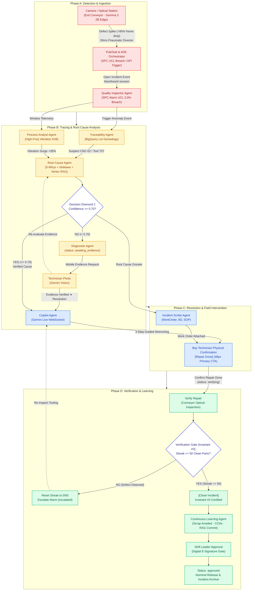

# System Topology Workflow Wireframe & Architecture Specification

> **Feature Ticket:** `TKT-045` / `FEAT-SYSTEM-TOPOLOGY-WORKFLOW-REDESIGN`  
> **GitHub Issue:** [#211](https://github.com/vanduc2514/hackathon-builder-cup-manufacturing-anomaly/issues/211)  
> **Target Viewport:** Desktop Primary `1440 × 900 px` (Responsive Tablet/Mobile `< 1024 px`)  
> **Primary Personas:** Shift Leader, Plant Operations Manager, Automation & Systems Architect  
> **Design Standard:** [`docs/DESIGN.md`](../DESIGN.md) (Lumina Slate — Liquid Glass, Light Mode)  
> **Core Architectural Paradigms:** Product-First Reactive Swarm, Top-to-Bottom Vertical Execution Flow, Dual Decision Gates, Invariant #3 Strict Enforcement.

---

## 1. Executive Summary & Design Rationale

The previous System Topology interface presented system components as horizontal swimlanes (`grid-template-columns: repeat(4, 1fr)`), which did not align with shop-floor cognitive intuition where physical production and reactive swarm incidents flow sequentially through time from **Top to Bottom**.

Following user and product design feedback, this redesign transforms the page into a **Top-to-Bottom (Vertical Flow) Execution Pipeline**:
1. **Vertical Continuous Execution Flow:** Replaces horizontal swimlanes with a sequential top-to-bottom execution pipeline. Events start at the top at physical edge inspection (**Phase A: Detection**), stream downward into causal reasoning (**Phase B: Tracing & RCA**), branch into guided field intervention (**Phase C: Resolution**), and terminate at post-repair conveyor certification (**Phase D: Verification & Governance**).
2. **Dual Decision Gates (Decision Diamonds):** Explicitly surfaces the AI uncertainty threshold (`Confidence >= 0.70?`) with a Diagnostic Loop return path, and the shop-floor physical proof gate (**Invariant #3**: `Streak >= 50 clean parts`) with an automatic defect reset loop.
3. **Ergonomic Canvas Controls & Orthogonal Flowchart Routing:** Replaces soft Bezier curves with crisp, high-contrast orthogonal step connectors (`right-angled step routing`) and enlarged $8 \times 8$ px arrowhead markers. Default connectors use solid dark slate (`#475569`, 2.4px) for immediate readability on `#eef1fb`, switching to animated pulsed dashed lines during active execution. Includes intuitive zoom/pan navigation (Zoom In, Zoom Out, Reset 100%, Fit-to-View), a live vertical Minimap preview, and full glove-friendly touch target compliance ($\ge 44 \times 44$ px).
4. **Calm Tech & Progressive Disclosure (3 Tiers):** Maintains a calm, low-cognitive-load lavender canvas (`#eef1fb`) with frosted glass nodes, reserving high-contrast semantic alerts only for active anomalies and decision branches.
5. **Dedicated System Architecture Navigation:** Decouples the System Topology entry point from the task-focused `Operational Loop` (which contains `Line Overview` and active `Incidents`) into an independent `System Architecture` sidebar section positioned between Operational Loop and Knowledge Loop.
6. **Deep Visual Component Interactivity & Edge Highlighting:** Hovering or clicking any component triggers phase-calibrated glowing illumination (`#phase-a`: danger, `#phase-b`: warning/accent, `#phase-c`: info, `#phase-d`: success), highlights connected incoming and outgoing edges (`3.8px`, `#4338ca` with drop shadow) while dimming background edges (`opacity: 0.12`), rings immediate upstream/downstream neighbors, and unlocks interactive drawer triggers (`Simulate Trigger`, `Copy JSON`, `Inspect Logs`).
7. **Compact Header Scenario Selector Dropdown:** Replaces horizontal scenario button strips with a compact, frosted-glass dropdown menu situated directly within the Top Header bar. Displays the active scenario state with a colored status dot, provides descriptive scenario summaries with checkmark indicators, and frees up vertical screen height for optimal workflow canvas viewing.

---

## 2. End-to-End User Flow & UI Workflow (Top-to-Bottom)



---

## 3. Personas & Jobs-to-be-Done (JTBD)

| Persona | Operational Context | Primary JTBD on System Topology Screen |
|---|---|---|
| **Shift Leader** | Production floor supervision desk (27" display or tablet). | **JTBD-TOP-01:** Instantly glance down the vertical pipeline to assess the active bottleneck/stage in under 3 seconds; verify whether the incident is currently in Detection, Diagnostic Loop, Guided Repair, or Conveyor Streak Verification. |
| **Plant Ops Manager** | Morning Kaizen review & continuous improvement committee. | **JTBD-TOP-02:** Trace systemic performance, verify edge filter efficiency (>95% frame drop), and confirm Invariant #3 audit integrity for ISO 9001 compliance. |
| **Automation & Systems Architect** | Edge-to-cloud integration & reliability engineering. | **JTBD-TOP-03:** Inspect agent health status, node latencies, pub/sub throughput, and diagnose WebSocket or API edge connectivity failures. |
| **Bay-Side Technician** | Mobile terminal with safety gloves during repair. | **JTBD-TOP-04:** Check whether field evidence was ingested by the Root Cause Agent and see immediate feedback after pressing "Confirm Repair Done". |

---

## 4. Five Core Design Principles Implementation

### 4.1. Principle 1: Calm Technology & Signal-to-Noise Ratio
- **Calm Canvas (`#eef1fb`):** Light, restful pastel foundation with subtle dot matrix (`24px` grid) and soft radial lavender/blue washes.
- **Frosted Glass Cards:** Translucent white glass (`rgba(255, 255, 255, 0.65)`) with soft diffusion (`backdrop-filter: blur(28px)`).
- **Subdued Standby Nodes:** In nominal operations, nodes remain in calm, low-saturation neutral styling (`--muted`, `--hair-strong`).
- **High-Signal Alert Highlighting:** Only active nodes pulse with semantic tone rings (`--accent` for processing, `--danger` for SPC breach, `--warning` for diagnostic wait, `--success` for verified streak). Dark surfaces are strictly prohibited except for toast notifications and minimap backdrop.

### 4.2. Principle 2: Progressive Disclosure (3 Cognitive Tiers)
- **Tier 1 (Glance - 1 second):**
  - Header health pill: `Line Health Nominal · All Nodes Standby` OR `Active Incident #INC-2026-B42 (Phase B: Tracing)`.
  - Phase header status chips (`Completed`, `Active Phase`, `Standby`).
  - Active glowing orthogonal step edge paths showing downward direction of real-time data flow.
- **Tier 2 (Focus - 5 seconds):**
  - Node summary labels (`Edge Gateway: Gemma 3 2B`, `Quality Inspector: SPC UCL 3.0%`).
  - Live metric chips within nodes (`Latency: 42ms`, `Confidence: 89%`, `Streak: 42/50`).
  - Decision Diamond conditions clearly highlighted (`YES >= 0.70` vs `NO < 0.70 (Loop)`).
- **Tier 3 (Deep Dive - On-Demand):**
  - Clicking any node or decision gate slides open the `TopologyNodeDrawer` (width `580px` on desktop, full-width sheet on mobile).
  - Contains complete JTBD specification, input/output schemas, live blackboard state snippet, BigQuery query logs, and direct jump buttons.

### 4.3. Principle 3: Single Job-to-be-Done per Screen
- The System Topology page does **NOT** duplicate detailed repair wrenching steps or raw manual editing of 8D reports.
- Its singular job is **Real-Time Architecture Visualization & Operational Flow Tracing**. Dedicated actions on nodes navigate directly to the appropriate focused view (`Incident Command`, `Technician Mobile`, or `Knowledge Base`).

### 4.4. Principle 4: Shop-Floor Ergonomics & Bay-Side Usability
- Minimum tap targets: $\ge 44 \times 44$ px for all buttons, scenario selectors, and drawer dismiss targets.
- Primary CTA inside drawer: 48 px tall full-width touch button.
- Smooth panning (drag background) and step zoom buttons (`+`, `-`, `Reset`, `Fit`) facilitate one-touch navigation on shop-floor tablets.

### 4.5. Principle 5: Product-Evidence Driven Incident Closure (Invariant #3)
- Reflects Invariant #3 strictly via **Decision Diamond 2**:
  - Streak progress indicator displaying verified consecutive clean parts (`42 / 50`).
  - Node 12 (Shift Leader Approval Gate) is hard-locked with a visible lock badge until optical verification reaches 50/50.
  - Defect detection triggers an immediate reset to 0/50 and escalates the alarm.

---

## 5. Lumina Slate Token Mappings (Pure CSS)

| Token Name | Token Value | Applied UI Surface / Component |
|---|---|---|
| `--bg-app` | `#eef1fb` | Viewport backdrop & canvas pan area |
| `--ink` | `#0b1220` | Node titles, primary headers, active text |
| `--muted` | `#64748b` | Node sub-labels, metrics, inactive icons |
| `--hair` | `rgba(15, 23, 42, .07)` | Internal card dividers, table borders |
| `--hair-strong` | `rgba(15, 23, 42, .14)` | Node card resting border, canvas grid dots |
| `--accent` | `#5b5bf0` | Decision Diamond 1 border, active flow lines, selection outlines |
| `--accent-soft` | `rgba(91, 91, 240, .10)` | Active node background tints, selected chips |
| `--danger` | `#e5484d` | Phase A badge, anomaly alert pill, reject paths |
| `--warning` | `#f5a524` | Phase B badge, Diagnostic Loop border, low confidence pill |
| `--info` | `#3b82f6` | Phase C badge, Copilot Live status, streaming indicators |
| `--success` | `#12a150` | Phase D badge, Decision Diamond 2 border, streak progress fill |
| `--glass-bg` | `rgba(255, 255, 255, .65)` | Pipeline phase cards, floating controls |
| `--glass-bg-strong`| `rgba(255, 255, 255, .82)` | Node cards, SideDrawer background |
| `--glass-border` | `rgba(255, 255, 255, .78)` | Outer glass border with highlight reflection |
| `--glass-shadow` | `0 8px 24px -6px rgba(30, 41, 90, .08)` | Ambient card elevation |
| `--font-main` | `'Inter', sans-serif` | Body copy, technical specifications |
| `--font-display`| `'Geist', sans-serif` | Headers, node names, phase titles |
| `--font-mono` | `'JetBrains Mono', monospace` | Latencies, telemetry metrics, JSON blackboard payloads |

### 5.1. Orthogonal Step Connectors & High-Contrast Arrowhead Tokens

| Edge State / Element | Routing & Geometry | Visual Stroke / Token | Arrowhead Marker Token |
|---|---|---|---|
| **Default Resting Path** | Orthogonal right-angled step (`M x1 y1 V midY H x2 V y2`) | Solid `2.4px` · `#475569` (Slate 600) | `marker-arrow` (`8x8px`, `#475569`, `refX="7"`, `refY="5"`) |
| **Active Processing Path**| Orthogonal step with animated dash offset | Dashed `3.0px` (`8 5`) · `#4f46e5` (`flowDash 1.2s`) | `marker-arrow-active` (`8x8px`, `#4f46e5`) |
| **Completed / Verified Path**| Orthogonal step solid line | Solid `2.6px` · `#16a34a` (Green 600) | `marker-arrow-completed` (`8x8px`, `#16a34a`) |
| **Decision Branch YES** | Orthogonal step bus routing through central alley | Dashed `2.8px` (`8 5`) · `#2563eb` (Blue 600) | `marker-arrow-yes` (`8x8px`, `#2563eb`) |
| **Decision Branch NO** | Orthogonal step branching to Diagnostic Agent | Dashed `2.8px` (`8 5`) · `#d97706` (Amber 600) | `marker-arrow-warning` (`8x8px`, `#d97706`) |
| **Reject / Reset Loop** | Orthogonal outer margin step (`M x1 y1 H xTrack V y2 H x2`) | Dashed `3.0px` (`8 5`) · `#dc2626` (Red 600) | `marker-arrow-danger` (`8x8px`, `#dc2626`) |
| **Feedback Loopback** | Right-margin orthogonal routing into RCA right port | Dashed `2.4px` (`8 5`) · `#4f46e5` | `marker-arrow-active` (`8x8px`, orient left) |

---

## 6. Canvas Ergonomics & Touch Compliance

| Control Element | Visual Dimensions | Minimum Touch Hit Area | Glove Ergonomics Specification |
|---|---|---|---|
| **Zoom In Button** | $40 \times 40$ px | **$44 \times 44$ px** | Secondary glass button with 1px border; high-contrast icon. |
| **Zoom Out Button** | $40 \times 40$ px | **$44 \times 44$ px** | Dedicated hit target padding, prevents accidental misclicks. |
| **Zoom Reset Button** | $40 \times 40$ px | **$44 \times 44$ px** | Center alignment, resets transform matrix to scale(1.0) & translate(0,0). |
| **Fit to View Button** | $40 \times 40$ px | **$44 \times 44$ px** | Automatically calculates bounding box of all 4 vertical phases. |
| **Minimap Toggle** | $40 \times 40$ px | **$44 \times 44$ px** | Shows/hides floating minimap to maximize canvas view on small screens. |
| **Topology Node Card** | $360 \times 104$ px | Full card area | Entire card acts as interactive tap target to open SideDrawer. |
| **Decision Diamond** | Full width card | Full card area | Ample tap area; distinct diamond visual cue with branch indicators. |
| **Scenario Filter Chips** | $32$ px height | **$44$ px touch target** | Touch target expanded via `::before` pseudo-element. |
| **Drawer Close CTA** | $44 \times 44$ px | **$44 \times 44$ px** | Prominent top-right floating circle button. |

---

## 7. Four-Phase Continuous Vertical Workflow & Decision Gates Detail

### Phase A: Detection & Ingestion (Top)
- **Node A1 (Camera / Optical Station · Gemma 3 Edge):** Gemma 3 2B running locally on edge IPC at conveyor exit. Filters >95% nominal video frames; triggers 50ms pneumatic rejector on defect detection.
- **Node A2 (Pub/Sub Ingestion & ADK Orchestrator):** Ingests defect frames and machine telemetry into Cloud Pub/Sub; triggers SPC UCL breach anomaly event and creates incident blackboard session in Firestore.
- **Node A3 (Quality Inspector Agent):** Evaluates SPC Upper Control Limit (UCL 3.0%) across sliding 100-part window. Triggers formal anomaly ticket when Nelson Rule 1 or 2 is violated.

### Phase B: Tracing & Root Cause Analysis
- **Node B1 (Traceability Agent):** Queries BigQuery Lot genealogy graph; correlates workpiece barcode with raw billet heat and CNC tool serial number.
- **Node B2 (Process Analyst Agent):** Fetches high-frequency spindle vibration RMS and motor load; detects statistical drift prior to defect onset.
- **Node B3 (Root Cause Agent):** Synthesizes lot genealogy, telemetry drift, and Vertex AI Search (RAG) 8D archives to form a 5-Whys causal tree.
- **Decision Diamond 1 (`Confidence >= 0.70?`):**
  - **Path YES ($\ge 0.70$):** High certainty in causal analysis; transitions downward to Phase C for field execution.
  - **Path NO ($< 0.70$):** Insufficient data or contradictory telemetry; activates **Diagnostic Loop Node** (`status = awaiting_evidence`). Dispatches notification to technician mobile terminal to photograph physical tool wear; technician image is re-injected into Root Cause Agent.

### Phase C: Resolution & Field Intervention
- **Node C1 (Technician Copilot Live):** Bidirectional Gemini Live WebSocket audio/video stream providing hands-free step-by-step tool replacement and calibration guidance.
- **Node C2 (Incident Scribe Agent):** Automatically compiles draft 8D incident report, generates maintenance work order, and prepares revised SOP documentation.
- **Node C3 (Bay Technician Physical Confirmation):** Technician completes physical bay repair and taps the primary 48px "Confirm Repair Completed" CTA. Transitions incident to `status: verifying`.

### Phase D: Verification, Learning & Governance (Bottom)
- **Node D1 (Conveyor Optical Camera Inspection):** Exit inspection camera resumes optical inspection of newly machined workpieces.
- **Decision Diamond 2 (Invariant #3: `Streak >= 50 clean parts?`):**
  - **Path NO (Defect Encountered):** Counter immediately resets to `0/50`. System transitions to `escalated` status and sounds bay Andon alarm. Re-routes to Copilot for tooling inspection.
  - **Path YES (50 consecutive clean workpieces):** Invariant #3 certified; incident transitions to `closed`.
- **Node D2 (Continuous Learning Agent & Impact Engine):** Calculates ESG metrics (scrap avoided in kg, kWh saved, USD material preserved) and commits solution to permanent vector index.
- **Node D3 (Shift Leader Approval Gate):** Shift leader reviews completed 8D dossier and applies digital E-Signature. Incident status permanently transitions to `approved`.

---

## 7. Deep Component Visual Interactivity & Flow Tracing

To provide technicians and systems engineers with intuitive situational awareness without visual overload, each component on the Topology canvas supports deep visual interactivity:

| Interaction Event | Visual & Behavioral Feedback | Shop-Floor Ergonomics |
|---|---|---|
| **Hover on Node / Gate** | Immediate phase-calibrated glowing border (`0 0 0 3px` tint) + `$2\text{px}$` elevation lift. Connected incoming/outgoing edges switch to `.edge-highlighted` (`3.8px`, `#4338ca`, drop shadow); all non-connected edges dim to `opacity: 0.12`. | Clear visual tracing of data provenance without clicking. |
| **Click / Select Node** | Locks component selection with persistent glowing border. Immediate upstream/downstream neighbors receive subtle `.connected-neighbor` accent ring. Slides open the Tier 3 `TopologyNodeDrawer`. | Glove-friendly hit target covers entire node card ($360 \times 104\text{ px}$). |
| **Click Decision Gate** | Selects Diamond Gateway (`decision-gate-1` or `decision-gate-2`), highlights incoming upstream metrics and outgoing branch conduits. Opens gate decision logic in Drawer. | Diamond card touch target $580 \times 80\text{ px}$. |
| **Drawer: Simulate Trigger** | Dispatches an interactive simulation ripple (`@keyframes triggerSimulationPulse`) across the canvas node, flashes outgoing flow paths with animated pulses, and displays a Lumina Slate toast alert: `⚡ Simulated trigger event dispatched to: [Node Name] ([SLA])`. | Instant visual verification of component execution behavior. |
| **Drawer: Copy JSON** | Copies formatted blackboard JSON payload to system clipboard; displays confirmation toast: `📋 Blackboard JSON payload copied to clipboard`. | Fast export for diagnostics and debugging. |
| **Drawer: Inspect Logs** | Toggles inline monospace Cloud Logging stream showing recent timestamped entries (`[INFO]`, `[STATE]`, `[ACK]`) and channel synchronization status. | Immediate access to audit trails without navigating away. |
| **Canvas Background Click** | Clears active selection, closes SideDrawer, and restores all SVG connectors to standard scenario opacity. | Ergonomic one-touch dismiss on touchscreens. |

---

## 8. Low-Fi ASCII Wireframe: Desktop Layout (1440 × 900 px)

```text
+-----------------------------------------------------------------------------------------------------------------------------+
| [K] KAIZEN AGENT   Cell Line 1 / System Topology     (●) Nominal   [ Scenario: 1. Nominal Standby ▾ ]  [ Reset View ]           |
+-----------------------------------------------------------------------------------------------------------------------------+
| Top-to-Bottom Multi-Agent Execution Graph   [ 12 Nodes · 2 Gates ] [ Invariant #3 Protected ]   [ Export Graph JSON ]           |
| Top-to-bottom reactive swarm: Edge Vision -> Event Ingest -> RCA -> Dual Gates -> Copilot Fix -> Optical Proof -> Release   |
+-----------------------------------------------------------------------------------------------------------------------------+
| CANVAS CONTROLS: [ + Zoom In ] [ - Zoom Out ] [ 100% Reset ] [ [ ] Fit View ] [ (M) Map ]   | Legend: [▼] Flow  [✓] Done  [○] Idle|
+-----------------------------------------------------------------------------------------------------------------------------+
|                                                                                                                             |
|   ╔═════════════════════════════════════════════════════════════════════════════════════════════════════════════════════╗   |
|   ║ PHASE A: DETECTION & INGESTION                                                          [ Lamp: RED / SPC Breach ]  ║   |
|   ║ ─────────────────────────────────────────────────────────────────────────────────────────────────────────────────── ║   |
|   ║   +---------------------------------------------+      +---------------------------------------------+              ║   |
|   ║   | [1] Camera / Optical Station (Gemma 3 Edge) | ───> | [2] Pub/Sub Ingestion & ADK Orchestrator    |              ║   |
|   ║   | Filters >95% normal frames; 50ms rejector   |      | SPC UCL Breach / Anomaly API Trigger Event  |              ║   |
|   ║   +---------------------------------------------+      +----------------------+----------------------+              ║   |
|   ║                                                                               |                                     ║   |
|   ║                                                                               ▼ (Open Incident)                     ║   |
|   ║                                                        +---------------------------------------------+              ║   |
|   ║                                                        | [3] Quality Inspector Agent (ADK & SPC Gate)|              ║   |
|   ║                                                        | Defect: Roughness scratch · UCL: 3.0% breach|              ║   |
|   ║                                                        +----------------------+----------------------+              ║   |
|   ╚═══════════════════════════════════════════════════════════════════════════════╪═════════════════════════════════════╝   |
|                                                                                   │                                         |
|                                                                                   ▼ (Trigger Anomaly & Telemetry Window)    |
|   ╔═══════════════════════════════════════════════════════════════════════════════╧═════════════════════════════════════╗   |
|   ║ PHASE B: TRACING & ROOT CAUSE ANALYSIS (RCA)                                            [ Lamp: AMBER / Diagnosing ]║   |
|   ║ ─────────────────────────────────────────────────────────────────────────────────────────────────────────────────── ║   |
|   ║         ┌─────────────────────────────────────────────────────────────┐                                             ║   |
|   ║         ▼                                                             ▼                                             ║   |
|   ║   +---------------------------------------------+      +---------------------------------------------+              ║   |
|   ║   | [4] Traceability Agent (BigQuery SQL)       |      | [5] Process Analyst Agent (Telemetry FFT)   |              ║   |
|   ║   | Lot genealogy: CNC-02 / Tool T07 / Heat 8849|      | Spindle vibration 2.84 mm/s · Load 78.6%    |              ║   |
|   ║   +----------------------+----------------------+      +----------------------+----------------------+              ║   |
|   ║                          │                                                    │                                     ║   |
|   ║                          └──────────────────────┬─────────────────────────────┘                                     ║   |
|   ║                                                 ▼ (Evidence Synthesis)                                              ║   |
|   ║                                 +---------------------------------------------+                                     ║   |
|   ║                                 | [6] Root Cause Agent (5-Whys + RAG Search)  |                                     ║   |
|   ║                                 | Flank wear on T07 · Brinell hardness surge  |                                     ║   |
|   ║                                 +----------------------+----------------------+                                     ║   |
|   ║                                                        │                                                            ║   |
|   ║                                                        ▼                                                            ║   |
|   ║                                       /─────────────────────────────────\                                           ║   |
|   ║                                      /    DECISION DIAMOND 1             \                                          ║   |
|   ║                                     <      Confidence >= 0.70?            >                                         ║   |
|   ║                                      \                                   /                                          ║   |
|   ║                                       \────────────────┬────────────────/                                           ║   |
|   ║                        [ NO (< 0.70) ]                 │                 [ YES (>= 0.70) ]                          ║   |
|   ║               ┌────────────────────────────────────────┘                 │                                          ║   |
|   ║               ▼                                                          │                                          ║   |
|   ║   +---------------------------------------------+                        │                                          ║   |
|   ║   | [6b] Diagnostic Agent (awaiting_evidence)   |                        │                                          ║   |
|   ║   | Dispatches macro photo order to mobile app  |                        │                                          ║   |
|   ║   +----------------------+----------------------+                        │                                          ║   |
|   ║                          │                                               │                                          ║   |
|   ║                          ▼ (Field Macro Capture)                         │                                          ║   |
|   ║   +---------------------------------------------+                        │                                          ║   |
|   ║   | [6c] Technician Photo (Gemini Vision)       |                        │                                          ║   |
|   ║   | Multimodal wear analysis · Flank wear 0.92  |                        │                                          ║   |
|   ║   +----------------------+----------------------+                        │                                          ║   |
|   ║                          │                                               │                                          ║   |
|   ║                          ├─ (Re-eval RCA) ──> [6] RCA                    │                                          ║   |
|   ║                          │                                               │                                          ║   |
|   ║                          └─ (Evidence Verified) ──> Connect to Phase C ─────┘                                          ║   |
|   ╚══════════════════════════════════════════════════════════════════════════╪══════════════════════════════════════════╝   |
|                                                                              │                                              |
|                                                                              ▼ (Verified Cause & Work Order ➔ Resolution)   |
|   ╔══════════════════════════════════════════════════════════════════════════╧══════════════════════════════════════════╗   |
|   ║ PHASE C: RESOLUTION & FIELD INTERVENTION                                                [ Lamp: BLUE / Repairing ]  ║   |
|   ║ ─────────────────────────────────────────────────────────────────────────────────────────────────────────────────── ║   |
|   ║         ┌─────────────────────────────────────────────────────────────┐                                             ║   |
|   ║         ▼                                                             ▼                                             ║   |
|   ║   +---------------------------------------------+      +---------------------------------------------+              ║   |
|   ║   | [7] Copilot Agent (Gemini Live)             |      | [8] Incident Scribe Agent (WorkOrder, 8D)   |              ║   |
|   ║   | Hands-free voice/video · 3-Step Guided Fix  |      | Auto-draft 8D dossier D1-D8 · WO-2026-8812  |              ║   |
|   ║   +----------------------+----------------------+      +----------------------+----------------------+              ║   |
|   ║                          │                                                    │                                     ║   |
|   ║                          └──────────────────────┬─────────────────────────────┘                                     ║   |
|   ║                                                 ▼                                                                   ║   |
|   ║                                 +---------------------------------------------+                                     ║   |
|   ║                                 | [9] [Repair Done] · Bay Tech Confirmation   |                                     ║   |
|   ║                                 | Mobile 48px Primary CTA: "Confirm Done"     |                                     ║   |
|   ║                                 +----------------------+----------------------+                                     ║   |
|   ╚════════════════════════════════════════════════════════╪════════════════════════════════════════════════════════════╝   |
|                                                            │                                                                |
|                                                            ▼ (Confirm Repair Completed)                                     |
|   ╔════════════════════════════════════════════════════════╧════════════════════════════════════════════════════════════╗   |
|   ║ PHASE D: VERIFICATION & LEARNING                                                        [ Lamp: GREEN / Verifying ] ║   |
|   ║ ─────────────────────────────────────────────────────────────────────────────────────────────────────────────────── ║   |
|   ║                                 +---------------------------------------------+                                     ║   |
|   ║                                 | [10] Verify Repair (Optical Inspection)     |                                     ║   |
|   ║                                 | Exit CAM-EOL · Real-time Part Roughness Ra  |                                     ║   |
|   ║                                 +----------------------+----------------------+                                     ║   |
|   ║                                                        │                                                            ║   |
|   ║                                                        ▼                                                            ║   |
|   ║                                       /─────────────────────────────────\                                           ║   |
|   ║                                      /    VERIFICATION GATE (Streak>=50) \                                          ║   |
|   ║                                     <     Streak >= 50 Clean Parts?       >                                         ║   |
|   ║                                      \     [████████████░░░░]  42 / 50   /                                          ║   |
|   ║                                       \────────────────┬────────────────/                                           ║   |
|   ║                        [ NO (Defect Detected) ]        │                 [ YES (Streak 50/50 OK) ]                  ║   |
|   ║               ┌────────────────────────────────────────┘                 │                                          ║   |
|   ║               ▼                                                          ▼                                          ║   |
|   ║   +---------------------------------------------+      +---------------------------------------------+              ║   |
|   ║   | STREAK RESET TO 0/50                        |      | [Close Incident] Continuous Learning Agent  |              ║   |
|   ║   | Escalate alarm · Sound bay Andon siren      |      | 48.5kg scrap saved · 112kWh · RAG commit    |              ║   |
|   ║   +-------------------+-------------------------+      +----------------------+----------------------+              ║   |
|   ║                       │                                                       │                                     ║   |
|   ║                       └─ (Re-inspect tooling) ──> [7] Copilot                 ▼                                     ║   |
|   ║                                                        +---------------------------------------------+              ║   |
|   ║                                                        | [12] Shift Leader Approval Gate             |              ║   |
|   ║                                                        | Digital E-Signature · [HARD LOCKED <= 49]   |              ║   |
|   ║                                                        +----------------------+----------------------+              ║   |
|   ║                                                                               │                                     ║   |
|   ║                                                                               ▼ (Digital E-Signature Signed)        ║   |
|   ║                                                        +---------------------------------------------+              ║   |
|   ║                                                        | STATUS: CLOSED & NOMINAL PRODUCTION RELEASE |              ║   |
|   ║                                                        +---------------------------------------------+              ║   |
|   ╚═════════════════════════════════════════════════════════════════════════════════════════════════════════════════════╝   |
|                                                                                                                             |
+-----------------------------------------------------------------------------------------------------------------------------+
```

---

## 9. Low-Fi ASCII Wireframe: Deep-Dive SideDrawer (`TopologyNodeDrawer`)

```text
+-------------------------------------------------------------+
| TOPOLOGY NODE DEEP DIVE                                 [X] |
+-------------------------------------------------------------+
| (icon: psychology)  Root Cause Agent                        |
| ADK Multi-Agent Swarm · Tier 4 Focus Engine                 |
| Status: ACTIVE PROCESSING (Confidence: 0.89)                |
+-------------------------------------------------------------+
| SINGLE JOB-TO-BE-DONE (JTBD):                               |
| Synthesize lot genealogy graph from Traceability Agent and  |
| vibration telemetry anomalies from Process Analyst Agent;   |
| formulate 5-Whys causal tree with citations to OEM manual.  |
+-------------------------------------------------------------+
| SYSTEM SPECIFICATIONS & TIERS:                              |
| · Cognitive Tier:     Tier 4 (Focus & Diagnostic Reasoning) |
| · Tech Stack:         ADK Agent · Gemini 2.5 Pro · RAG      |
| · Latency SLA:        < 3.5s inference time                 |
| · Blackboard Channel: blackboard.findings.root_cause        |
+-------------------------------------------------------------+
| DECISION GATE LOGIC:                                        |
| [✓] Confidence Score: 0.89 (Threshold >= 0.70 MET)          |
| -> Path Taken: Forward transition to Phase C (Technician)   |
| -> Alternative: If < 0.70, triggers Diagnostic Loop         |
+-------------------------------------------------------------+
| LIVE INPUT PAYLOAD:                                         |
| {                                                           |
|   "machine_id": "CNC-02",                                   |
|   "tool_id": "T07",                                         |
|   "spindle_vibration_rms": 2.84,                            |
|   "baseline_vibration": 1.50                                |
| }                                                           |
+-------------------------------------------------------------+
| GENERATED CAUSAL CHAIN (5-WHYS):                            |
| 1. Why Ra > 3.8µm? Flank wear on cutting tool insert T07.   |
| 2. Why tool worn? Cutting cycle exceeded rating by 140 pcs. |
| 3. Why exceeded? Lot genealogy shows FC250 hardness surge.  |
+-------------------------------------------------------------+
| COMPONENT ACTIONS & INTERACTIVE SIMULATION:                 |
| [ ⚡ Simulate Trigger ] [ 📋 Copy JSON ] [ 🔍 Inspect Logs ]  |
|                                                             |
| LOG STREAM PREVIEW (EXPANDABLE):                            |
| 17:42:01.102 [INFO]  Service endpoint healthcheck: 200 OK   |
| 17:42:01.214 [STATE] Blackboard channel synchronized        |
| 17:42:01.350 [ACK]   Telemetry payload valid. SLA met.      |
+-------------------------------------------------------------+
| PRIMARY CTA:                                                |
| [ Inspect in Incident Command -> (48px) ]   [ Dismiss ]     |
+-------------------------------------------------------------+
```

---

## 10. Low-Fi ASCII Wireframe: Mobile & Tablet Vertical Flowchart (< 1024 px)

```text
+-----------------------------------+
| [K] Cell Line 1 · Topology   (=)  |
| Incident #INC-2026-B42 · Active   |
+-----------------------------------+
| PHASE A: DETECTION & INGESTION    |
| [1] Edge Gateway (Gemma 3 2B)     |
|     42ms · 96.2% Frame Drop       |
|     │ (50ms Pneumatic Divert)     |
|     ▼                             |
| [2] Pub/Sub Ingestion             |
|     │ (UCL Breach Trigger)        |
|     ▼                             |
| [3] Quality Inspector Agent       |
|     SPC UCL 3.0% Breach (1.42%)   |
|     │                             |
|     ▼ (Trigger RCA)               |
+-----------------------------------+
| PHASE B: TRACING & RCA            |
| [4] Traceability Agent (BigQuery) |
|     Workpiece: Housing-B42-0941   |
| [5] Process Analyst (Vibration)   |
|     Spindle RMS: 2.84 mm/s        |
|     │                             |
|     ▼                             |
| [6] Root Cause Agent (5-Whys)     |
|     Confidence: 0.89 (>= 0.70)    |
|     │                             |
|     ▼                             |
| < Decision 1: Conf >= 0.70? >     |
| ├── YES ──> Phase C               |
| └── NO  ──> Diagnostic Agent      |
|             └──> Tech Photo       |
|                  └──> Phase C     |
+-----------------------------------+
| PHASE C: RESOLUTION & FIX         |
| [7] Tech Copilot (Gemini Live)    |
|     Hands-free audio / vi-VN      |
| [8] Incident Scribe (8D & SOP)    |
|     D1-D8 Drafted · WO-2026-8812  |
|     │                             |
|     ▼                             |
| [9] Bay Technician Confirm        |
|     [ CONFIRM REPAIR DONE (48px) ]|
|     │                             |
|     ▼ (Repair Done)               |
+-----------------------------------+
| PHASE D: VERIFICATION & GOVERNANCE|
| [10] Exit Optical Camera (CAM-EOL)|
|     │                             |
|     ▼                             |
| < Decision 2: Streak >= 50? >     |
| [████████████░░░░] 42/50 (84%)    |
| ├── YES ──> Closed & Sign-off     |
| └── NO  ──> Reset 0/50 & Escalate |
|     │                             |
|     ▼                             |
| [11] Continuous Learning (ESG)    |
| [12] Shift Leader E-Sign [LOCKED] |
+-----------------------------------+
```

---

## 11. Acceptance Criteria & Verification Matrix

- [x] **AC-TOP-01:** Visual layout strictly implements the sequential top-to-bottom vertical execution pipeline (`Phase A: Detection & Ingestion` at the top, flowing sequentially down through `Phase B`, `Phase C`, and `Phase D: Verification & Governance`).
- [x] **AC-TOP-02:** Decision Diamond 1 explicitly depicts both branches: `YES (>= 0.70)` leading down to Phase C, and `NO (< 0.70)` leading to the Diagnostic Loop node with a re-evaluation feedback loop back to RCA.
- [x] **AC-TOP-03:** Decision Diamond 2 explicitly enforces **Invariant #3**: visual streak progress indicator (`42 / 50 clean parts`), a reset branch on defect detection, and hard-locking of the Shift Leader E-Signature approval node until streak $\ge 50$.
- [x] **AC-TOP-04:** Canvas features smooth pan/drag navigation and ergonomic step zoom controls (`+`, `-`, `Reset`, `Fit`, `Minimap`) with minimum touch hit areas of $\ge 44 \times 44$ px.
- [x] **AC-TOP-05:** Tapping any node card or decision gate opens the `TopologyNodeDrawer` with complete technical specification, cognitive tier classification, blackboard channel, and JSON payload.
- [x] **AC-TOP-06:** Lumina Slate Design System tokens (pure CSS, light mode `#eef1fb`, frosted glass cards) applied 100% without external libraries or dark canvas.
- [x] **AC-TOP-07:** Six interactive simulation scenarios testable directly in the prototype (Nominal, Active Anomaly, Low Confidence Loop, Verification Streak, Streak Reset, Closed & Approved).
- [x] **AC-TOP-08:** Navigation entry point for System Topology is housed in a dedicated **`System Architecture`** sidebar section, fully decoupled from the task-oriented **`Operational Loop`** (`Line Overview`, `Incidents`) and educational **`Knowledge Loop`**.
- [x] **AC-TOP-09:** Visual component interactivity enables deep inspection: hovering/selecting any node or decision gate applies a phase-aware halo ring, highlights connected incoming and outgoing edges (`3.8px`, `#4338ca`), dims unrelated background edges (`opacity: 0.12`), and indicates upstream/downstream neighbors.
- [x] **AC-TOP-10:** SideDrawer features interactive action triggers ($\ge 44 	imes 44\text{ px}$): `Simulate Trigger` with canvas ripple feedback, `Copy JSON` with clipboard confirmation, and expandable `Inspect Logs` Cloud Logging stream.
- [x] **AC-TOP-11:** Live simulation scenarios are selectable via a compact **Top Header Scenario Dropdown** (`aria-haspopup="true"`), displaying real-time scenario status dot, full option descriptions, and auto-dismiss on outside click while conserving canvas vertical space.
