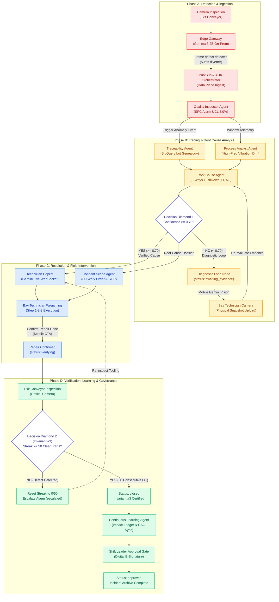

# System Topology Workflow Wireframe & Architecture Specification

> **Feature Ticket:** `TKT-045` / `FEAT-SYSTEM-TOPOLOGY-WORKFLOW-REDESIGN`  
> **GitHub Issue:** [#211](https://github.com/vanduc2514/hackathon-builder-cup-manufacturing-anomaly/issues/211)  
> **Target Viewport:** Desktop Primary `1440 × 900 px` (Responsive Tablet/Mobile `< 1024 px`)  
> **Primary Personas:** Shift Leader, Plant Operations Manager, Automation & Systems Architect  
> **Design Standard:** [`docs/DESIGN.md`](../DESIGN.md) (Lumina Slate — Liquid Glass, Light Mode)  
> **Core Architectural Paradigms:** Product-First Reactive Swarm, 4 Sequential Phases, Dual Decision Gates, Invariant #3 Strict Enforcement.

---

## 1. Executive Summary & Design Rationale

The previous System Topology interface presented system components as disconnected, static cards in a flat layout, failing to convey the dynamic, sequential, and reactive nature of the Kaizen Agent multi-agent architecture.

This redesign transforms the page into an **Interactive Workflow Diagram**:
1. **Continuous Product-First Flow:** Replaces static inventory cards with a live execution flowchart showing the exact path of a workpiece and anomaly event across 4 interconnected phases.
2. **Dual Decision Gates (Decision Diamonds):** Explicitly surfaces the AI uncertainty threshold (`Confidence >= 0.70`) and the shop-floor physical proof gate (**Invariant #3**: `Streak >= 50 clean parts`).
3. **Ergonomic Canvas Controls:** Introduces smooth SVG Bezier flowlines with animated pulse paths (`flowDash`), intuitive zoom/pan navigation (Zoom In, Zoom Out, Reset 100%, Fit-to-View), a live Minimap preview, and full glove-friendly touch target compliance ($\ge 44 \times 44$ px).
4. **Calm Tech & Progressive Disclosure (3 Tiers):** Maintains a calm, low-cognitive-load lavender canvas (`#eef1fb`) with frosted glass nodes, reserving high-contrast semantic alerts only for active anomalies and decision branches.

---

## 2. End-to-End User Flow & UI Workflow



---

## 3. Personas & Jobs-to-be-Done (JTBD)

| Persona | Operational Context | Primary JTBD on System Topology Screen |
|---|---|---|
| **Shift Leader** | Production floor supervision desk (27" display or tablet). | **JTBD-TOP-01:** Instantly glance at active bottleneck/stage in under 3 seconds; verify whether the system is gated at human inspection, diagnostic loop, or conveyor streak verification. |
| **Plant Ops Manager** | Morning Kaizen review & continuous improvement committee. | **JTBD-TOP-02:** Trace systemic performance, verify edge filter efficiency (>95% frame drop), and confirm Invariant #3 audit integrity for ISO 9001 compliance. |
| **Automation & Systems Architect** | Edge-to-cloud integration & reliability engineering. | **JTBD-TOP-03:** Inspect agent health status, node latencies, pub/sub throughput, and diagnose WebSocket or API edge connectivity failures. |
| **Bay-Side Technician** | Mobile terminal with safety gloves during repair. | **JTBD-TOP-04:** Check whether field evidence was ingested by the Root Cause Agent and see immediate feedback after pressing "Confirm Repair Done". |

---

## 4. Five Core Design Principles Implementation

### 4.1. Principle 1: Calm Technology & Signal-to-Noise Ratio
- **Calm Canvas (`#eef1fb`):** Light, restful pastel foundation with subtle dot matrix (`24px` grid) and soft radial lavender/blue washes.
- **Frosted Glass Cards:** Translucent white glass (`rgba(255, 255, 255, 0.65)`) with soft diffusion (`backdrop-filter: blur(28px)`).
- **Subdued Standby Nodes:** In nominal operations, nodes remain in calm, low-saturation neutral styling (`--muted`, `--hair-strong`).
- **High-Signal Alert Highlighting:** Only active nodes pulse with semantic tone rings (`--accent` for processing, `--danger` for SPC breach, `--warning` for diagnostic wait, `--success` for verified streak). Dark surfaces are strictly prohibited except for toast notifications and minimap backdrop.

### 4.2. Principle 2: Progressive Disclosure (3 Cognitive Tiers)
- **Tier 1 (Glance - 1 second):**
  - Header health pill: `Line Health Nominal \u00b7 All 11 Nodes Standby` OR `Active Incident #INC-2026-B42 (Phase B: Tracing)`.
  - Phase header status chips (`Completed`, `Active Phase`, `Standby`).
  - Active glowing Bezier edge paths showing direction of real-time data flow.
- **Tier 2 (Focus - 5 seconds):**
  - Node summary labels (`Edge Gateway: Gemma 3 2B`, `Quality Inspector: SPC UCL 3.0%`).
  - Live metric chips within nodes (`Latency: 42ms`, `Confidence: 89%`, `Streak: 42/50`).
  - Decision Diamond conditions clearly highlighted (`YES >= 0.70` vs `NO < 0.70 (Loop)`).
- **Tier 3 (Deep Dive - On-Demand):**
  - Clicking any node or decision gate slides open the `TopologyNodeDrawer` (width `640px` on desktop, full-width sheet on mobile).
  - Contains complete JTBD specification, input/output schemas, live blackboard state snippet, BigQuery query logs, and direct jump buttons.

### 4.3. Principle 3: Single Job-to-be-Done per Screen
- The System Topology page does **NOT** duplicate detailed repair wrenching steps or raw manual editing of 8D reports.
- Its singular job is **Real-Time Architecture Visualization & Operational Flow Tracing**. Dedicated actions on nodes navigate directly to the appropriate focused view (`Incident Command`, `Technician Mobile`, or `Knowledge Base`).

### 4.4. Principle 4: Shop-Floor Ergonomics & Bay-Side Usability
- **Touch Target Compliance:** All interactive elements (zoom buttons, pan handles, node cards, drawer triggers, chips) strictly enforce a minimum hit area of **$44 \times 44$ px**.
- **Zoom & Pan Controls:** Floating toolbar positioned at bottom-right or top-right with high-contrast tactile glass buttons (`48 × 48 px`).
- **Minimap Navigation:** Floating viewport overview (`180 × 110 px`) enabling single-tap jumps across large multi-phase topologies without heavy mouse dragging.

### 4.5. Principle 5: Product-Evidence Driven Incident Closure (Invariant #3)
- Decision Diamond 2 visually locks Phase D progression until the conveyor optical camera records **50 consecutive clean workpieces**.
- The wireframe explicitly illustrates the `0/50` counter, the dynamic progress fill, and the reject loop triggered if a defective workpiece breaks the streak before reaching 50.
- Shift Leader Approval node is marked with `locked` icon state until Invariant #3 outputs `verified = true`.

---

## 5. Component Hierarchy & Layout Specifications

```text
SystemTopologyView (Root Container)
 ├── TopHeader (Shared Shell Navigation)
 ├── TopologyToolbar (Action Bar & Scenario Presets)
 │    ├── ViewTitle ("System Architecture & Execution Graph")
 │    ├── ScenarioSelector (Nominal, Active CNC-02, Low Confidence, Streak 42/50, Reset)
 │    └── ActiveIncidentJumpButton (Pulsing pill when incident active)
 ├── CanvasControlsBar (Floating Glass Bar)
 │    ├── ZoomInButton (44x44px, icon: zoom_in)
 │    ├── ZoomOutButton (44x44px, icon: zoom_out)
 │    ├── ZoomResetButton (44x44px, label: 100%)
 │    ├── FitToViewButton (44x44px, icon: fit_screen)
 │    └── MinimapToggleButton (44x44px, icon: map)
 ├── TopologyCanvasContainer (Pan & Zoom Viewport)
 │    ├── SvgBezierOverlay (Background Layer, z-index: 0)
 │    │    ├── LinearGradients (Active, Completed, Reject Loop)
 │    │    ├── BezierPaths (M x1 y1 C ... x2 y2)
 │    │    └── FlowingPulseMarkers (SVG animated stroke-dashoffset)
 │    ├── SwimlanesGrid (Foreground Layer, z-index: 1)
 │    │    ├── SwimlanePhaseA (Detection & Ingestion)
 │    │    │    ├── PhaseHeader (Lamp A, Badge, Subtitle)
 │    │    │    ├── Node: Edge Gateway (Gemma 3 2B)
 │    │    │    ├── Node: Pub/Sub & Orchestrator
 │    │    │    └── Node: Quality Inspector Agent
 │    │    ├── SwimlanePhaseB (Tracing & Root Cause)
 │    │    │    ├── PhaseHeader (Lamp B, Badge, Subtitle)
 │    │    │    ├── Node: Traceability Agent (BigQuery Lot)
 │    │    │    ├── Node: Process Analyst Agent (Telemetry)
 │    │    │    ├── Node: Root Cause Agent (5-Whys + RAG)
 │    │    │    ├── DecisionDiamond1: Confidence >= 0.70?
 │    │    │    └── BranchNode: Diagnostic Loop (Awaiting Evidence)
 │    │    ├── SwimlanePhaseC (Resolution & Intervention)
 │    │    │    ├── PhaseHeader (Lamp C, Badge, Subtitle)
 │    │    │    ├── Node: Technician Copilot (Gemini Live)
 │    │    │    ├── Node: Incident Scribe Agent (8D/SOP)
 │    │    │    └── Node: Bay Technician Mobile Confirm
 │    │    └── SwimlanePhaseD (Verification & Governance)
 │    │         ├── PhaseHeader (Lamp D, Badge, Subtitle)
 │    │         ├── Node: Verify Repair (Optical Camera)
 │    │         ├── DecisionDiamond2: Streak >= 50 Clean Parts?
 │    │         ├── Node: Continuous Learning Agent (ESG)
 │    │         └── Node: Shift Leader Approval Gate
 │    └── MinimapWidget (Floating Glass Bottom-Left)
 │         ├── MiniSvgOverview
 │         └── ViewportWindowRect
 └── TopologyNodeDrawer (Tier 3 Deep-Dive Slide-Over)
      ├── DrawerHeader (Node Icon, Title, Subtitle, Close Button)
      ├── NodeStatusBanner (Live Blackboard state)
      ├── JTBDSection (Single Job-to-be-Done definition)
      ├── ArchitectureSpecsSection (Tiers, Tech Stack Chips, SLA)
      ├── DataContractsSection (Inputs, Outputs, Blackboard Keys)
      └── DrawerFooter (Direct View Jump CTA)
```

---

## 6. Canvas Ergonomics & Touch Compliance

| Control Element | Visual Dimensions | Minimum Touch Hit Area | Glove Ergonomics Specification |
|---|---|---|---|
| **Zoom In Button** | $40 \times 40$ px | **$44 \times 44$ px** | Secondary glass button with 1px border; high-contrast icon. |
| **Zoom Out Button** | $40 \times 40$ px | **$44 \times 44$ px** | Dedicated hit target padding, prevents accidental misclicks. |
| **Zoom Reset Button** | $40 \times 40$ px | **$44 \times 44$ px** | Center alignment, resets transform matrix to scale(1.0) & translate(0,0). |
| **Fit to View Button** | $40 \times 40$ px | **$44 \times 44$ px** | Automatically calculates bounding box of all 4 swimlanes. |
| **Minimap Toggle** | $40 \times 40$ px | **$44 \times 44$ px** | Shows/hides floating minimap to maximize canvas view on small screens. |
| **Topology Node Card** | $260 \times 110$ px | Full card area | Entire card acts as interactive tap target to open SideDrawer. |
| **Decision Diamond** | $96 \times 96$ px | $96 \times 96$ px | Ample tap area; distinct diamond visual cue with tooltips. |
| **Scenario Filter Chips** | $32$ px height | **$44$ px touch target** | Touch target expanded via `::before` pseudo-element. |
| **Drawer Close CTA** | $40 \times 40$ px | **$44 \times 44$ px** | Prominent top-right floating circle button. |

---

## 7. Four-Phase Continuous Workflow & Decision Gates Detail

### Phase A: Detection & Ingestion
- **Node A1 (Edge Gateway):** Gemma 3 2B running locally on edge IPC. Filters >95% nominal video frames; triggers 50ms pneumatic rejector on defect detection.
- **Node A2 (Pub/Sub & ADK Orchestrator):** Ingests defect frames and machine telemetry into Cloud Pub/Sub; instantiates incident blackboard session in Firestore.
- **Node A3 (Quality Inspector Agent):** Evaluates SPC Upper Control Limit (UCL 3.0%) across sliding 100-part window. Triggers formal anomaly ticket when Nelson Rule 1 or 2 is violated.

### Phase B: Tracing & Root Cause Analysis
- **Node B1 (Traceability Agent):** Queries BigQuery Lot genealogy graph; correlates workpiece barcode with raw billet heat and CNC tool serial number.
- **Node B2 (Process Analyst Agent):** Fetches high-frequency spindle vibration RMS and motor load; detects statistical drift prior to defect onset.
- **Node B3 (Root Cause Agent):** Synthesizes lot genealogy, telemetry drift, and Vertex AI Search (RAG) 8D archives to form a 5-Whys causal tree.
- **Decision Diamond 1 (`Confidence >= 0.70`):**
  - **Path YES ($\ge 0.70$):** High certainty in causal analysis; transitions immediately to Phase C for field execution.
  - **Path NO ($< 0.70$):** Insufficient data or contradictory telemetry; activates **Diagnostic Loop** (`status = awaiting_evidence`). Dispatches notification to technician mobile terminal to photograph physical tool wear; technician image is re-injected into Root Cause Agent.

### Phase C: Resolution & Field Intervention
- **Node C1 (Technician Copilot):** Bidirectional Gemini Live WebSocket audio/video stream providing hands-free step-by-step tool replacement and calibration guidance.
- **Node C2 (Incident Scribe Agent):** Automatically compiles draft 8D incident report, generates maintenance work order, and prepares revised SOP documentation.
- **Node C3 (Bay Technician Mobile Confirmation):** Technician completes physical bay repair and taps the primary 48px "Confirm Repair Completed" CTA.

### Phase D: Verification, Learning & Governance
- **Node D1 (Verify Repair - Optical Camera):** Exit inspection camera resumes optical inspection of newly machined workpieces.
- **Decision Diamond 2 (Invariant #3: `Streak >= 50 clean parts`):**
  - **Path NO (Defect Encountered):** Counter immediately resets to `0/50`. If 3 consecutive resets occur, system transitions to `escalated` status and sounds bay Andon alarm.
  - **Path YES (50 consecutive clean workpieces):** Invariant #3 certified; incident transitions to `closed`.
- **Node D2 (Continuous Learning Agent & Impact Engine):** Calculates ESG metrics (scrap avoided in kg, kWh saved, USD material preserved) and commits solution to permanent vector index.
- **Node D3 (Shift Leader Approval Gate):** Shift leader reviews completed 8D dossier and applies digital E-Signature. Incident status permanently transitions to `approved`.

---

## 8. Low-Fi ASCII Wireframe: Desktop Layout (1440 × 900 px)

```text
+--------------------------------------------------------------------------------------------------------------------------------------------------+
| [K] KAIZEN AGENT   Cell Line 1 / System Topology            (o) Live SSE: Connected   (Active INC #INC-2026-B42)   [ Shift Leader: Tuấn (Bay 4) ]|
+--------------------------------------------------------------------------------------------------------------------------------------------------+
| System Architecture & Execution Graph                                              [ Scenarios: (Nominal) [■ Active CNC-02 ■] (Low Conf) (Streak) ]|
| Continuous reactive loop: Gemma 3 2B Edge -> Pub/Sub Swarm -> Gemini Live Copilot -> Invariant #3 Streak -> Shift Leader Governance              |
+--------------------------------------------------------------------------------------------------------------------------------------------------+
| CANVAS CONTROLS: [ + Zoom In ] [ - Zoom Out ] [ 100% Reset ] [ [ ] Fit to View ] [ (M) Minimap ]  | Legend: [->] Flowing  [==] Done  [..] Standby |
+--------------------------------------------------------------------------------------------------------------------------------------------------+
|                                                                                                                                                  |
|  +------------------------+      +------------------------+      +------------------------+      +------------------------+                      |
|  | PHASE A: DETECTION     |      | PHASE B: TRACING & RCA |      | PHASE C: RESOLUTION    |      | PHASE D: VERIFICATION  |                      |
|  | [A] Detection & Ingest |      | [B] Tracing & RCA      |      | [C] Resolution & Fix   |      | [D] Learning & Signoff |                      |
|  | Lamp: RED (Active)     |      | Lamp: YELLOW (Active)  |      | Lamp: BLUE (Standby)   |      | Lamp: GREEN (Standby)  |                      |
|  +------------------------+      +------------------------+      +------------------------+      +------------------------+                      |
|  |                        |      |                        |      |                        |      |                        |                      |
|  |  +------------------+  |      |  +------------------+  |      |  +------------------+  |      |  +------------------+  |                      |
|  |  | [1] EDGE GATEWAY |  |      |  | [4] TRACEABILITY |  |      |  | [7] COPILOT LIVE |  |      |  | [9] VERIFY CAMERA|  |                      |
|  |  | Gemma 3 2B Edge  |  |      |  | BigQuery Lot Gen |  |      |  | Gemini Live WS   |  |      |  | Conveyor Optical |  |                      |
|  |  | Latency: 42ms    |  |      |  | Tool T07 Matched |  |      |  | Hands-free Audio |  |      |  | Live Inspection  |  |                      |
|  |  | [Done] (95% Drop)|  |      |  | [Done]           |  |      |  | [Standby]        |  |      |  | [Standby]        |  |                      |
|  |  +--------+---------+  |      |  +--------+---------+  |      |  +--------+---------+  |      |  +--------+---------+  |                      |
|  |           | (MQTT)     |      |           |            |      |           |            |      |           |            |                      |
|  |           v            |      |           +------+     |      |           v            |      |           v            |                      |
|  |  +------------------+  |      |                  |     |      |  +------------------+  |      |   /----------------\   |                      |
|  |  | [2] PUB/SUB & ADK|  |      |  +------------------+  |      |  | [8] SCRIBE AGENT |  |      |  /   DECISION 2     \  |                      |
|  |  | Ingest & Dispatch|  |      |  | [5] PROCESS ANLYS|  |      |  | 8D Report & SOP  |  |      | <  Streak >= 50?    > |                      |
|  |  | Blackboard State |  |      |  | Vibration Drift  |  |      |  | Work Order Draft |  |      |  \  (Invariant #3)  /  |                      |
|  |  | [Done]           |  |      |  | [Done]           |  |      |  | [Standby]        |  |      |   \----------------/   |                      |
|  |  +--------+---------+  |      |  +--------+---------+  |      |  +--------+---------+  |      |     | YES        | NO   |                      |
|  |           | (Stream)   |      |           |            |      |           |            |      |     v (50 OK)    v Defect                      |
|  |           v            |      |           v            |      |           v            |      |  +----------+ +--------+                      |
|  |  +------------------+  |      |  +------------------+  |      |  +------------------+  |      |  | [10] ESG | | RESET  |                      |
|  |  | [3] QUALITY INSP |  |      |  | [6] ROOT CAUSE   |  |      |  | BAY TECHNICIAN   |  |      |  | Impact & | | STREAK |                      |
|  |  | SPC UCL Alarm    |========>|  | 5-Whys + RAG     |  |=====>|  | Mobile Confirm   |=====>|  | RAG Store| | (0/50) |                      |
|  |  | Defect Rate 1.42%| (SPC)   |  | Confidence: 0.89 |  | (Fix)|  | "Repair Done CTA"| (Ver)|  | [Standby]| | Alarm  |                      |
|  |  | [Active Pulse]   |         |  | [Active Pulse]   |  |      |  | [Standby]        |      |  +----+-----+ +---+----+                      |
|  |  +------------------+         +--------+---------+--+  |      +---------------------+      |       |           |                           |
|  |                                        |               |                                   |       v           |                           |
|  |                                        v               |                                   |  +----------+     | (Re-inspect)              |
|  |                              /-------------------\     |                                   |  | [11] APPR|     |                           |
|  |                             /   DECISION 1        \    |                                   |  | Shift Ldr|<----+                           |
|  |                            < Confidence >= 0.70?   >   |                                   |  | Sign-off |                                 |
|  |                             \                     /    |                                   |  | [Locked] |                                 |
|  |                              \-------------------/     |                                   |  +----------+                                 |
|  |                                 | YES           | NO   |                                   +-----------------------------------------------+
|  |                                 | (To Phase C)  |      |                                                                                   |
|  |                                 v               v      |                                                                                   |
|  |                           (Continue)   +---------------+                                                                                   |
|  |                                        | DIAGNOSTIC    |                                                                                   |
|  |                                        | LOOP          |                                                                                   |
|  |                                        | Mobile Photo  |                                                                                   |
|  |                                        | (awaiting_ev) |                                                                                   |
|  |                                        +-------+-------+                                                                                   |
|  |                                                | (Re-evaluate RCA)                                                                         |
|  |                                                +------------------------------> (Back to RCA [6])                                          |
|  +--------------------------------------------------------------------------------------------------------------------------------------------+
|                                                                                                                                                  |
|  +---------------------+                                                                                                                         |
|  | MINIMAP PREVIEW     |                                                                                                                         |
|  | [A] [B] [C] [D]     |                                                                                                                         |
|  | [=== Viewport ===]  |                                                                                                                         |
|  +---------------------+                                                                                                                         |
+--------------------------------------------------------------------------------------------------------------------------------------------------+
```

---

## 9. Low-Fi ASCII Wireframe: Deep-Dive SideDrawer (`TopologyNodeDrawer`)

```text
+-------------------------------------------------------------+
| TOPOLOGY NODE DEEP DIVE                                 [X] |
+-------------------------------------------------------------+
| (icon: psychology)  Root Cause Agent                        |
| ADK Multi-Agent Swarm · Tier 4 Focus Engine                 |
| Status: ACTIVE PROCESSING (Confidence: 0.89)                |
+-------------------------------------------------------------+
| SINGLE JOB-TO-BE-DONE (JTBD):                               |
| Synthesize lot genealogy graph from Traceability Agent and  |
| vibration telemetry anomalies from Process Analyst Agent;    |
| formulate 5-Whys causal tree with citations to OEM manual.  |
+-------------------------------------------------------------+
| SYSTEM SPECIFICATIONS & TIERS:                              |
| · Cognitive Tier:     Tier 4 (Focus & Diagnostic Reasoning) |
| · Tech Stack:         ADK Agent · Gemini 2.5 Pro · RAG      |
| · Latency SLA:        < 3.5s inference time                 |
| · Blackboard Channel: blackboard.findings.root_cause        |
+-------------------------------------------------------------+
| DECISION GATE LOGIC:                                        |
| [✓] Confidence Score: 0.89 (Threshold >= 0.70 MET)          |
| -> Path Taken: Forward transition to Phase C (Technician)   |
| -> Alternative: If < 0.70, triggers Diagnostic Loop         |
+-------------------------------------------------------------+
| LIVE INPUT PAYLOAD:                                         |
| {                                                           |
|   "machine_id": "CNC-02",                                   |
|   "tool_id": "T07",                                         |
|   "spindle_vibration_rms": 2.84,                            |
|   "baseline_vibration": 1.50                                |
| }                                                           |
+-------------------------------------------------------------+
| GENERATED CAUSAL CHAIN (5-WHYS):                            |
| 1. Why Ra > 3.8µm? Flank wear on cutting tool insert T07.    |
| 2. Why tool worn? Cutting cycle exceeded rating by 140 pcs. |
| 3. Why exceeded? Lot genealogy shows FC250 hardness surge.  |
+-------------------------------------------------------------+
| ACTIONS:                                                    |
| [ View in Incident Command -> ]      [ Copy Node Telemetry ]|
+-------------------------------------------------------------+
```

---

## 10. Low-Fi ASCII Wireframe: Mobile & Tablet Vertical Flowchart (< 1024 px)

```text
+-----------------------------------+
| [K] Cell Line 1 · Topology   (=)  |
| Incident #INC-2026-B42 · Active   |
+-----------------------------------+
| PHASE A: DETECTION & INGESTION    |
| [1] Edge Gateway (Gemma 3 2B)     |
|     (•) Done · 95% Frame Drop     |
|               |                   |
|               v                   |
| [2] Pub/Sub & ADK Orchestrator    |
|     (•) Done · Blackboard Stream  |
|               |                   |
|               v                   |
| [3] Quality Inspector Agent       |
|     (•) Active · UCL 3.0% Breach  |
+-----------------------------------+
               |
               v
+-----------------------------------+
| PHASE B: TRACING & RCA            |
| [4] Traceability Agent            |
|     (•) Done · Lot Housing-B42    |
|               |                   |
| [5] Process Analyst Agent         |
|     (•) Done · 2.84 mm/s Vib      |
|               |                   |
|               v                   |
| [6] Root Cause Agent              |
|     (•) Active · Conf: 0.89       |
|               |                   |
|               v                   |
|   /---------------------------\   |
|  <    Confidence >= 0.70?      >  |
|   \---------------------------/   |
|         | YES           | NO      |
|         |               v         |
|         |        [ Diagnostic ]   |
|         |        [ Loop Photo ]   |
|         v               |         |
+-----------------------------------+
          |               |
          v               +---------+ (Loops back to RCA)
+-----------------------------------+
| PHASE C: RESOLUTION & FIX         |
| [7] Technician Copilot Live       |
|     (•) Standby · Hands-free WS   |
|               |                   |
| [8] Incident Scribe Agent         |
|     (•) Standby · 8D / SOP Draft  |
|               |                   |
| [!] Technician Mobile Terminal    |
|     "Confirm Repair Done CTA"     |
+-----------------------------------+
               |
               v
+-----------------------------------+
| PHASE D: VERIFICATION & GOVERNANCE|
| [9] Exit Optical Camera           |
|               |                   |
|   /---------------------------\   |
|  <     Streak >= 50 Clean?     >  |
|   \---------------------------/   |
|         | YES           | NO      |
|         |               v         |
|         |        [ Reset 0/50 ]   |
|         v        [ Escalate   ]   |
| [10] Continuous Learning (ESG)    |
| [11] Shift Leader Approval Gate   |
|      (Locked until streak >= 50)  |
+-----------------------------------+
```

---

## 11. UI State Transitions & Edge Cases Matrix

| System Scenario State | Active Nodes | Inactive / Standby Nodes | Decision Gates Behavior | UI Visual Feedback |
|---|---|---|---|---|
| **1. Nominal Standby** | Edge Gateway (`edge-gemma`) monitoring. | All other 10 nodes in `idle` / standby. | Diamonds neutral; no active evaluation. | Clean, calm pastel glass canvas; green nominal status badge in header; dashed neutral connection lines; no pulsing rings. |
| **2. Active Anomaly: Detecting (Phase A)** | `edge-gemma`, `cloud-ingest`, `agent-qa`. | Nodes in Phases B, C, D in standby. | Decision Diamond 1 pending. | Edge Gateway pulses red; active connection line flows into Pub/Sub; Quality Inspector triggers SPC UCL alarm tile with red status dot. |
| **3. Tracing & Low Confidence ($< 0.70$)** | `agent-tra`, `agent-pa`, `agent-rca`, `diagnostic-loop`. | Copilot & Verification standby. | **Decision Diamond 1 evaluates NO ($< 0.70$).** | Red glowing Bezier line diverts into Diagnostic Loop branch; amber pulse (`awaiting_evidence`); mobile camera upload card becomes hot. |
| **4. High Confidence ($\ge 0.70$) & Repairing** | `copilot-live`, `agent-scribe`, `tech-confirm`. | Phase A & B marked `completed` (`green`). | **Decision Diamond 1 evaluates YES ($\ge 0.70$).** | Green completed Bezier lines flow across Phase B; Phase C lights up in indigo/blue accent; Copilot WebSocket displays active waveform pulse. |
| **5. Verification Streak In-Progress ($42/50$)** | `gatekeeper-qa` (Exit Optical Camera). | Resolution nodes completed. | **Decision Diamond 2 evaluating streak.** | Invariant #3 progress indicator displays `42/50`; green streak cells animated; Shift Leader approval button explicitly shows `[LOCKED: 8 parts remaining]`. |
| **6. Streak Defect Break & Reset** | `gatekeeper-qa` resets to `0/50`. | Shift Leader Approval locked. | **Decision Diamond 2 evaluates NO (Defect detected).** | Alarm banner flashes red; counter drops to `0/50`; red reject Bezier path loops back to Technician Copilot; status transitions to `escalated`. |
| **7. Clean Closure & E-Sign Approval** | `agent-learn`, `human-approval`. | All upstream nodes `completed`. | **Decision Diamond 2 evaluates YES ($50/50$).** | Invariant #3 gate turns glowing green; Shift Leader Approval button unlocks with pulsing ink button; ESG sustainability ledger renders kg CO2e saved. |

---

## 12. Design Tokens Binding (Lumina Slate)

All components, layouts, typography, and visual assets are bound to `docs/DESIGN.md`:

```css
/* Core Palette Tokens */
--bg-app: #eef1fb;                     /* Soft lavender-grey canvas */
--ink: #0b1220;                        /* High-contrast titles & primary CTA */
--ink-2: #1e2638;                      /* Secondary headings & node titles */
--text: #334155;                       /* Body descriptions & node JTBD */
--muted: #64748b;                      /* Metadata, subtitles, tech stack chips */
--hair: rgba(15, 23, 42, 0.07);        /* Delicate dividers */
--hair-strong: rgba(15, 23, 42, 0.12); /* Standby connection lines & borders */

/* Semantic Status Accents */
--accent: #5b5bf0;                     /* Active execution pulse & brand */
--accent-2: #7c6cff;                   /* Flow pulse gradient partner */
--danger: #e5484d;                     /* Anomaly breach, streak reset, Phase A lamp */
--warning: #f5a524;                    /* Diagnostic loop wait, Phase B lamp */
--success: #12a150;                    /* Verified streak, nominal health, Phase D lamp */
--info: #3b82f6;                       /* Copilot Live WS, Phase C lamp */

/* Glass Cards & Shadows */
--glass-bg: rgba(255, 255, 255, 0.65);
--glass-bg-strong: rgba(255, 255, 255, 0.82);
--glass-border: rgba(255, 255, 255, 0.75);
--glass-shadow: 0 1px 1px rgba(15, 23, 42, 0.03), 0 8px 24px -6px rgba(30, 41, 90, 0.08), 0 24px 48px -24px rgba(30, 41, 90, 0.12);

/* Typography */
--font-main: 'Inter', -apple-system, sans-serif;
--font-display: 'Geist', 'Inter', sans-serif;
--font-mono: 'JetBrains Mono', monospace;

/* Geometry & Radii */
--radius-sm: 8px;                      /* Tech stack tags, inner buttons */
--radius-md: 12px;                     /* Node action buttons, icon tiles */
--radius-lg: 16px;                     /* Swimlane headers, decision cards */
--radius-xl: 24px;                     /* Glass node cards, SideDrawer */
--radius-full: 999px;                  /* Status pills, indicator dots */
```

---

## 13. Acceptance Criteria for Implementation

- [x] **AC-TOP-01:** Visual layout strictly implements the 4 sequential phases (`Phase A: Detection`, `Phase B: Tracing & RCA`, `Phase C: Resolution`, `Phase D: Verification & Governance`).
- [x] **AC-TOP-02:** Decision Diamond 1 explicitly models the AI Confidence gate (`>= 0.70` vs `< 0.70`), including the diagnostic loop path back to mobile camera evidence.
- [x] **AC-TOP-03:** Decision Diamond 2 strictly models Invariant #3 (`Streak >= 50 clean parts`), displaying both clean pass and defect reset flowlines.
- [x] **AC-TOP-04:** Ergonomic canvas toolbar includes Zoom In, Zoom Out, Reset 100%, Fit-to-View, and Minimap toggle.
- [x] **AC-TOP-05:** Interactive SideDrawer (`TopologyNodeDrawer`) opens on node click, displaying JTBD, inputs/outputs, live blackboard status, and deep-dive links.
- [x] **AC-TOP-06:** Touch targets across all interactive buttons, cards, and chips meet the $\ge 44 \times 44$ px standard.
- [x] **AC-TOP-07:** Pure CSS tokens match `docs/DESIGN.md` 100% with no external component frameworks or dark-mode violations.
