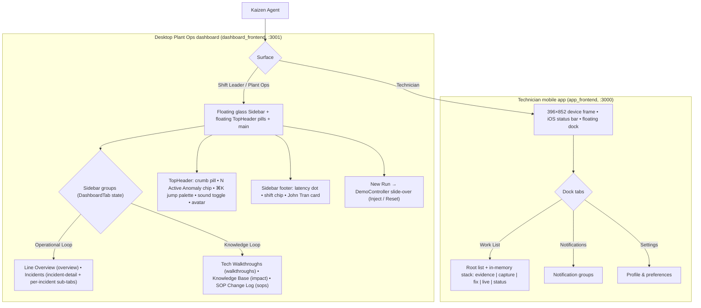

# Project Base Layout: Desktop Floating Glass Sidebar & Mobile Device Frame + Dock

> **File:** `docs/wireframes/00_base_layout.md`  
> **Viewports:** Desktop `1440 × 900 px` (Plant Ops dashboard) · Mobile `396 × 852 px` device frame (Technician app)  
> **Design Standard:** [`docs/DESIGN.md`](../DESIGN.md) (Lumina Slate liquid glass)  
> **Terminology:** Unified **Agent Team** across all pages and documentation.  
> **Sources:** PR #105 `dashboard_frontend/src/App.tsx`, `Sidebar.tsx`, `TopHeader.tsx`; PR #106 `app_frontend/src/components/mobile/MobileApp.tsx`, `MobileNav.tsx`, `MobileDeviceFrame.tsx`.

---

## 1. Architectural Principle: Separation of Shell & Content

To ensure visual consistency and prevent cognitive fatigue across the manufacturing floor:
1. **The Base Shell handles all global concerns:**
   - tab switching (React state, no URL router);
   - demo controls (DemoController drawer);
   - the SSE / backend latency dot;
   - the user card.
2. **Individual pages focus exclusively on their single JTBD content.** They mount into the shell's content slot and do not redefine navigation or the outer shell.



---

## 2. Desktop Shell Components

```
Root App (App.tsx)
│
├── .app-backdrop (fixed; pastel radial washes + 22px dot grid)
│
├── Sidebar (.glass-strong; fixed left/top/bottom 12px; width 236px; radius 24; --sidebar-w 248 incl. gap)
│   ├── Brand: "K" logo tile (dark gradient, 32px, radius 9) + "KAIZEN AGENT" (Geist 800)
│   ├── line-select inset: "Cell Line 1: Turning & Milling"
│   ├── .eyebrow "Operational Loop"
│   │   ├── NavItem: Line Overview
│   │   └── NavItem: Incidents
│   │       └── closable mono sub-tabs, one per opened incident (indented left rule)
│   ├── .eyebrow "Knowledge Loop"
│   │   ├── NavItem: Tech Walkthroughs
│   │   ├── NavItem: Knowledge Base
│   │   └── NavItem: SOP Change Log
│   └── Footer: backend latency dot (pulsing green / red) • shift chip • "JT John Tran · Shift Leader" card
│       (active NavItem: white 85% background, accent icon, weight 650)
│
├── TopHeader (fixed top 12, height 56, no bar background)
│   ├── Left: glass pill breadcrumb "Cell Line 1 / {Crumb}"
│   └── Right: red "N Active Anomaly" chip (only while an incident is open)
│             • ⌘K glass search pill "Search telemetry or jump to…" (44px; opens 360px jump palette)
│             • 44px round sound toggle
│             • name + 42px dark avatar
│
├── <main> (margin-left calc(var(--sidebar-w) + 12px); padding-top calc(64px + 28px); right padding 16px)
│   └── .page (column, max-width 1680px, gap 1.25rem)
│       ├── Page header: .page-title + muted subtitle | contextual buttons (.btn / .btn-dark)
│       └── Page body: mounted screen components
│
├── DemoController (right .glass-strong slide-over, 420px, radius 26, blur scrim)
│   ├── Scenario cards: CNC Tool Wear (CNC-02/T07) • IM Damp Material (IM-05/MOLD-03)
│   ├── demo / fast timing • Inject • Reset
│   └── .glass-dark run-status box with red→amber progress bar
│
└── Toast (.toast.glass-dark, fixed bottom-right; tone-red for errors; auto-dismiss 5s)
```

---

## 3. Low-Fi ASCII Wireframe: Desktop Base Layout (1440px)

```text
 .app-backdrop (pastel washes + dot grid) ─────────────────────────────────────────────────────────────────────────────────────────────────────
  ╭──────────────────────╮   ╭─────────────────────────────╮                     (●) 1 Active Anomaly  ╭ ⌘K Search telemetry or jump to… ╮ (♪) John Tran (JT)
  │ [K] KAIZEN AGENT     │   │ Cell Line 1 / Line Overview │                                           ╰──────────────────────────────────╯
  │ ╭──────────────────╮ │   ╰─────────────────────────────╯   <-- floating TopHeader pills (top 12, h 56, no bar)
  │ │Cell Line 1:      │ │
  │ │Turning & Milling │ │   .page-title (Geist 1.85rem)                                         [ Contextual .btn ] [ Primary .btn-dark ]
  │ ╰──────────────────╯ │   muted subtitle (0.9rem)
  │                      │
  │ OPERATIONAL LOOP     │   ╭── .glass card (radius 22) ──────────────────────────────────────────────────────────────────────────────────╮
  │ ▣ Line Overview  *   │   │                                                                                                             │
  │ ⚠ Incidents          │   │   {Each tab mounts its focused content into .page}                                                          │
  │   │ #INC-… ×         │   │                                                                                                             │
  │                      │   │   - overview:        AnomalyBanner + 4 KPI cards + MachineFleetTable                                        │
  │ KNOWLEDGE LOOP       │   │   - incident-detail: 5 StepSections + StepRail + 8D sign-off                                                │
  │ ▶ Tech Walkthroughs  │   │   - walkthroughs / impact / sops: Knowledge Loop pages                                                      │
  │ ▤ Knowledge Base     │   │                                                                                                             │
  │ ☰ SOP Change Log     │   ╰─────────────────────────────────────────────────────────────────────────────────────────────────────────────╯
  │                      │
  │ (●) 24 ms  [Shift A] │                                                                                       ╭─ .toast.glass-dark ──────╮
  │ (JT) John Tran       │                                                                                       │ ✓ Message (auto 5s)      │
  │      Shift Leader    │                                                                                       ╰──────────────────────────╯
  ╰──────────────────────╯
   ^-- floating glass-strong Sidebar (236px, inset 12px, radius 24)          ^-- <main> .page (max 1680px)
```

---

## 4. Desktop Breakpoints

The sidebar never collapses.

| Width | Change |
|---|---|
| 1280px | Overview KPI grid 4 → 2 columns |
| 1100px | Impact two-column layouts → 1 |
| 900px | ESG KPIs 3 → 1 |
| 760px | Step rail hidden |
| 720px | KPI and diagnostics grids → 1, banner stacks |
| 640px | Walkthrough duration hidden |

---

## 5. Mobile Shell (Technician App)

- **Device frame (`MobileDeviceFrame`):** 396 × 852 phone, 10px bezel, radius 58 (screen 48), scaled 0.55–1 to the window height, on the dark host page `#090D16`. Dynamic Island 112×32; home indicator 128×5.
- **iOS status bar:** 44px, "9:41".
- **`MobileHeader` (root tabs):** brand tile + "kAIgen", stream status line Live / Connecting… / Offline, 36px gradient avatar, then the iOS large title + subtitle.
- **`MobileNavBar` (detail screens):** 38px circular glass back button, centered title + `#id` subtitle, trailing priority chip.
- **Scroll area:** padding `44px 0 112px` (reserves status bar and dock); screen padding 16, gap 14. No media queries.
- **Floating dock (`MobileNav`):** left/right 12, bottom 14, 66px tall, radius 999, glass `rgba(255,255,255,.62)` blur 28; black `#0d0f17` sliding thumb; 3 tabs:
  - Work List (`assignment`)
  - Notifications (`notifications`, red unread badge)
  - Settings (`tune`)
- **Navigation:** tab state + in-memory stack on Work List (`evidence | capture | fix | live | status`). Tapping Work List again pops to root.
- **Full-screen routes (`capture`, `live`):** scroll padding removed, status bar turns white, dock switches to on-dark `rgba(240,242,250,.78)` and stays visible over the camera.

```text
        ╭──────────────────────────────────────╮  <-- device frame 396×852, radius 58, on #090D16
        │ 9:41          ▬▬▬▬▬▬▬▬        ▂▄▆ ▮  │  <-- iOS status bar (44px)
        │ [⚙] kAIgen                      (AV) │  <-- MobileHeader topbar (36px tiles)
        │     (●) Live                         │
        │                                      │
        │ Work List                            │  <-- large title 30/800
        │ 2 jobs need you · Bay 4              │
        │                                      │
        │ ╭──────────────────────────────────╮ │
        │ │  .m-glass card (radius 24)       │ │  <-- screen padding 16, gap 14
        │ ╰──────────────────────────────────╯ │
        │ ╭──────────────────────────────────╮ │
        │ │  .m-glass card                   │ │
        │ ╰──────────────────────────────────╯ │
        │                                      │
        │ ╭──────────────────────────────────╮ │
        │ │ [█WorkList█]  Notifs(2)  Settings│ │  <-- floating dock 66px, black sliding thumb
        │ ╰──────────────────────────────────╯ │
        │              ────────                │  <-- home indicator
        ╰──────────────────────────────────────╯

  Detail screen top:  ( ‹ )      Repair brief       [P1]      <-- MobileNavBar: 38px back, title + #id, priority chip
                               #INC-… · CNC-02
```
