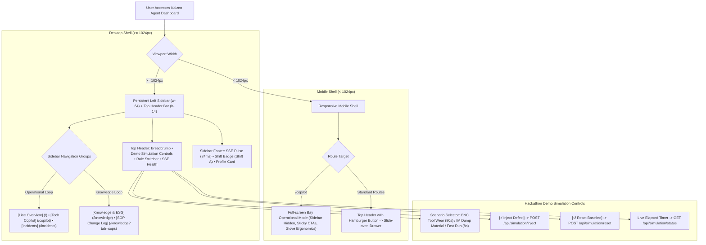

# Project Base Layout: Desktop Sidebar Shell & Mobile Navigation

> **File:** `docs/wireframes/00_base_layout.md`  
> **Target Viewport:** Desktop `1440 × 900 px` (Standard Control Room / Supervisor Workstation)  
> **Design Standard:** [`docs/DESIGN.md`](../DESIGN.md) (shadcn/ui Light Mode)  
> **Terminology:** Unified **Agent Team** across all pages and documentation.  
> **Component Architecture:** Persistent Left Sidebar (`w-64` / 256px) + Top Header Bar (`h-14` / 56px) + Fluid `<main>` Content Container.

---

## 1. Architectural Principle: Separation of Shell & Content

To ensure visual consistency and prevent cognitive fatigue across the manufacturing floor:
1. **The Base Shell handles all global concerns:** routing, cell line switching, Hackathon Demo simulation controls, global SSE connection monitoring, and user role switching.
2. **Individual pages (`/`, `/copilot`, `/incidents/:id`, `/knowledge`) focus exclusively on their single JTBD content.** They mount into the `<main>` container and do not redefine the navigation menu or outer shell.



---

## 2. Base Shell Components (shadcn/ui Primitives)

```
Root App Layout (h-screen w-screen flex overflow-hidden bg-background)
│
├── Left Sidebar (w-64 border-r bg-card flex flex-col justify-between shrink-0)
│   ├── SidebarHeader (p-4 border-b space-y-1)
│   │   ├── Brand Logo + Title ("KAIZEN AGENT" // Agent Team Quality Control)
│   │   └── Cell Line Dropdown / Badge ("Cell Line 1: Turning & Milling")
│   │
│   ├── SidebarContent (p-3 space-y-6 flex-1 overflow-y-auto)
│   │   ├── NavGroup: "OPERATIONAL LOOP"
│   │   │   ├── NavItem: [Line Overview] (`/`, icon: LayoutDashboard)
│   │   │   ├── NavItem: [Technician Copilot] (`/copilot`, icon: Wrench)
│   │   │   └── NavItem: [Incidents] (`/incidents`, icon: AlertTriangle, Badge: "1", variant: destructive)
│   │   │
│   │   └── NavGroup: "KNOWLEDGE LOOP"
│   │       ├── NavItem: [Knowledge & ESG Hub] (`/knowledge`, icon: BookOpen)
│   │       └── NavItem: [SOP Change Log] (`/knowledge?tab=sops`, icon: History)
│   │
│   └── SidebarFooter (p-4 border-t space-y-3 bg-muted/20)
│       ├── Real-time SSE Pulse: ("● Connected | Latency: 24ms")
│       ├── Shift Badge: ("Shift A • 06:00 - 14:00")
│       └── User Profile Card: ("John Tran // Shift Leader")
│
└── Main Viewport (flex-1 flex flex-col min-w-0 overflow-hidden)
    ├── Top Header Bar (h-14 border-b bg-background/95 backdrop-blur px-6 flex items-center justify-between shrink-0)
    │   ├── Left Slot:
    │   │   ├── Breadcrumb ("Cell Line 1  /  Line Overview")
    │   │   └── Global Status Pill Badge: `(o) 1 Active Anomaly` (destructive) or `(o) Nominal` (success)
    │   │
    │   ├── Center Slot — Hackathon Demo Control Bar:
    │   │   ├── Scenario Dropdown: [ Scenario: CNC Tool Wear (90s) v ]
    │   │   ├── CTA Inject: [ ⚡ Inject Defect ] (variant="destructive", size="sm", rounded-md)
    │   │   ├── CTA Reset: [ ↺ Reset Baseline ] (variant="outline", size="sm", rounded-md)
    │   │   └── Timer Badge: [ ⏱ Elapsed: 12.4s ] (font-mono, rounded-full)
    │   │
    │   └── Right Slot:
    │       ├── Command Palette: [ ⌘K ]
    │       └── Role Switcher Dropdown: [ John Tran // Shift Leader v ]
    │           ├── (•) Shift Leader (John Tran)
    │           ├── ( ) Maintenance Technician (Tuan Le)
    │           └── ( ) QA / Plant Manager (David Vu)
    │
    └── Page Content Slot (<main class="flex-1 overflow-y-auto p-6 space-y-6 bg-slate-50/40">)
        ├── Page Header (<div class="flex items-center justify-between pb-4 border-b">)
        │   ├── Left Column: Title (text-2xl font-bold tracking-tight) + Subtitle (text-sm text-muted-foreground)
        │   └── Right Action Slot: Contextual Buttons (Export, Filter, Refresh, Status Badges)
        └── Page Body: Mounted Screen Content Components
```

---

## 3. Low-Fi ASCII Wireframe: Desktop Base Layout (1440px)

```text
+-----------------------+--------------------------------------------------------------------------------------------------------------------------------+
|  KAIZEN AGENT         | Cell Line 1 / Line Overview        [ Scenario: CNC Tool Wear (90s) v ] [⚡ Inject Defect] [↺ Reset] [⏱ 12.4s]  [John Tran (Lead) v]  |
|  Cell Line 1: Turning | <-- TOP HEADER BAR (h-14, bg-background/95 border-b flex items-center justify-between px-6) ----------------------------------+ |
+-----------------------+                                                                                                                                |
|                       | +-- PAGE HEADER (<div class="flex items-center justify-between pb-4 border-b">) ---------------------------------------------+ |
|  OPERATIONAL LOOP     | | Page Title (text-2xl font-bold tracking-tight)                          [ Contextual Action ] [ Primary Page Action CTA ]  | |
|  [#] Line Overview *  | | Descriptive subtitle explaining single JTBD (text-sm text-muted-foreground)                                                | |
|  [T] Tech Copilot     | +----------------------------------------------------------------------------------------------------------------------------+ |
|  [!] Incidents (1)    |                                                                                                                                |
|                       | +-- PAGE CONTENT CONTAINER (<main class="p-6 space-y-6">) -------------------------------------------------------------------+ |
|  KNOWLEDGE LOOP       | |                                                                                                                            | |
|  [?] Knowledge & ESG  | |   {Each page mounts its focused domain content modules into this slot}                                                     | |
|  [@] SOP Change Log   | |                                                                                                                            | |
|                       | |   - Screen 1: Top Destructive Alert + 3 KPI Cards + Machine Fleet Table                                                    | |
|                       | |   - Screen 3: Verification 50-Part Streak Gate + Live Agent Team Stream + 8D Sign-Off                                      | |
|                       | |   - Screen 4: 3 ESG KPI Cards + RAG Knowledge Search Bar + Verified Solutions Table                                        | |
|                       | |                                                                                                                            | |
|-----------------------| +----------------------------------------------------------------------------------------------------------------------------+ |
| (o) Live Connected    |                                                                                                                                |
| Shift A (06:00-14:00) |                                                                                                                                |
| John Tran (Lead)      |                                                                                                                                |
+-----------------------+--------------------------------------------------------------------------------------------------------------------------------+
  ^--- PERSISTENT LEFT SIDEBAR (w-64)                        ^--- FLUID VIEWPORT WITH TOP DEMO CONTROLS (<main class="p-6">)
```

---

## 4. Mobile Adaptability (Responsive Shell)

- **Mobile Viewport (iPhone 390px):**
  - The left sidebar transforms into a **Slide-over Sheet Drawer (`<Sheet>`)** accessible via a hamburger menu button in the top header.
  - **Screen 2 (`/copilot`):** Operates in a **Full-Screen Bay Mode** with the sidebar hidden by default to maximize vertical workspace. The top bar retains only the bay breadcrumb and emergency status, while the bottom is anchored by sticky 48px touch CTAs (`h-12`) optimized for one-handed operation with heavy work gloves.
