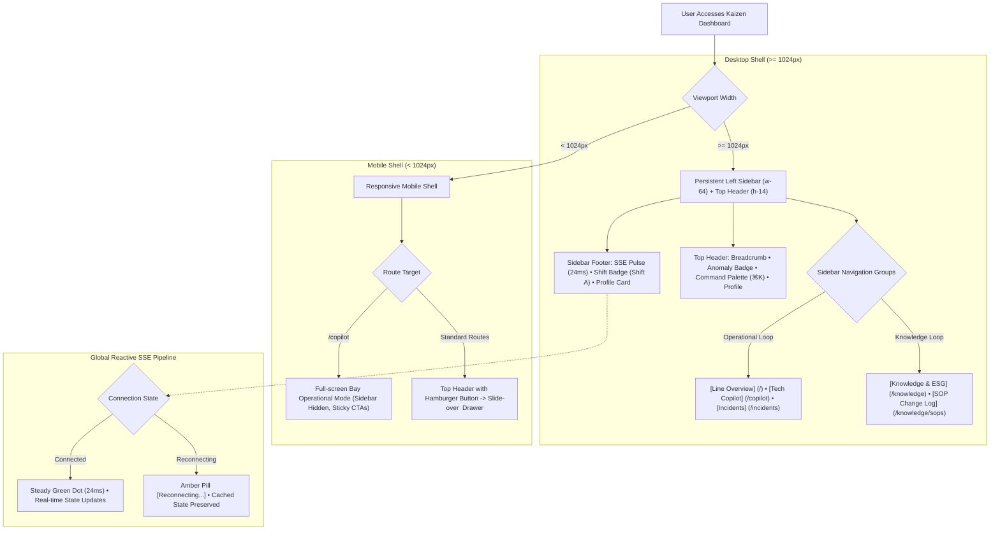

# Project Base Layout: Desktop Sidebar Shell & Mobile Navigation

> **File:** `docs/wireframes/00_base_layout.md`  
> **Target Viewport:** Desktop `1440 × 900 px` (Standard Control Room / Workstation)  
> **Design Standard:** [`docs/DESIGN.md`](../DESIGN.md) (shadcn/ui Light Mode)  
> **Component Architecture:** Persistent Left Sidebar (`w-64` / 256px) + Top Header Bar (`h-14` / 56px) + Fluid `<main>` Content Container.

---

## 1. Architectural Principle: Separation of Shell & Content

To ensure visual consistency and prevent cognitive fatigue across the manufacturing floor:
1. **The Base Shell handles all routing, cell line switching, global SSE connection monitoring, and user identity.**
2. **Individual pages (`/`, `/copilot`, `/incidents/:id`, `/knowledge`) focus exclusively on their page-specific content.** They do not redefine the navigation menu or outer application shell.



---

## 2. Base Shell Components (shadcn/ui Sidebar Primitives)

```
Root App Layout (h-screen w-screen flex overflow-hidden bg-background)
│
├── Left Sidebar (w-64 border-r bg-card flex flex-col justify-between shrink-0)
│   ├── SidebarHeader (p-4 border-b space-y-1)
│   │   ├── Brand Logo + Title ("KAIZEN AGENT")
│   │   └── Cell Line Dropdown / Badge ("Cell Line 1: Turning & Milling")
│   │
│   ├── SidebarContent (p-3 space-y-6 flex-1 overflow-y-auto)
│   │   ├── NavGroup: "OPERATIONAL LOOP"
│   │   │   ├── NavItem: [Line Overview] (`/`, icon: LayoutDashboard)
│   │   │   ├── NavItem: [Technician Copilot] (`/copilot`, icon: Wrench)
│   │   │   └── NavItem: [Incidents] (`/incidents`, icon: AlertTriangle, Badge: "1")
│   │   │
│   │   └── NavGroup: "KNOWLEDGE LOOP"
│   │       ├── NavItem: [Knowledge & ESG Hub] (`/knowledge`, icon: BookOpen)
│   │       └── NavItem: [SOP Change Log] (`/knowledge/sops`, icon: History)
│   │
│   └── SidebarFooter (p-4 border-t space-y-3 bg-muted/20)
│       ├── Real-time SSE Pulse: ("● Connected | Latency: 24ms")
│       ├── Shift Badge: ("Shift A • 06:00 - 14:00")
│       └── User Profile Card: ("John Tran // Shift Leader")
│
└── Main Viewport (flex-1 flex flex-col min-w-0 overflow-hidden)
    ├── Top Header Bar (h-14 border-b bg-background/95 backdrop-blur px-6 flex items-center justify-between shrink-0)
    │   ├── Breadcrumb ("Cell Line 1  /  Line Overview")
    │   ├── Global Health Pill Badge ("(o) 1 Active Anomaly" or "(o) Nominal")
    │   └── Actions: [Command Palette (⌘K)] [Audio Mute/Unmute] [Profile Menu]
    │
    └── Page Content Slot (<main class="flex-1 overflow-y-auto p-6 space-y-6 bg-slate-50/40">)
        ├── Page Header (<div class="flex items-center justify-between pb-4 border-b">)
        │   ├── Left Column: Title (text-2xl font-bold tracking-tight) + Subtitle (text-sm text-muted-foreground)
        │   └── Right Action Slot: Contextual Buttons (Export, Filter, Refresh, Status Badges)
        └── Page Body: Mounted Screen Content Components
```


---

## 3. Low-Fi ASCII Wireframe: Desktop Base Layout (1440px)

```text
+-----------------------+------------------------------------------------------------------------------------------+
|  KAIZEN AGENT         |  Cell Line 1  /  Line Overview                 Badge: [ (!) 1 ANOMALY ]  [ ⌘K ] [User v] |
|  Cell Line 1: Turning |  <-- TOP HEADER BAR (h-14) ------------------------------------------------------------+ |
+-----------------------+                                                                                          |
|                       |  +-- PAGE HEADER (<div class="flex items-center justify-between pb-4 border-b">) ------+ |
|  OPERATIONAL LOOP     |  |  Page Title (text-2xl font-bold)               [ Contextual Action ] [ Action CTA ] | |
|  [#] Line Overview *  |  |  Page descriptive subtitle (text-sm text-muted)                                     | |
|  [T] Tech Copilot     |  +-------------------------------------------------------------------------------------+ |
|  [!] Incidents  (1)   |                                                                                          |
|                       |  +-- PAGE BODY CONTENT SLOT (space-y-6) -----------------------------------------------+ |
|  KNOWLEDGE LOOP       |  |                                                                                     | |
|  [?] Knowledge & ESG  |  |   {Each page mounts its focused domain content modules here}                        | |
|  [@] SOP Change Log   |  |                                                                                     | |
|                       |  |   - Screen 1: Top Destructive Alert + 3 KPI Cards + Machine Fleet Table             | |
|                       |  |   - Screen 3: Verification 50-Part Streak Gate + 5-Whys Tree + 8D Sign-Off          | |
|                       |  |   - Screen 4: 3 ESG KPI Cards + RAG Search Bar + Verified Solutions Table           | |
|                       |  |                                                                                     | |
|-----------------------|  +-------------------------------------------------------------------------------------+ |
| (o) Live Connected    |                                                                                          |
| Shift: A (06:00-14:00)|                                                                                          |
| John Tran (Lead)      |                                                                                          |
+-----------------------+------------------------------------------------------------------------------------------+
  ^--- PERSISTENT LEFT SIDEBAR (w-64)                        ^--- FLUID PAGE VIEWPORT (<main class="p-6">)
```


---

## 4. Mobile Adaptability (Responsive Shell)

- **Mobile Viewport (iPhone 390px):**
  - The left sidebar transforms into a **Slide-over Sheet Drawer (`<Sheet>`)** accessible via a hamburger menu button in the top header.
  - **Screen 2 (`/copilot`):** Designed as a specialized full-screen bay-side operational interface optimized for one-handed gloved use, hiding the desktop sidebar by default to maximize vertical workspace.
