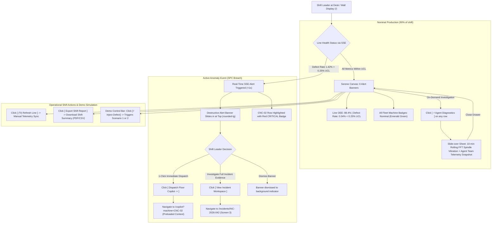

# Screen 1: Line Overview & Machine List

> **Route:** `/`  
> **Viewport:** Desktop `1440 × 900 px`  
> **Primary Persona:** Shift Leader (John Tran)  
> **Single Job-to-be-Done (JTBD):** Line Health Supervision & Instant 1-Click Dispatch. *(Not for physical wrenching guides or deep root cause analysis).*  
> **Design Standard:** [`docs/DESIGN.md`](../DESIGN.md) (shadcn/ui Light Mode)  
> **Terminology:** Unified **Agent Team** across all pages and documentation.

---

## 1. End-to-End User Flow & UI Workflow

The Line Overview screen serves as the primary operational cockpit for the Shift Leader, balancing calm monitoring with instant anomaly dispatch:



---

## 2. Persona & Context

- **Shift Leader (John Tran):** Manages a 12-operator shift across Cell Line 1. Must ensure high line output (OEE > 90%), zero uncontained scrap escapes, and fast response times to stoppages.
- **Physical Context:** Monitors from a central 27" wall-mounted monitor or supervisor desk 2–3 meters away.
- **Cognitive Requirement:** Must assess cell health in **under 3 seconds** without parsing complex telemetry graphs.

---

## 3. Progressive Disclosure Architecture (3 Tiers)

```
[Tier 1: Glance (1s)]   --> Line Status Pill Badge + 3 Summary KPI Cards + Affected Machine ID
        │
        ▼
[Tier 2: Focus (5s)]    --> Top Anomaly Alert Banner + Actionable Dispatch CTAs + Machine Row Highlight
        │
        ▼
[Tier 3: Deep Dive]     --> Slide-over Agent Diagnostics Drawer (FFT Spectrum + Agent Team Snapshot)
```

### Page Header Component (Slot Top)
- **Title:** `Cell Line 1 Overview` (`text-2xl font-bold tracking-tight`)
- **Subtitle:** `Real-time machine fleet telemetry, statistical process control (SPC), and instant dispatch.` (`text-sm text-muted-foreground`)
- **Trailing Action Slot:**
  - `[ (↻) Refresh Line ]` (Ghost button, `rounded-md`)
  - `[ Export Shift Report ]` (Outline button, `rounded-md`)

### Tier 1: Glance (1-Second Reception)
- **Global Status Badge:** `(o) 1 Active Anomaly` in destructive red (`rounded-full`) or `(o) Nominal` in emerald green.
- **Top KPI Cards (3 Units, `rounded-xl`):**
  - **Line OEE:** `88.4%` (Target: 90%)
  - **Defect Rate vs UCL:** `1.42%` (UCL: `0.25%` — Flagged in red)
  - **Active Incidents:** `1 Critical` (`INC-2026-042`)

### Tier 2: Focus (5-Second Reception)
- **Actionable Anomaly Banner (`<Alert variant="destructive">`, `rounded-lg`):**
  - Problem: `CNC-02 (Bay 4): Severe Flank Wear on Tool T07 Exceeding SPC Limit`
  - Evidence: `Defect rate jumped to 1.42% (5.6x UCL) | Spindle Vibration: 2.84 mm/s (+35% vs 1.50 mm/s baseline)`
  - Recommended Fix: `Replace insert with WNMG-080408, torque 45 Nm`
  - Actionable CTAs:
    - Primary Button (`rounded-md`, Slate `#0F172A`): `[ Dispatch Floor Copilot → ]` (opens `/copilot?machine=CNC-02`)
    - Secondary Outline Button: `[ View Incident Workspace ]` (opens `/incidents/INC-2026-042`)
- **Machine Fleet Table (`rounded-xl` Card):**
  - Machine `CNC-02` row highlighted with soft red background (`bg-destructive-muted/30`) and red badge `CRITICAL`.
  - Direct row CTA: `[ OPEN COPILOT ]`.

### Tier 3: Deep Dive (On-Demand / Slide-Over Sheet Drawer)
- Clicking `[ ⚡ Agent Diagnostics ]` on any machine row slides in a right-side Sheet (`Drawer`):
  - **Rolling 10-min Spindle Vibration Waveform & FFT Spectrum:** Real-time RMS vibration in `mm/s` (ISO 10816).
  - **Spindle Motor Current & Load:** Real-time amperage curves.
  - **Agent Team Telemetry Findings:** Quick summary from Process Analyst (`Vibration surge onset at 09:30 (+35%)`) and Traceability Agent (`Suspect Correlation: 0.95`).

---

## 4. Dual Scenarios Adaptation Note

Kaizen Agent supports two distinct industrial scenarios out of the box:

1. **Scenario 1: CNC Tool Wear (Default)**
   - Machine: `CNC-02` (Bay 4, Turning Lathe) • Tool: `T07 (Rough Turn)` • Workpiece: `Housing-B42` (FC250 Iron).
   - Telemetry Anomaly: Spindle vibration surges to `2.84 mm/s` (Baseline `1.50 mm/s`, Warning `1.95 mm/s`).
   - Defect: Surface roughness Ra > 3.8 µm, vertical scratch rate `1.42%`.
2. **Scenario 2: Plastic Injection Molding Material Moisture (`IM-05`)**
   - Machine: `IM-05` (Bay 5, Injection Molding) • Mold Cavity: `MOLD-03` (Cavity #3).
   - Telemetry Anomaly: Material dryer dew point surges from `-40 °C` to `-18 °C`.
   - Defect: Short fill & sink marks on Cavity #3 (`8.1%` defect rate).
   - *UI Behavior:* Machine Fleet Table displays `IM-05` with `Dryer Dew Point: -18 °C` in red warning badge, and the Anomaly Banner recommends inspecting the dryer desiccant filter.

---

## 5. Low-Fi ASCII Wireframe: Page Content Slot (Desktop 1440px)

```text
+-----------------------+--------------------------------------------------------------------------------------------------------------------------------+
|  KAIZEN AGENT         | Cell Line 1 / Line Overview        [ Scenario: CNC Tool Wear (90s) v ] [⚡ Inject Defect] [↺ Reset] [⏱ 12.4s]  [John Tran (Lead) v]  |
|  Cell Line 1: Turning | <-- TOP HEADER BAR (h-14) ----------------------------------------------------------------------------------------------------+ |
+-----------------------+                                                                                                                                |
|                       | +-- PAGE HEADER (<div class="flex items-center justify-between pb-4 border-b">) ---------------------------------------------+ |
|  OPERATIONAL LOOP     | | Cell Line 1 Overview                                                                 [ (↻) Refresh ] [ Export Shift Report ] | |
|  [#] Line Overview *  | | Real-time machine fleet telemetry, statistical process control (SPC), and instant dispatch                                  | |
|  [T] Tech Copilot     | +----------------------------------------------------------------------------------------------------------------------------+ |
|  [!] Incidents (1)    |                                                                                                                                |
|                       | === TIER 2 (FOCUS): ACTIONABLE ANOMALY ALERT BANNER (rounded-lg) ============================================================ |
|  KNOWLEDGE LOOP       | +----------------------------------------------------------------------------------------------------------------------------+ |
|  [?] Knowledge & ESG  | | (!) CNC-02 (Bay 4): Tool T07 Severe Flank Wear Exceeding SPC Limit                                                         | |
|  [@] SOP Change Log   | |     Defect Rate: 1.42% (UCL: 0.25%) | Spindle Vibration: 2.84 mm/s (Base: 1.50 mm/s) | Part: Housing-B42 (FC250)           | |
|                       | |     Recommended Action: Replace insert with WNMG-080408, calibrate torque 45 Nm.                                           | |
|                       | |                                                                                                                            | |
|                       | |     [ Dispatch Floor Copilot -> ]           [ View Incident Workspace ]           [ Dismiss Banner ]                       | |
|                       | +----------------------------------------------------------------------------------------------------------------------------+ |
|                       |                                                                                                                                |
|                       | === TIER 1 (GLANCE): 3 HIGH-LEVEL KPI METRICS (rounded-xl) ================================================================== |
|                       | +-- LINE OEE ------------+  +-- DEFECT RATE VS UCL -+  +-- ACTIVE INCIDENTS ----+                                              |
|                       | | Availability & Output  |  | SPC vs UCL Limit      |  | Resolution Pipeline    |                                              |
|                       | |   88.4%                |  |   1.42% (UCL: 0.25%)  |  |   1 Critical           |                                              |
|                       | |   -2.1% from target    |  |   (!) 5.6x UCL Breach |  |   INC-2026-042 (CNC-02)|                                              |
|                       | +------------------------+  +-----------------------+  +------------------------+                                              |
|                       |                                                                                                                                |
|                       | === TIER 2 (FOCUS): MACHINE FLEET TABLE (rounded-xl) ======================================================================== |
|                       | +----------------------------------------------------------------------------------------------------------------------------+ |
|                       | | Filter: [All (5)] [Nominal (4)] [Anomaly (1)] | Search: [ Q Filter bay or machine ID...                                  ] | |
|                       | +----------------------------------------------------------------------------------------------------------------------------+ |
|                       | | Machine ID  | Part Model  | Vibration (RMS) | Spindle Load | Status Badge   | Active Incident | Contextual Action          | |
|                       | +-------------+-------------+-----------------+--------------+----------------+-----------------+----------------------------+ |
|                       | | CNC-01      | Shaft-A12   | 1.46 mm/s       | 42.1 %       | (o) Nominal    | None            | [ ⚡ Agent Diagnostics ]   | |
|                       | | CNC-02      | Housing-B42 | 2.84 mm/s (!)   | 78.6 %       | (*) CRITICAL   | INC-2026-042    | [ OPEN COPILOT → ]         | |
|                       | | CNC-03      | Flange-F09  | 1.48 mm/s       | 45.0 %       | (o) Nominal    | None            | [ ⚡ Agent Diagnostics ]   | |
|                       | | CNC-04      | Gear-G15    | 1.41 mm/s       | 39.8 %       | (o) Nominal    | None            | [ ⚡ Agent Diagnostics ]   | |
|                       | | CONVEYOR-01 | Discrete    | 0.12 mm/s       | 18.2 %       | (o) Nominal    | None            | [ ⚡ Agent Diagnostics ]   | |
|                       | +----------------------------------------------------------------------------------------------------------------------------+ |
|-----------------------|                                                                                                                                |
| (o) Live Connected    | === TIER 3 (DEEP DIVE): ON-DEMAND AGENT DIAGNOSTICS DRAWER (Opens on clicking "[ ⚡ Agent Diagnostics ]") =================== |
| Shift A (06:00-14:00) | | [Slide-over Sheet]: Rolling 10-min FFT Spindle Vibration Spectrum + Agent Team Telemetry Correlation Snapshot (Off-canvas) | |
| John Tran (Lead)      | +----------------------------------------------------------------------------------------------------------------------------+ |
+-----------------------+--------------------------------------------------------------------------------------------------------------------------------+
  ^--- PERSISTENT LEFT SIDEBAR                               ^--- PAGE CONTENT SLOT (<main class="p-6">)
```

---

## 6. UI States & Edge Cases

| State | UI Behavior |
|---|---|
| **All Nominal (90% of shift)** | No alert banner displayed. All machine badges green `(o) Nominal`. KPI card shows `Defect Rate: 0.04%` (well below UCL 0.25%). Canvas is completely serene. |
| **Active Anomaly (SPC Breach)** | Destructive alert slides in at top within 1 second via SSE. `CNC-02` row highlighted with soft red background. Primary CTA "Dispatch Floor Copilot" active. |
| **SSE Stream Disconnected** | Top header displays amber pill `[● Reconnecting...]`. Cached telemetry data remains readable with a muted informative banner. |
| **Dual Scenario Switch** | When Scenario 2 is triggered via header demo controls, table dynamically reflects `IM-05` injection molding telemetry and dew point alerts. |
