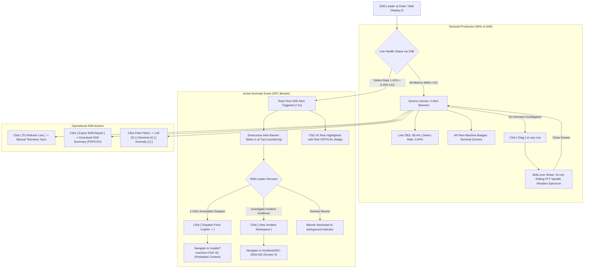

# Screen 1: Line Overview & Machine List

> **Route:** `/`  
> **Viewport:** Desktop `1440 × 900 px`  
> **Primary Persona:** Shift Leader (John Tran)  
> **Single Job-to-be-Done (JTBD):** Line Health Supervision & Instant 1-Click Dispatch. *(Not for wrenching guides or deep root cause analysis).*  
> **Design Standard:** [`docs/DESIGN.md`](../DESIGN.md) (shadcn/ui Light Mode)

---

## 1. End-to-End User Flow & UI Workflow

The Line Overview screen serves as the primary operational cockpit for the Shift Leader, balancing calm monitoring with instant anomaly dispatch:



---

## 2. Persona & Context

- **Shift Leader (John Tran):** Manages a 12-operator shift across Cell Line 1. Must ensure high line output (OEE > 90%), zero uncontained scrap escapes, and fast response times to stoppages.
- **Physical Context:** Monitors from a central 27" wall-mounted monitor or supervisor desk 2–3 meters away.
- **Cognitive Requirement:** Must assess cell health in **under 3 seconds** without parsing complex telemetry graphs.

---

## 3. Progressive Disclosure Architecture (3 Tiers)

```
[Tier 1: Glance (1s)]   --> Line Status Pill Badge + 3 Summary KPI Cards + Affected Machine ID
        │
        ▼
[Tier 2: Focus (5s)]    --> Top Anomaly Alert Banner + Actionable Dispatch CTAs + Machine Row Highlight
        │
        ▼
[Tier 3: Deep Dive]     --> Slide-over Machine Diagnostics Drawer (FFT Vibration Spectrum, Torque Curves)
```

### Page Header Component (Slot Top)
- **Title:** `Cell Line 1 Overview` (`text-2xl font-bold tracking-tight`)
- **Subtitle:** `Real-time machine fleet telemetry, statistical process control (SPC), and instant dispatch.` (`text-sm text-muted-foreground`)
- **Trailing Action Slot:**
  - `[ (↻) Refresh Line ]` (Ghost button, `rounded-md`)
  - `[ Export Shift Report ]` (Outline button, `rounded-md`)

### Tier 1: Glance (1-Second Reception)
- **Global Status Badge:** `(o) 1 Active Anomaly` in destructive red (`rounded-full`) or `(o) Nominal` in emerald green.
- **Top KPI Cards (3 Units, `rounded-xl`):**
  - **Line OEE:** `88.4%` (Target: 90%)
  - **Defect Rate vs UCL:** `1.42%` (UCL: `0.25%` — Flagged in red)
  - **Active Incidents:** `1 Critical` (`INC-2026-042`)

### Tier 2: Focus (5-Second Reception)
- **Actionable Anomaly Banner (`<Alert variant="destructive">`, `rounded-lg`):**
  - Problem: `CNC-02 (Bay 4): Severe Flank Wear on Tool T07`
  - Evidence: `Defect rate jumped to 1.42% (5.6x UCL) | Vibration 2.84g`
  - Recommended Fix: `Replace insert with WNMG-080408, torque 45 Nm`
  - Actionable CTAs:
    - Primary Button (`rounded-md`, Slate `#0F172A`): `[ Dispatch Floor Copilot → ]` (opens `/copilot?machine=CNC-02`)
    - Secondary Outline Button: `[ View Incident Workspace ]` (opens `/incidents/INC-2026-042`)
- **Machine Fleet Table (`rounded-xl` Card):**
  - Machine `CNC-02` row highlighted with soft red background (`bg-destructive-muted/30`) and red badge `CRITICAL`.
  - Direct row CTA: `[ OPEN COPILOT ]`.

### Tier 3: Deep Dive (On-Demand / Slide-Over Drawer)
- Clicking `[ Diagnostics ]` on any machine opens a right-side Slide-over Sheet (`Drawer`):
  - 10-minute rolling Spindle Vibration FFT Spectrum.
  - Spindle Torque / Load curves.
  - Historical maintenance logs for that bay.

---

## 4. User Stories & Acceptance Criteria

### User Story 1.1: 3-Second Glance Line Health (Tier 1)
> **As a** Shift Leader on the manufacturing floor,  
> **I want to** see the real-time operational status of all CNC machines at a single glance,  
> **So that** I know production is nominal without wading through raw sensor telemetry charts.

- **Acceptance Criteria:**
  - **Given** normal operations, all machines show green `(o) Nominal` badges (`rounded-full`), and no alert banner is displayed.
  - **Given** an SPC threshold breach (defect rate > 0.25% UCL), a prominent red alert banner slides in at the top within 1 second via SSE.
  - The 3 KPI cards provide immediate visibility into line availability, defect rate, and incident count.

### User Story 1.2: One-Click Technician Dispatch (Tier 2)
> **As a** Shift Leader,  
> **I want to** click a single "Dispatch Copilot" button directly from the anomaly banner or table row,  
> **So that** a technician is dispatched to the bay with pre-loaded diagnostics in under 10 seconds.

- **Acceptance Criteria:**
  - The anomaly banner highlights machine (`CNC-02`), tool slot (`T07`), and part model (`Housing-B42`).
  - Clicking `[ Dispatch Floor Copilot → ]` immediately navigates to `/copilot?machine=CNC-02` with context pre-loaded.
  - Clicking `[ View Incident Workspace ]` opens `/incidents/INC-2026-042`.

### User Story 1.3: On-Demand Machine Telemetry Drawer (Tier 3)
> **As a** Shift Leader or QC Inspector,  
> **I want to** open a side drawer to inspect detailed telemetry for any machine without leaving the line overview,  
> **So that** the main screen remains clean and calm while allowing deep troubleshooting when requested.

- **Acceptance Criteria:**
  - Clicking `[ Diagnostics ]` on any table row slides in a `<Sheet>` drawer from the right.
  - The drawer displays the rolling vibration waveform and historical tool replacement records.
  - Closing the drawer restores the clean overview state instantly.

---

## 5. Low-Fi ASCII Wireframe: Page Content Slot (with Persistent Left Sidebar)

> **Context:** Mounted within the Desktop Base Shell (`docs/wireframes/00_base_layout.md`). The persistent Left Sidebar provides navigation, while the right pane focuses strictly on Line Overview & Machine List content.

```text
+-----------------------+------------------------------------------------------------------------------------------+
|  KAIZEN AGENT         |  Cell Line 1  /  Line Overview                 Badge: [ (!) 1 ANOMALY ]  [ ⌘K ] [User v] |
|  Cell Line 1: Turning |  <-- TOP HEADER BAR (h-14) ------------------------------------------------------------+ |
+-----------------------+                                                                                          |
|                       |  +-- PAGE HEADER (<div class="flex items-center justify-between pb-4 border-b">) ------+  |
|  OPERATIONAL LOOP     |  |  Cell Line 1 Overview                           [ (↻) Refresh ] [ Export Report ]   |  |
|  [#] Line Overview *  |  |  Real-time machine telemetry, SPC thresholds, and instant dispatch                  |  |
|  [T] Tech Copilot     |  +------------------------------------------------------------------------------------+  |
|  [!] Incidents  (1)   |                                                                                          |
|                       |  === TIER 2 (FOCUS): ACTIONABLE ANOMALY ALERT BANNER (rounded-lg) =====================  |
|  KNOWLEDGE LOOP       |  +------------------------------------------------------------------------------------+  |
|  [?] Knowledge & ESG  |  | (!) CNC-02 (Bay 4): Tool T07 Severe Flank Wear Exceeding SPC Limit                 |  |
|  [@] SOP Change Log   |  |     Defect Rate: 1.42% (UCL: 0.25%) | Vibration: 2.84g | Part: Housing-B42          |  |
|                       |  |     Recommended Action: Replace insert with WNMG-080408, torque 45 Nm.             |  |
|                       |  |                                                                                    |  |
|                       |  |     [ Dispatch Floor Copilot -> ]    [ View Incident Workspace ]    [ Dismiss ]     |  |
|                       |  +------------------------------------------------------------------------------------+  |
|                       |  === TIER 1 (GLANCE): 3 HIGH-LEVEL KPI METRICS (rounded-xl) ==========================  |
|                       |  +-- LINE OEE ------------+  +-- DEFECT RATE VS UCL -+  +-- ACTIVE INCIDENTS ----+       |
|                       |  | Availability & Output  |  | SPC vs UCL Limit      |  | Resolution Pipeline    |       |
|                       |  |   88.4%                |  |   1.42% (UCL: 0.25%)  |  |   1 Critical           |       |
|                       |  |   -2.1% from target    |  |   (!) 5.6x UCL Breach |  |   INC-2026-042 (CNC-02)|       |
|                       |  +------------------------+  +-----------------------+  +------------------------+       |
|                       |                                                                                          |
|                       |  === TIER 2 (FOCUS): MACHINE FLEET TABLE (rounded-xl) ================================  |
|                       |  +------------------------------------------------------------------------------------+  |
|                       |  | Filter: [All (5)] [Nominal (4)] [Anomaly (1)] | Search: [ Q Filter machine...   ]  |  |
|                       |  +------------------------------------------------------------------------------------+  |
|                       |  | Machine ID  | Part        | Vibration  | Spindle | Status Badge | Incident | Action    |  |
|                       |  +-------------+-------------+------------+---------+--------------+----------+-----------+  |
|                       |  | CNC-01      | Shaft-A12   | 0.38 g     | 42.1 %  | (o) Nominal  | None     | [ Diag ]  |  |
|                       |  | CNC-02      | Housing-B42 | 2.84 g (!) | 78.6 %  | (*) CRITICAL | INC-042  | [COPILOT] |  |
|                       |  | CNC-03      | Flange-F09  | 0.41 g     | 45.0 %  | (o) Nominal  | None     | [ Diag ]  |  |
|                       |  | CNC-04      | Gear-G15    | 0.35 g     | 39.8 %  | (o) Nominal  | None     | [ Diag ]  |  |
|                       |  | CONVEYOR-01 | Discrete    | 0.12 g     | 18.2 %  | (o) Nominal  | None     | [ Diag ]  |  |
|                       |  +------------------------------------------------------------------------------------+  |
|-----------------------|                                                                                          |
| (o) Live Connected    |  === TIER 3 (DEEP DIVE): ON-DEMAND DIAGNOSTICS DRAWER (Opens on clicking "[ Diag ]")==  |
| Shift A (06:00-14:00) |  | [Slide-over Sheet]: Rolling 10-min FFT Spindle Vibration Spectrum (Off-canvas)    |  |
| John Tran (Lead)      |  +------------------------------------------------------------------------------------+  |
+-----------------------+------------------------------------------------------------------------------------------+
  ^--- PERSISTENT LEFT SIDEBAR                               ^--- PAGE CONTENT SLOT (<main class="p-6">)

```

---

## 6. UI States & Edge Cases

| State | UI Behavior |
|---|---|
| **All Nominal (90% of time)** | No alert banner; all badges green `(o) Nominal`; KPI card shows `Defect Rate: 0.04%` (Well below UCL). Canvas is completely serene. |
| **Active Anomaly** | Destructive alert slides in at top; CNC-02 row highlighted with soft red background; Primary CTA "Dispatch Floor Copilot" enabled. |
| **SSE Stream Disconnected** | Top header shows amber pill `[Reconnecting...]`; cached data remains readable with a muted notification banner. |
