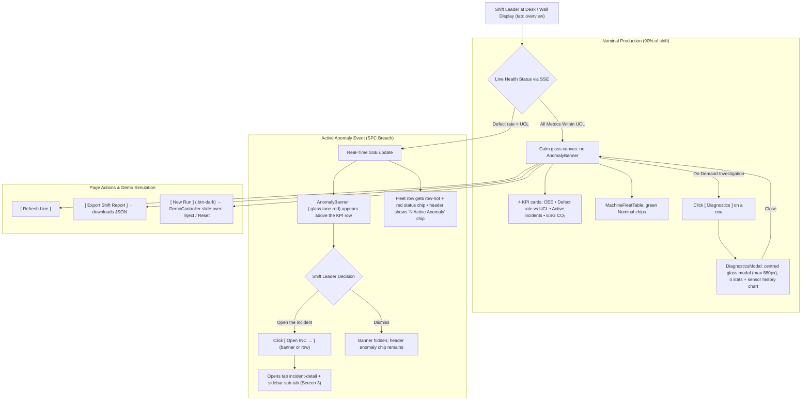

# Screen 1: Line Overview & Machine Fleet

> **Tab:** `overview` (sidebar "Line Overview")  
> **Viewport:** Desktop `1440 × 900 px`  
> **Primary Persona:** Shift Leader (John Tran)  
> **Single Job-to-be-Done (JTBD):** Line Health Supervision & Instant 1-Click Dispatch. *(Not for physical wrenching guides or deep root cause analysis).*  
> **Design Standard:** [`docs/DESIGN.md`](../DESIGN.md) (Lumina Slate liquid glass)  
> **Source:** PR #105 `dashboard_frontend/src/components/views/LineOverviewView.tsx` + `components/overview/*`  
> **Terminology:** Unified **Agent Team** across all pages and documentation.

---

## 1. End-to-End User Flow & UI Workflow

The Line Overview screen serves as the primary operational cockpit for the Shift Leader, balancing calm monitoring with instant anomaly dispatch:



---

## 2. Persona & Context

- **Shift Leader (John Tran):** Manages a 12-operator shift across Cell Line 1. Must ensure high line output (OEE > 90%), zero uncontained scrap escapes, and fast response times to stoppages.
- **Physical Context:** Monitors from a central 27" wall-mounted monitor or supervisor desk 2–3 meters away.
- **Cognitive Requirement:** Must assess cell health in **under 3 seconds** without parsing complex telemetry graphs.

---

## 3. Progressive Disclosure Architecture (3 Tiers)

```
[Tier 1: Glance (1s)]   --> TopHeader "N Active Anomaly" chip + 4 KPI cards
        │
        ▼
[Tier 2: Focus (5s)]    --> AnomalyBanner (Open INC →) + MachineFleetTable row-hot
        │
        ▼
[Tier 3: Deep Dive]     --> DiagnosticsModal (4 stats + sensor history chart)
```

### Page Header
- **Title:** `Cell Line 1 Overview` (`.page-title`, Geist 1.85rem / 700)
- **Subtitle:** `Real-time machine fleet telemetry, statistical process control (SPC), and instant dispatch` (muted, 0.9rem)
- **Buttons:**
  - `[ Refresh Line ]` (`.btn`)
  - `[ Export Shift Report ]` (`.btn`, downloads JSON)
  - `[ New Run ]` (`.btn-dark`, opens DemoController)

### Tier 1: Glance (1-Second Reception)
- **TopHeader chip:** red `.chip` with pulsing `.dot`: `N Active Anomaly` (only while an incident is open).
- **4 KPI cards** (`.glass.kpi-card`, grid 4 columns → 2 below 1280px → 1 below 720px):
  1. **OEE** (`OeeCard`): eyebrow + delta chip, mono KPI, 3 thin 6px ink bars for availability, performance, quality.
  2. **Defect rate vs UCL** (`DefectRateCard`): rate vs UCL, ratio chip, 6px SPC bar coloured by tone with a UCL tick mark.
  3. **Active incidents** (`ActiveIncidentsCard`): count by severity, SLA countdown chip, inset incident chip with a `P1 Critical` / `P2 Minor` chip, target MTTR `< 15 mins`.
  4. **ESG CO₂** (`EsgCard`): `.tone-green-soft` card, CO₂e avoided, energy/material split bar (`#12a150` / `#7dd3a8`), scrap and kWh, link `Open Knowledge Base →`.

### Tier 2: Focus (5-Second Reception)
- **AnomalyBanner** (`.glass.tone-red`; shown only while an incident is open; dismissible):
  - 40px red-outlined icon tile, `.anomaly-title` (e.g. `CNC-02: Tool T07 Flank Wear`), uppercase `.sev-chip`, pulsing status chip.
  - Mono SPC meta in `#9f1d22` (e.g. `Defect rate 1.42% · UCL 0.25%`).
  - Actions: `[ Open INC → ]` (`.btn-dark`) and a `Dismiss` link.
- **MachineFleetTable** (`.glass` card + `.fleet-table`):
  - Toolbar: `.pill` tabs `Anomaly` / `Nominal` / `All` (default `Anomaly`; active Anomaly pill is solid red) + inset search.
  - Columns: Machine ID · Part Model · Vibration RMS · Spindle Load · Status chip (with dot) · Incident ID (red underlined link) · Actions.
  - Actions: `[ OPEN INC → ]` (`.btn-dark .btn-sm`) on rows with an incident, otherwise `[ Diagnostics ]` (`.btn-sm`).
  - Critical rows use `row-hot` (pink background + 3px red inset left edge).

### Tier 3: Deep Dive (On-Demand Modal)
- **DiagnosticsModal:** centred glass modal (max-width 880px) opened from `[ Diagnostics ]`:
  - 4 stats.
  - Sensor history chart (hand-built SVG).

---

## 4. Dual Scenarios Adaptation Note

Kaizen Agent supports two distinct industrial scenarios out of the box (selected in the DemoController):

1. **Scenario 1: CNC Tool Wear (Default)**
   - Machine: `CNC-02` (Bay 4, Turning Lathe) • Tool: `T07 (Rough Turn)` • Workpiece: `Housing-B42` (FC250 Iron).
   - Telemetry Anomaly: Spindle vibration surges to `2.84 mm/s` (Baseline `1.50 mm/s`, Warning `1.95 mm/s`).
   - Defect: Surface roughness Ra > 3.8 µm, vertical scratch rate `1.42%`.
2. **Scenario 2: Plastic Injection Molding Material Moisture (`IM-05`)**
   - Machine: `IM-05` (Bay 5, Injection Molding) • Mold Cavity: `MOLD-03` (Cavity #3).
   - Telemetry Anomaly: Material dryer dew point surges from `-40 °C` to `-18 °C`.
   - Defect: Short fill & sink marks on Cavity #3 (`8.1%` defect rate).
   - *UI Behavior:* MachineFleetTable shows `IM-05` as a `row-hot` row with a red status chip, and the AnomalyBanner names the IM-05 defect.

---

## 5. Low-Fi ASCII Wireframe: Page Content Slot (Desktop 1440px)

```text
 ╭──────────────────────╮  ╭─────────────────────────────╮            (●) 1 Active Anomaly  ╭ ⌘K Search telemetry or jump to… ╮ (♪) John Tran (JT)
 │ [K] KAIZEN AGENT     │  │ Cell Line 1 / Line Overview │                                  ╰──────────────────────────────────╯
 │ ╭ Cell Line 1:     ╮ │  ╰─────────────────────────────╯
 │ ╰ Turning & Milling╯ │
 │                      │  Cell Line 1 Overview                                         [ Refresh Line ] [ Export Shift Report ] [■ New Run ■]
 │ OPERATIONAL LOOP     │  Real-time machine fleet telemetry, statistical process control (SPC), and instant dispatch
 │ ▣ Line Overview  *   │
 │ ⚠ Incidents          │  ╭── AnomalyBanner (.glass.tone-red) ─────────────────────────────────────────────────────────────────────────╮
 │   │ #INC-… ×         │  │ ╭──╮ CNC-02: Tool T07 Flank Wear  [CRITICAL]  (●) Investigating                                              │
 │                      │  │ │⚠ │ Defect rate 1.42% · UCL 0.25% · Housing-B42                        [■ Open INC → ■]   Dismiss       │
 │ KNOWLEDGE LOOP       │  │ ╰──╯                                                                                                         │
 │ ▶ Tech Walkthroughs  │  ╰────────────────────────────────────────────────────────────────────────────────────────────────────────────╯
 │ ▤ Knowledge Base     │
 │ ☰ SOP Change Log     │  ╭─ OEE ───────────────╮ ╭─ DEFECT RATE VS UCL ╮ ╭─ ACTIVE INCIDENTS ──╮ ╭─ ESG CO₂ (tone-green-soft)╮
 │                      │  │ OEE        [-2.1%]  │ │ DEFECT RATE  [5.6×] │ │ 1 CRITICAL  [SLA ⏱] │ │ CO₂e avoided              │
 │                      │  │ 88.4 %              │ │ 1.42 %              │ │ ╭ #INC-…  [P1 Crit] ╮│ │ {n} kg                    │
 │                      │  │ Avail  ▬▬▬▬▬▬▬▬▬▭   │ │ ▬▬▬▬▬▬▬▬▬▬▬▬|▬▬▬▬   │ │ ╰───────────────────╯│ │ ▬▬▬▬▬▬▬▬▭▭ energy/material│
 │                      │  │ Perf   ▬▬▬▬▬▬▬▬▭▭   │ │            UCL tick │ │ Target MTTR < 15 mins│ │ Open Knowledge Base →     │
 │                      │  │ Qual   ▬▬▬▬▬▬▬▭▭▭   │ │                     │ │                      │ │                           │
 │                      │  ╰─────────────────────╯ ╰─────────────────────╯ ╰──────────────────────╯ ╰───────────────────────────╯
 │                      │
 │                      │  ╭── MachineFleetTable (.glass) ──────────────────────────────────────────────────────────────────────────────╮
 │                      │  │ (■Anomaly■) ( Nominal ) ( All )                                     ╭ 🔍 Search machine or part…       ╮ │
 │                      │  │                                                                     ╰──────────────────────────────────╯ │
 │                      │  │ MACHINE ID   PART MODEL    VIBRATION RMS   SPINDLE LOAD   STATUS        INCIDENT ID    ACTIONS           │
 │                      │  │▌CNC-02       Housing-B42   2.84 mm/s       78.6 %         (●) Critical  INC-…          [■ OPEN INC → ■]  │ <- row-hot
 │                      │  │ CNC-01       Shaft-A12     1.46 mm/s       42.1 %         (●) Nominal   —              [ Diagnostics ]   │
 │ (●) 24 ms  [Shift A] │  ╰────────────────────────────────────────────────────────────────────────────────────────────────────────────╯
 │ (JT) John Tran       │
 ╰──────────────────────╯           Tier 3: [ Diagnostics ] → DiagnosticsModal (centred glass, max 880px): 4 stats + sensor history chart
```

---

## 6. UI States & Edge Cases

| State | UI Behavior |
|---|---|
| **Nominal** | No AnomalyBanner; no header anomaly chip. Fleet table rows show green Nominal chips; no `row-hot` rows. |
| **Anomaly (SPC breach)** | AnomalyBanner appears above the KPI row; header shows red `N Active Anomaly` chip; the affected machine row gets `row-hot` and `[ OPEN INC → ]`. |
| **Banner dismissed** | AnomalyBanner hidden for the current incident; header chip and `row-hot` row remain so the incident stays discoverable. |
| **Backend offline** | Sidebar footer latency dot turns red; last fetched values stay visible. |
| **Dual scenario switch** | When Scenario 2 is injected from the DemoController, the fleet table and banner reflect `IM-05` instead of `CNC-02`. |
