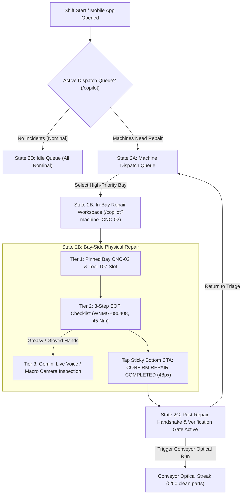

# Screen 2: Technician Floor Copilot & Machine Queue

> **Route:** `/copilot` (Maintenance Dispatch Queue) & `/copilot?machine=CNC-02` (In-Bay Repair Workspace)  
> **Viewport:** Mobile `390 × 844 px` (iPhone 14 / Industrial Handheld Terminal)  
> **Primary Persona:** Frontline Maintenance Technician (Tuan Le)  
> **Single Job-to-be-Done (JTBD):** Bay-Side Machine Triage, Guided Physical Repair Execution, and Completion Sign-Off. *(Zero SPC distraction, zero administrative paperwork).*  
> **Design Standard:** [`docs/DESIGN.md`](../DESIGN.md) (shadcn/ui Light Mode)

---

## 1. End-to-End User Flow & Technician Journey

The mobile floor copilot accompanies the technician throughout the entire physical intervention lifecycle:



---

## 2. Progressive Disclosure Architecture (3 Tiers per Screen State)

### 2.1. State 2A: Machine Dispatch Queue (`/copilot`)
- **Tier 1: Glance (1s):** Header with active shift badge (`Shift A • 06:00 - 14:00`), technician identity (`Tuan Le // TECH-08`), and active queue counter (`1 Critical Anomaly | 1 Preventive Maintenance`).
- **Tier 2: Focus (5s):** Prioritized machine dispatch cards:
  - **Card 1 (Critical Anomaly):** Machine `CNC-02 (Bay 4)`, Tool `T07`, Flank wear symptom (`VB > 0.35mm`, SPC defect rate `1.42%`), elapsed dispatch time (`8m ago`). Primary Action CTA: `[ START REPAIR (BAY 4) → ]`.
  - **Card 2 (Preventive Maintenance):** Machine `CNC-04 (Bay 2)`, Tool `T03` life at 85%, scheduled insert indexing. Secondary Action CTA: `[ Accept Task ]`.
- **Tier 3: Deep Dive (On-Demand):** Filter tabs (`All (2)`, `Critical (1)`, `Preventive (1)`), quick bay status summary.

### 2.2. State 2B: In-Bay Repair Workspace (`/copilot?machine=CNC-02`)
- **Tier 1: Glance (1s):**
  - Top Pinned Header: `[< Back to Queue]` button + Pinned Bay `CNC-02 // Bay 4` + Status badge `rounded-full` (`(!) REPAIR IN PROGRESS`).
  - Target Confirmation: Workpiece `Housing-B42` and Tool Turret Slot `Tool T07 (Rough Turn)`.
- **Tier 2: Focus (5s):**
  - **Target Specs Card (`rounded-xl`):**
    - Defect Symptom: `Flank Wear (VB > 0.35mm)`
    - Replacement Insert: `WNMG-080408` (`font-mono`) — Storage Bin: `A-14` (`font-mono`)
    - Calibrated Tightening Torque: `45 Nm` (`font-mono`, Torque Wrench #3)
  - **3-Step Action Checklist (`rounded-xl` Card, Touch Targets ≥ 44 × 44 px, Checkboxes `rounded-sm`):**
    - Step 1: `[x] Power down spindle, engage LOTO lockout & open safety door`
    - Step 2: `[ ] Replace worn insert with WNMG-080408 (Bin A-14)`
    - Step 3: `[ ] Tighten clamp screw with torque wrench to exactly 45 Nm`
  - **Sticky Full-Width Completion CTA (`h-12` / 48px, Solid Slate Dark `#0F172A`, `rounded-md`):**
    - Text: `[ CONFIRM REPAIR COMPLETED ]`
    - Ergonomics: High-contrast touch target designed for gloved thumb operation.
- **Tier 3: Deep Dive (On-Demand / Hands-Free):**
  - **Gemini Live Multimodal Drawer (`<Sheet>`):** Real-time voice visualizer for hands-free queries ("Confirm torque spec for T07") and macro camera validation ("Scan insert seating and screw torque").
  - **Technical Video Reference Modal:** `[ > Watch 30s SOP Video Walkthrough ]`.

### 2.3. State 2C: Post-Repair Handshake & Verification (`/copilot?machine=CNC-02&status=verified_pending`)
- **Tier 1: Glance (1s):** Success checkmark banner `(✓) REPAIR LOGGED SUCCESSFULLY`.
- **Tier 2: Focus (5s):**
  - Intervention Summary: Machine `CNC-02`, Tool `T07`, Insert `WNMG-080408`, Calibrated Torque `45 Nm`, Intervention Duration `6m 40s`.
  - **Optical Verification Gate Preview (`rounded-xl` Card):**
    - Conveyor EOL Camera status: `Initiating 50-Part Clean Streak Run`
    - Progress Bar: `[--------------------------------] 0 / 50 Good Parts (0%)`
    - Strict Rule: `Automatic streak reset on any single defect: ACTIVE`
  - Navigation Actions: `[ < Back to Machine Queue ]` and `[ Monitor Verification (Incident #42) ]`.

### 2.4. State 2D: All Nominal / Idle Queue (`/copilot`)
- **Tier 1: Glance (1s):** Serene green status indicator `(✓) ALL MACHINES NOMINAL`.
- **Tier 2: Focus (5s):** Fleet status card showing all bays operating within statistical control limits (OEE > 90%, zero uncontained defects).

---

## 3. User Stories & Acceptance Criteria

### User Story 2.1: Priority Dispatch Queue Triage (State 2A)
> **As a** Frontline Maintenance Technician opening the copilot on my mobile device,  
> **I want to** see an urgent list of machines requiring immediate physical intervention ranked by severity,  
> **So that** I attend to critical downtime bottlenecks first without needing verbal instructions.

- **Acceptance Criteria:**
  - Navigating to `/copilot` displays all machines needing service in prioritized cards.
  - Urgent SPC anomalies (`CNC-02`) display red `CRITICAL` badges (`rounded-full`), defect symptoms, and one-tap `[ START REPAIR → ]` action.
  - Tapping a machine card navigates immediately to `/copilot?machine=CNC-02`.

### User Story 2.2: Instant Bay & Turret Slot Confirmation (State 2B - Tier 1)
> **As a** Technician walking up to Cell Line 1,  
> **I want to** immediately verify that I am servicing the correct machine bay and turret slot,  
> **So that** I never service the wrong tool holder.

- **Acceptance Criteria:**
  - Pinned header shows `CNC-02 // Bay 4` and `Tool T07`.
  - Machine specs highlight FC250 Cast Iron workpiece and current anomaly status.

### User Story 2.3: 3-Step Guided Checklist with Gloved Ergonomics (State 2B - Tier 2)
> **As a** Maintenance Technician wearing heavy work gloves,  
> **I want to** follow a 3-step physical checklist with exact part numbers and torque values,  
> **So that** I complete the physical repair accurately without searching through 200-page paper binders.

- **Acceptance Criteria:**
  - Checklist item touch targets are at least **44 × 44 px**.
  - Checkboxes use `rounded-sm` (6px) tokens.
  - Part number (`WNMG-080408`), storage bin (`A-14`), and torque specification (`45 Nm`) are highlighted in bold monospaced text (`font-mono`).

### User Story 2.4: Hands-Free Voice & Vision Assistance (State 2B - Tier 3)
> **As a** Technician with grease on my gloves,  
> **I want to** speak to Kaizen via voice or show the tool holder to my mobile camera,  
> **So that** I get hands-free verification that the insert is seated correctly without touching the screen.

- **Acceptance Criteria:**
  - Voice wave indicator reflects real-time Gemini Live WebSocket connection.
  - Camera inspection CTA provides instantaneous audio/visual confirmation ("Insert seated correctly at 45 Nm").

### User Story 2.5: One-Touch Glove-Friendly Sign-Off & Verification Handshake (State 2B -> 2C)
> **As a** Technician who has finished torqueing the insert,  
> **I want to** tap a large sticky button `CONFIRM REPAIR COMPLETED`,  
> **So that** the orchestrator immediately triggers post-repair conveyor verification without extra navigation.

- **Acceptance Criteria:**
  - The sticky button is pinned to the bottom of the viewport with a height of **48 px** (`h-12`).
  - Tapping marks repair completed on the Blackboard and transitions status to `VERIFYING` (Screen 3 & State 2C).
  - Screen transitions to State 2C showing the live 0/50 clean streak verification gate.

---

## 4. Low-Fi ASCII Wireframes (Mobile 390px Viewport)

### Wireframe 2A: Machine Dispatch Queue (`/copilot`)

```text
+---------------------------------------+
| [=] KAIZEN COPILOT        (o) Shift A |  <-- Header: Menu + Shift Indicator
| Technician: Tuan Le (ID: TECH-08)     |
+---------------------------------------+
|                                       |
| ACTIVE DISPATCH QUEUE                 |
| [!] 1 Urgent Line Stop | [*] 1 Maint  |
|                                       |
| FILTERS (rounded-full):               |
| (x) Action Needed (2)  ( ) Completed  |
|                                       |
| === CARD 1: CRITICAL ANOMALY (rounded-xl)
| +-----------------------------------+ |
| | (!) CNC-02 (Bay 4)     [CRITICAL] | |  <-- Destructive pill badge (rounded-full)
| | Anomaly: T07 Flank Wear (VB>0.35) | |
| | Part: Housing-B42 | SPC: 1.42% err| |
| | Elapsed: 8 min ago                | |
| | Dispatched by: John Tran (Lead)   | |
| |                                   | |
| | [ START REPAIR (BAY 4)  -> ]      | |  <-- Primary Solid Slate CTA (rounded-md)
| +-----------------------------------+ |
|                                       |
| === CARD 2: PREVENTIVE TASK (rounded-xl)
| +-----------------------------------+ |
| | (*) CNC-04 (Bay 2)      [PREVENT] | |  <-- Warning pill badge (rounded-full)
| | Task: Index Insert T03 (85% life) | |
| | Part: Gear-G15 | Schedule: Shift A| |
| |                                   | |
| | [ Accept Preventive Task ]        | |  <-- Secondary Outline CTA (rounded-md)
| +-----------------------------------+ |
|                                       |
| === FLEET NOMINAL STATUS ============ |
| (o) CNC-01 (Bay 1): Nominal           |
| (o) CNC-03 (Bay 3): Nominal           |
| (o) CONVEYOR-01:    Nominal           |
+---------------------------------------+
```

---

### Wireframe 2B: In-Bay Active Repair Workspace (`/copilot?machine=CNC-02`)

```text
+---------------------------------------+
| [<] Machine Queue      CNC-02 (Bay 4) |  <-- [<] Navigates back to State 2A
| Status: [ (!) REPAIR IN PROGRESS ]    |  <-- Red Destructive Badge (rounded-full)
+---------------------------------------+
|                                       |
| === TIER 1 (GLANCE): TARGET SPECS === |
| +-- TARGET MACHINE (rounded-xl) ----+ |
| | Machine: CNC-02 (Bay 4 - Lathe)   | |
| | Turret:  Tool T07 - Rough Turn    | |
| | Anomaly: Flank Wear (VB > 0.35mm) | |
| | Part:    Housing-B42 (FC250 Iron) | |
| | Insert:  WNMG-080408 (Bin A-14)   | |  <-- font-mono specs
| | Torque:  45 Nm (Calibrated Wrench)| |  <-- font-mono torque
| +-----------------------------------+ |
|                                       |
| === TIER 2 (FOCUS): 3-STEP SOP =====  |
| (Touch targets >= 44px, Checkboxes rounded-sm)
| +-- SOP-CNC-042 REPAIR STEPS -------+ |
| | [X] Step 1: Stop main spindle,    | |  <-- Large 44px tap target (Checked)
| |     engage LOTO & open door.      | |
| |                                   | |
| | [ ] Step 2: Remove worn insert.   | |  <-- Large 44px tap target
| |     Mount new WNMG-080408         | |      Insert: WNMG-080408
| |     (Storage: Bin A-14)           | |      Bin: A-14
| |                                   | |
| | [ ] Step 3: Use torque wrench,    | |  <-- Large 44px tap target
| |     tighten clamp screw to 45 Nm. | |      Spec: 45 Nm
| +-----------------------------------+ |
|                                       |
| === TIER 3 (DEEP DIVE / HANDS-FREE) = |
| +-- GEMINI LIVE VOICE & VISION -----+ |
| | (((( o )))) Voice Assistant Active| |  <-- Hands-free voice visualizer
| | "Say: 'Insert torqued to 45 Nm'   | |
| |                                   | |
| | [ (o) Voice Mic ] [ [o] Camera ]  | |  <-- Macro camera seat inspection
| +-----------------------------------+ |
| | [>] Watch 30s SOP Video Clip      | |  <-- Procedural video modal
| +-----------------------------------+ |
|                                       |
+---------------------------------------+
| [ CONFIRM REPAIR COMPLETED ]          |  <-- TIER 2: Sticky 48px Glove Button
+---------------------------------------+      Full width (h-12, Slate #0F172A)
```

---

### Wireframe 2C: Post-Repair Handshake & Verification (`/copilot?machine=CNC-02&status=verified_pending`)

```text
+---------------------------------------+
| [V] REPAIR LOGGED         CNC-02      |
+---------------------------------------+
|                                       |
|       ( V )  REPAIR LOGGED!           |  <-- Green success icon & tactile confirmation
|                                       |
| Technician: Tuan Le                   |
| Equipment:  CNC-02 // Bay 4 - Tool T07|
| Replaced:   WNMG-080408 (Bin A-14)    |
| Torque:     45 Nm (Verified)          |
| Duration:   6m 40s                    |
|                                       |
| === CONVEYOR VERIFICATION GATE ====== |
| +-----------------------------------+ |
| | Conveyor Optical Inspection EOL   | |
| | Progress: 0 / 50 Clean Parts (0%) | |  <-- Optical camera begins 50-part count
| | [-------------------------------] | |  <-- Emerald progress bar (rounded-full)
| | Gate Rule: 50 consecutive passed  | |
| | Reset: Resets to 0 on any defect  | |
| +-----------------------------------+ |
|                                       |
| [ < Back to Machine Queue ]           |  <-- Returns to State 2A
| [ Monitor Verification (Screen 3) ]   |  <-- Deep links to /incidents/INC-042
+---------------------------------------+
```

---

### Wireframe 2D: All Nominal / Idle Queue (`/copilot`)

```text
+---------------------------------------+
| [=] KAIZEN COPILOT        (o) Shift A |
| Technician: Tuan Le                   |
+---------------------------------------+
|                                       |
|       ( ~ )  ALL BAYS NOMINAL         |
|                                       |
| No active machine anomalies or        |
| urgent maintenance requests.          |
|                                       |
| +-- PRODUCTION FLEET STATUS --------+ |
| | (o) CNC-01 (Bay 1): Nominal       | |
| | (o) CNC-02 (Bay 4): Nominal       | |
| | (o) CNC-03 (Bay 3): Nominal       | |
| | (o) CNC-04 (Bay 2): Nominal       | |
| | (o) CONVEYOR-01:   Nominal        | |
| +-----------------------------------+ |
|                                       |
| [ (↻) Refresh Fleet Telemetry ]      |
+---------------------------------------+
```

---

## 5. UI States & Edge Cases

| State | UI Behavior |
|---|---|
| **Queue Triage (State 2A)** | Ranked by severity: `CRITICAL` (SPC breach) > `WARNING` (Drift) > `PREVENTIVE` (Scheduled tool life). |
| **Bay In-Progress (State 2B)** | Steps 1–3 can be checked off individually by finger tap or hands-free voice command ("Insert replaced and torqued"). |
| **Gloved / Greasy Hands** | Gemini Live voice assistant responds hands-free without requiring screen taps; camera macro lens verifies insert seat. |
| **Completion Submitted (State 2C)** | Button triggers 500ms tactile feedback, logs repair on the Blackboard, and transitions status to `VERIFYING` (Conveyor streak starts). |
| **Streak Reset on Defect** | If a defect occurs during post-repair conveyor run, notification alerts technician: `"Verification reset: Defect detected on part #39. Inspect bay alignment."` |
| **All Nominal (State 2D)** | Calm technology view; zero red banners; all indicators serene green. |
