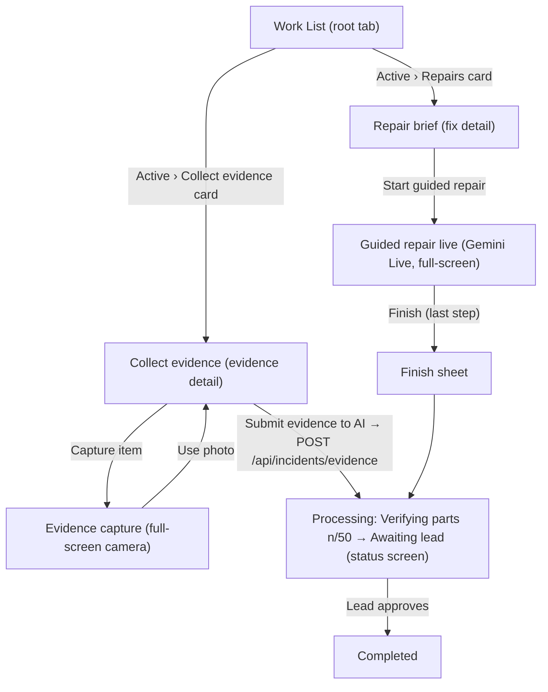

# Screen 2: Technician Mobile App — Work List, Evidence & Guided Repair

> **Viewport:** Mobile `396 × 852 px` device frame (scaled 0.55–1 on a dark host page)  
> **Navigation:** Dock tabs (Work List / Notifications / Settings) + in-memory stack on Work List: `evidence | capture | fix | live | status` (no URL router)  
> **Primary Persona:** Frontline Maintenance Technician (Tuan Le)  
> **Single Job-to-be-Done (JTBD):** Bay-side evidence capture, guided physical repair, and verification hand-off. *(Zero SPC distraction, zero administrative paperwork).*  
> **Design Standard:** [`docs/DESIGN.md`](../DESIGN.md) §4 (Lumina Slate liquid glass — mobile surface)  
> **Terminology:** Unified **Agent Team** across all pages and documentation.

---

## 1. End-to-End Flow



---

## 2. Incident Status → Work-Order Stage

The live incident maps to a work-order stage as below. Demo orders (badge `Demo`) are local only.

| Incident status | Stage |
|---|---|
| `repairing` | fix / active |
| `verifying` | fix / processing |
| `closed` | processing until approved, then completed |
| `dismissed` | evidence / completed |
| `escalated` / `error` | processing |
| everything else (`detecting` … `awaiting_evidence`) | evidence / active |

---

## 3. Screens

### 3.1. Work List (root tab)
- **Tier 1: Glance:** `MobileHeader` (brand "kAIgen", stream status Live / Connecting… / Offline, avatar) + `PageTitle` `Work List`, caption `{n} jobs need you · Bay 4`.
- **Tier 2: Focus:**
  - `SegmentedControl` (size `md`) **Active / Processing / Completed** with counts. Hints: `Jobs waiting on you right now.` / `Submitted — being verified by your lead.` / `Signed off and closed.`
  - Active tab groups under `Eyebrow`: `Collect evidence` and `Repairs`.
  - **WorkOrderCard** (`GlassCard`, 4px stage accent bar: warm = evidence, indigo = fix, blue = processing):
    - **Active:** chips row (`Chip` size `sm`; state chip `Needs evidence` tone `danger` with pulsing StatusDot / `AI analysing` tone `warning` / `Ready to fix` tone `accent`; priority chip P1 `danger` / P2 `warning` / P3 `neutral`; `Live` (`danger`, pulsing) / `Demo` (`neutral`) chip; `createdAt` right) → 64px thumbnail + title + `#id · machine` + summary → evidence cards add `Evidence collected N of M` progress (warm gradient) → footer: type pill (`N shots needed` / `Repair · ~X min`) + `Button` (size `sm`) `Collect` (variant `accent`) or `Open`.
    - **Processing:** `Chip` tone `info` `Verifying parts` / `Awaiting lead` / tone `danger` `Escalated`, mono `Parts verified 12/50` + progress bar, footer `Sign-off by {lead}` with `hourglass_top` + chevron.
    - **Completed:** 48px thumbnail, `Chip` tone `success` `Done`, outcome line, `Finished {time} · machine`.
- **Tier 3:** tap a card → its detail route.

```text
╭──────────────────────────────────────╮
│ 9:41                        ▂▄▆ ▮    │
│ [⚙] kAIgen                      (AV) │
│     (●) Live                         │
│ Work List                            │
│ {n} jobs need you · Bay 4            │
│ ╭──────────────────────────────────╮ │
│ │(█Active 2█)  Processing 1  Compl.│ │  <-- SegmentedControl md (white sliding thumb)
│ ╰──────────────────────────────────╯ │
│ Jobs waiting on you right now.       │
│ COLLECT EVIDENCE                     │  <-- Eyebrow
│ ╭──────────────────────────────────╮ │
│ ▌[NEEDS EVIDENCE][P1][LIVE]   09:42  │  <-- 4px warm accent bar
│ ▌ ╭────╮ Tool T07 flank wear        │ │
│ ▌ │img │ #INC-… · CNC-02            │ │
│ ▌ ╰────╯ summary…                   │ │
│ ▌ Evidence collected 1 of 3 ▬▬▭▭▭▭  │ │
│ ▌ ──────────────────────────────── │ │
│ ▌ (◆ 2 shots needed)      [Collect]│ │  <-- Button size sm, variant accent
│ ╰──────────────────────────────────╯ │
│ REPAIRS                              │
│ ╭──────────────────────────────────╮ │
│ ▌[READY TO FIX][P2][DEMO]          │ │  <-- indigo accent bar
│ ▌ … (◆ Repair · ~X min)     [Open] │ │
│ ╰──────────────────────────────────╯ │
│ ╭──────────────────────────────────╮ │
│ │[█WorkList█]  Notifs(2)  Settings │ │  <-- floating Dock (64px)
│ ╰──────────────────────────────────╯ │
╰──────────────────────────────────────╯
```

### 3.2. Notifications (tab)
- Header `Notifications`, caption `{n} unread` / `You're all caught up`; trailing `Button` (size `sm`, variant `secondary`) `Mark all read`.
- Groups `Today` and `Earlier`, one glass list each. Row: 36px gradient icon tile (red / indigo / blue / green / orange), title (700 if unread), time, body, 8px blue unread dot. Tapping opens the related work order.
- Generated on: Evidence needed, Repair ready, Verifying parts, Parts verified · awaiting lead, Escalated, Dismissed, Approved by {lead}, Sensor alert, Evidence sent.

```text
│ Notifications                 [Mark all read] │
│ {n} unread                                    │
│ TODAY                                         │
│ ╭───────────────────────────────────────────╮ │
│ │ [▣] Evidence needed            09:42   ●  │ │
│ │     body…                                 │ │
│ │ ───────────────────────────────────────── │ │
│ │ [▣] Repair ready               09:30      │ │
│ ╰───────────────────────────────────────────╯ │
│ EARLIER                                       │
│ ╭───────────────────────────────────────────╮ │
│ │ [▣] Approved by {lead}         Yesterday  │ │
│ ╰───────────────────────────────────────────╯ │
```

### 3.3. Settings (tab)
- Profile card: 64px avatar, name, role, mono employee-ID chip, indigo bay chip.
- `Personal information`: Name, Phone, Email, Shift Leader, Shift (read-only).
- `Preferences`: Language select (Tiếng Việt / English); toggles Voice guidance / Push notifications / Haptics (28px icon tiles, `Switch`).
- `Button` variant `secondary` `Sign out` with red text; footer `kAIgen · v1.0`.

```text
│ Settings                                      │
│ ╭───────────────────────────────────────────╮ │
│ │ (AV) Tuan Le · Technician                 │ │
│ │      [TECH-…] [Bay 4]                     │ │
│ ╰───────────────────────────────────────────╯ │
│ PERSONAL INFORMATION                          │
│ │ Name  ……  │ Phone ……  │ Email …… │ Shift … │
│ PREFERENCES                                   │
│ │ [◎] Language            Tiếng Việt ›      │ │
│ │ [◎] Voice guidance            (●━━)       │ │
│ │ [◎] Push notifications        (●━━)       │ │
│ │ [◎] Haptics                   (━━○)       │ │
│ [          Sign out (red text)          ]     │
│              kAIgen · v1.0                    │
```

### 3.4. Evidence Request Detail ("Collect evidence")
- `MobileNavBar`: title, subtitle `#id · machine`, priority chip.
- **AI card** (`AiCard`): badge `AI needs your eyes` / `AI is working`, title, orange `ConfidenceRing` captioned `confidence`, the AI's request in quotes, plain chips for location, suspect tool and `Status: …`.
- `VisualEvidenceCard` ("What the AI saw") and `AiReasonCard` ("Why the AI flagged this").
- `Already collected · N items`: 2-col evidence tiles, source tag Sensor / Inline cam / You.
- `Still needed · N left` (red) or `All done` (green): need-rows (dashed `add_a_photo` icon or captured thumbnail; `Captured hh:mm · tap to retake`; indigo PHOTO/VIDEO chip or green check).
- **Bottom CTA** (`Button` size `lg` 48px, variant `primary`): `Capture N more to submit` / `Submit evidence to AI` / `Sending to AI…` / `AI is re-analysing your photo`. Disabled until ready; posts `POST /api/incidents/evidence`.

```text
│ ( ‹ )     Collect evidence        [P1]  │
│          #INC-… · CNC-02                │
│ ╭─ AiCard (gradient hairline) ────────╮ │
│ │ [✦ AI needs your eyes]       ╭──╮   │ │
│ │ Title…                       │65│   │ │  <-- orange ConfidenceRing
│ │ "Take a close-up of T07…"    ╰──╯   │ │
│ │ (Bay 4) (T07) (Status: …)  conf.    │ │
│ ╰─────────────────────────────────────╯ │
│ ╭ What the AI saw   [Defect confirmed]╮ │
│ ╰─────────────────────────────────────╯ │
│ ╭ ◉ Why the AI flagged this        ⌄ ╮ │
│ ╰─────────────────────────────────────╯ │
│ ALREADY COLLECTED · 2 ITEMS             │
│ ╭────────────╮ ╭────────────╮           │
│ │ ▓▓ Sensor  │ │ ▓▓ Inline  │           │
│ ╰────────────╯ ╰────────────╯           │
│ STILL NEEDED · 1 LEFT                   │
│ │ [⋯📷⋯] Close-up of cutting edge [PHOTO] │
│ [■■■■■ Capture 1 more to submit ■■■■■]  │  <-- disabled until ready
```

### 3.5. Evidence Capture (full-screen camera)
- Top row: `IconButton` (40px, variant `inverse`) close, glass-dark title pill (item label, or `REC 00:0s / 00:10`), torch `IconButton` (yellow `#ffd60a` when on).
- Light glass guide card `How to take this shot` with a numbered guidance list.
- 230px corner-bracket frame with a violet scanline; hint pill `Frame the part inside the box`.
- `PHOTO` / `VIDEO` mode switch; video caps at 10s and keeps one still frame.
- 72px shutter (red inner for video; rounded square while recording).
- Review state: `Check your shot` card with `Retake` (`Button` `secondary`) and **`Use photo`** (`Button` `accent`).
- Without camera access it falls back to a file picker.

```text
╭──────────────────────────────────────╮  (dark camera canvas, white status bar)
│ (×)   [ Close-up of cutting edge ] (ϟ) │
│ ╭ How to take this shot ───────────╮ │
│ │ 1. …  2. …  3. …                 │ │
│ ╰──────────────────────────────────╯ │
│          ┌──            ──┐          │
│          │   (scanline)   │          │  <-- 230px frame
│          └──            ──┘          │
│     ( Frame the part inside the box )│
│          PHOTO  ·  VIDEO             │
│               ( ◯ )                  │  <-- 72px shutter
│ [WorkList] [Notifs] [Settings] (on-dark dock)
╰──────────────────────────────────────╯
```

### 3.6. Repair Brief (work order detail)
- 196px hero image with location and `~N min` `Chip` tone `inverse`, machine and title.
- `What's going on` AI card with a green `AI sure` ring, Root cause (red `report` icon) and Suspect part (`hardware`).
- `AiReasonCard`; collapsible `Work order · Incident Scribe` with `documents.work_order` in monospace.
- `Live readings` stat tiles (Edge telemetry / Last recorded sample, trend icons, red when in alert).
- `Bring with you` parts list with green checks.
- `Repair plan · N steps`: numbered rows `Target X · reference`.
- Orange-tinted safety card: `Lock out the machine before touching it…`.
- `Button` (size `lg`, variant `accent`) **`Start guided repair`** (`play_arrow`).

```text
│ ( ‹ )        Repair brief          [P1] │
│ ╭─ hero 196px ───────────────────────╮  │
│ │ (Bay 4) (~N min)                   │  │
│ │ CNC-02 · Tool T07 flank wear       │  │
│ ╰────────────────────────────────────╯  │
│ ╭ What's going on       ╭──╮ AI sure ╮  │
│ │ ⚠ Root cause …        ╰──╯         │  │
│ │ ⚙ Suspect part …                   │  │
│ ╰────────────────────────────────────╯  │
│ LIVE READINGS                           │
│ [ Vib ↑ ] [ Load ] [ Temp ]             │  <-- stat tiles
│ BRING WITH YOU    ✓ insert  ✓ wrench    │
│ REPAIR PLAN · 3 STEPS                   │
│ 1 … Target X · ref   2 …   3 …          │
│ ╭ ⚠ Lock out the machine before… ╮      │  <-- orange safety card
│ [▶▶▶▶ Start guided repair (accent) ▶▶▶▶]│
```

### 3.7. Guided Repair with Gemini Live (full-screen)
- Rear camera video with vignette.
- Top: `IconButton` (40px, variant `inverse`) back, glass-dark pill with connection state (`Copilot Live` / `Connecting…` / `Copilot offline` / `Demo guide`) + machine, `Chip` tone `inverse` `vi-VN · LIVE/SIM`.
- Light glass step card: `Chip` tone `accent` `i/N`, reference chip (`menu_book`), step title, instruction, 2-cell spec grid **Target** / **Check** (tolerance in accent), step-progress dots; `Step n done` tag.
- Transcript card: `You` line + `Copilot` line (accent spark avatar), voice-wave, `Ask again` `Button` (size `sm`, variant `secondary`). Demo steps show Vietnamese text with an English subline.
- Controls row: glass-dark tool group (torch, undo previous step; 40px `IconButton` `inverse`), **56px accent voice button** (`volume_up` / `volume_off`, pulsing halo when on), `Button` (size `lg`, variant `primary`) `NextStepButton` **`Done · next (k/N)`** → **`Finish`** (`flag`) on the last step.

```text
╭──────────────────────────────────────╮  (camera video + vignette)
│ ( ‹ ) [● Copilot Live · CNC-02] [vi-VN · LIVE]
│ ╭──────────────────────────────────╮ │
│ │ [2/3] [📖 SOP-…]                 │ │
│ │ Replace insert                   │ │
│ │ instruction…                     │ │
│ │ ┌ Target ────┬ Check ──────────┐ │ │
│ │ │ 45 Nm      │ ± tol (accent)  │ │ │
│ │ └────────────┴─────────────────┘ │ │
│ │ ▬ ▬ ▭                            │ │
│ ╰──────────────────────────────────╯ │
│ ╭ You: …                            ╮│
│ │ ✦ Copilot: … ∿∿∿     [Ask again]  ││
│ ╰───────────────────────────────────╯│
│ [(ϟ)(↶)]     ( 🔊 56 )  [Done · next (2/3)]│
╰──────────────────────────────────────╯
```

### 3.8. Finish Sheet (bottom sheet in guided repair)
- Grabber, 52px green success icon, `All N steps done` + subtitle about the inline camera.
- Steps list with green checks and mono targets.
- Textarea `Handover note for your lead (saved on this device)`.
- `Button` (size `lg`, variant `primary`) **`Finish repair`** (live) or `Submit for lead verification` (demo).

```text
│ ╭─────────────── ▬▬▬ ───────────────╮ │  <-- BottomSheet, radius 32
│ │              ( ✓ )                │ │
│ │         All 3 steps done          │ │
│ │ ✓ Step 1 …              Target …  │ │
│ │ ✓ Step 2 …              Target …  │ │
│ │ ┌ Handover note for your lead … ┐ │ │
│ │ └───────────────────────────────┘ │ │
│ │ [■■■■■■■ Finish repair ■■■■■■■■]  │ │
│ ╰───────────────────────────────────╯ │
```

### 3.9. Work Status / Verification (Processing, Completed, Escalated)
- Navbar title: `Completed` / `Escalated` / `Processing`.
- 160px hero with a white `Chip`: Closed (`success`) / Escalated (`danger`) / Verifying parts / Awaiting lead (`info`).
- Red `Incident Notice` card showing `status_reason` (when present).
- Verification card: 64px blue ring with the count, `Verifying parts` / `Parts verified`, `{target−n} more good parts in a row before your lead can approve.`, blue progress bar.
- Completed card (green `task_alt`, outcome, finished time).
- `Impact` 2×2 stats: Scrap avoided parts, Downtime min, CO₂ saved kg, Savings $.
- `Progress` timeline: Root cause → Repair → Product verification (`n consecutive good parts (target 50)`) → Lead sign-off; adds Escalated when relevant; Dismissed shows a single milestone.
- Then VisualEvidenceCard, AiReasonCard, Summary, `Your handover note · On this device only`, and `Reports` with collapsible 8D report and SOP proposal.
- `Button` (size `lg`, variant `secondary`) `Remind {lead}`.

```text
│ ( ‹ )         Processing          [P1] │
│ ╭─ hero 160px ─── [Verifying parts] ─╮ │
│ ╰────────────────────────────────────╯ │
│ ╭────────────────────────────────────╮ │
│ │ ╭────╮ Verifying parts             │ │
│ │ │ 12 │ 38 more good parts in a row │ │  <-- 64px blue ring
│ │ ╰────╯ before your lead can approve.│ │
│ │ ▬▬▬▬▬▭▭▭▭▭▭▭▭▭▭▭                   │ │
│ ╰────────────────────────────────────╯ │
│ IMPACT   [Scrap] [Downtime]            │
│          [CO₂  ] [Savings ]            │
│ PROGRESS                               │
│ ● Root cause                           │
│ ● Repair                               │
│ ◉ Product verification · 12 consecutive good parts (target 50)
│ ○ Lead sign-off                        │
│ REPORTS  ▸ 8D report  ▸ SOP proposal   │
│ [      Remind {lead} (secondary)     ] │
```

---

## 4. UI States & Edge Cases

| State | UI Behavior |
|---|---|
| **No work** | `EmptyState`: `Nothing here. Nice work.` |
| **Stream connecting / offline** | Header status line turns orange `Connecting…` or red `Offline`. |
| **Evidence not ready** | Evidence CTA stays disabled with `Capture N more to submit`. |
| **Evidence submitted** | CTA shows `Sending to AI…` then `AI is re-analysing your photo`; notification `Evidence sent`. |
| **Verifying** | Processing card `Verifying parts` with mono `n/50`; streak resets on any defect (Invariant #3). |
| **Closed, awaiting approval** | Processing chip `Awaiting lead`; footer `Sign-off by {lead}`. |
| **Approved** | Order moves to Completed with `Chip` tone `success` `Done`; notification `Approved by {lead}`. |
| **Escalated / error** | `Chip` tone `danger` `Escalated`; `Incident Notice` card shows `status_reason`. |
| **No camera access** | Evidence capture falls back to a file picker. |
