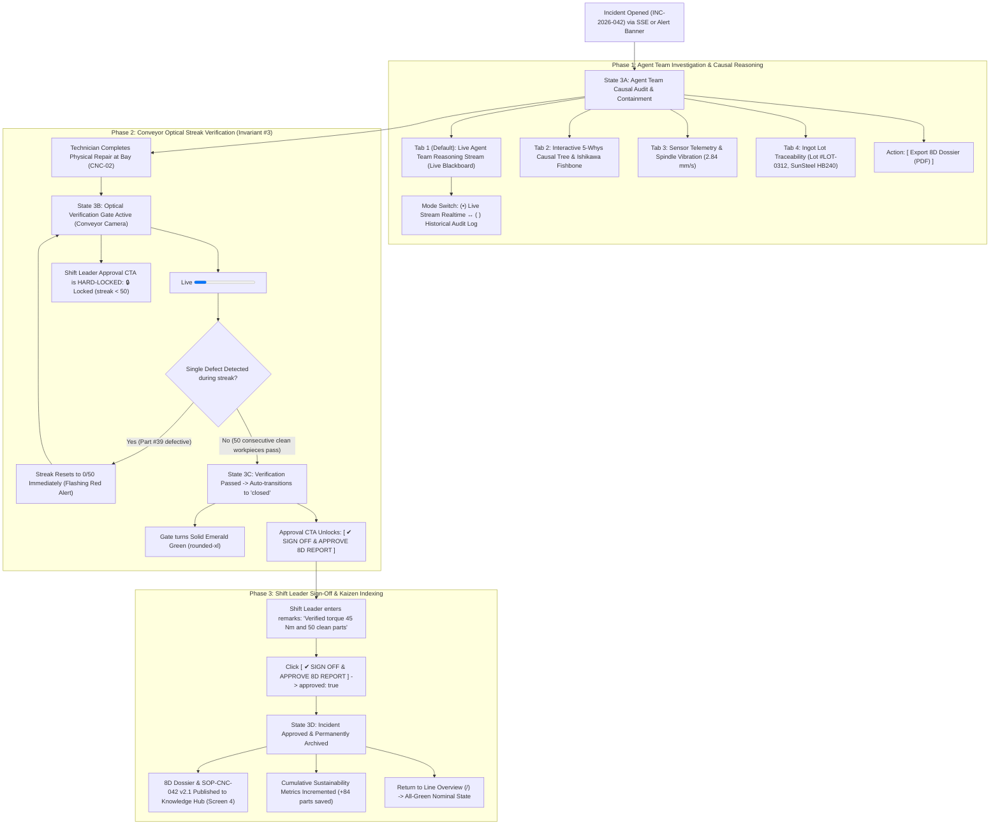

# Screen 3: Incident Workspace & 8D Approval

> **Route:** `/incidents/:id` (e.g. `/incidents/INC-2026-042` or `/incidents/current`)  
> **Viewport:** Desktop `1440 × 900 px` / Tablet Landscape `1024 × 768 px`  
> **Primary Personas:** Shift Leader (John Tran) & Quality Assurance Engineer (Huong Pham)  
> **Single Job-to-be-Done (JTBD):** Product-Evidence Verification & 8D Incident Sign-Off. *(Ensures incidents close exclusively on physical product evidence, enforcing Invariant #3).*  
> **Design Standard:** [`docs/DESIGN.md`](../DESIGN.md) (shadcn/ui Light Mode)  
> **Terminology:** Unified **Agent Team** across all pages and documentation.

---

## 1. End-to-End User Flow & UI Workflow

The Incident Workspace guides cross-functional roles through Agent Team causal investigation, strict product-evidence verification (Invariant #3), and formal 8D closure:



---

## 2. Persona & Context

- **Shift Leader (John Tran):** Authorizes production line resumption. Must verify that finished workpieces are physically conforming before signing off on 8D closure.
- **Quality Assurance Engineer (Huong Pham):** Audits Agent Team findings (Quality Inspector, Traceability, Process Analyst, Root Cause) and standardizes corrective actions into permanent SOPs.
- **Core Governance Rule (Invariant #3):** **Incidents close on product evidence only.** The approval button is hard-disabled until the optical camera verifies `50 consecutive clean workpieces` on the conveyor.

---

## 3. Progressive Disclosure Architecture (3 Tiers)

```
[Tier 1: Glance (1s)]   --> Incident ID & Status Pill + Live 50-Part Optical Streak Progress Bar
        │
        ▼
[Tier 2: Focus (5s)]    --> Live Batch Defect Rate + 8D Executive Summary + Shift Leader Approval CTA (Gated)
        │
        ▼
[Tier 3: Deep Dive]     --> Live Agent Team Reasoning Stream + 5-Whys Tree + Sensor Window + Lot Traceability
```

### Page Header Component (Slot Top)
- **Title:** `Incident Workspace: INC-2026-042` (`text-2xl font-bold tracking-tight`)
- **Subtitle:** `Anomaly Bay: CNC-02 (Turning) • Tool T07 Flank Wear • Optical Streak Verification Active` (`text-sm text-muted-foreground`)
- **Trailing Action Slot:**
  - Status Pill Badge: `[ (o) VERIFYING 38/50 ]` (emerald pulse) or `[ (✓) CLOSED ]`
  - `[ View BigQuery Logs ]` (Ghost button, `rounded-md`)
  - `[ Export 8D Dossier (PDF) ]` (Outline button, `rounded-md`)

### Tier 1: Glance (1-Second Reception)
- **Incident Status Badge:** Incident `INC-2026-042` with status pill badge `rounded-full` (`[ (o) VERIFYING 38/50 ]`).
- **Live Optical Verification Gate Card (`rounded-xl` Card, `bg-slate-50/50`):**
  - Animated Progress Bar (`<Progress>`, `h-3 rounded-full`, emerald fill): `38 / 50 Good Parts (76%)`.
  - Pass/Fail Indicator: Real-time visual pulse per passing workpiece.

### Tier 2: Focus (5-Second Reception)
- **Verification Health Metrics:**
  - Current Batch Defect Rate: `0.00%` (Nominal | UCL: `0.25%`).
  - Target Gate: `50 consecutive passed workpieces`.
  - Strict Rule: `Automatic streak reset on any single defect: ACTIVE`.
- **8D Executive Summary Card (`rounded-xl`):**
  - D1 Team: `J. Tran (Lead), T. Le (Tech), H. Pham (QA)`
  - D2 Problem: `Flank wear on Tool T07 causing Ra 3.8 um roughness`.
  - D3 Containment: `14 defective parts quarantined from Lot B42-03`.
  - D4 Root Cause: `Supplier cast iron lot hardness HB240 (+15% nominal) accelerated tool wear`.
  - D5 Permanent Fix: `Insert replaced with WNMG-080408 (45 Nm) + dynamic feed scaling updated`.
  - D6 Verification: `50/50 clean parts verified on conveyor (0.00% defect rate)`.
  - D7 Prevention: `Revise SOP-CNC-042: add automatic piece counter reminder at 1,900 pcs`.
  - D8 Team Recognition: `Safe production shift handover`.
- **Shift Leader Sign-Off Bar:**
  - Primary Action Button:
    - While `streak < 50`: `[ 🔒 LOCKED — AWAITING 50 GOOD PARTS (38/50) ]` (Disabled, `bg-muted text-muted-foreground`)
    - When `streak >= 50`: `[ ✔ SIGN OFF & APPROVE 8D REPORT ]` (Solid Slate `#0F172A`, `rounded-md`)
  - Gated Behavior: Governed strictly by **Key Invariant #3**.

---

### Tier 3: Deep Dive (On-Demand / Tabs in Left Column 60%)

The left column organizes deep diagnostic evidence into 4 specialized tabs:

#### Tab 1 (Default): `[ ⚡ Agent Team Reasoning Stream ]` (Live Blackboard)
- **Mode Switcher:** `(•) Live Stream Realtime` ↔ `( ) Historical Audit Log (Saved)`
- Displays the structured 4-part contract for each agent in the Agent Team:
  1. **Quality Inspector (Phase A) [Conf: 98%]:**
     - *Finding:* Vertical scratches on Face A, defect rate surged to 1.42% (UCL 0.25%).
     - *Evidence:* 23/300 defective workpieces; edge filter dropped 96.4% normal frames.
     - *Citation:* `Gemma Edge Gateway + CAM-LINE01-EOL`
  2. **Traceability Agent (Phase B) [Conf: 95%]:**
     - *Finding:* 100% of defective workpieces passed through CNC-02 / Tool T07. Material lot ruled out.
     - *Evidence:* CNC-01 and CNC-03 processed the same ingot heat with 0.04% defect rate.
     - *Citation:* `BigQuery Discrete Topology Query`
  3. **Process Analyst (Phase B) [Conf: 80%]:**
     - *Finding:* Spindle vibration surged +35% to 2.84 mm/s starting at 09:30 (10m prior to optical defects).
     - *Evidence:* Spindle vibration 2.84 mm/s vs 1.50 mm/s baseline; motor current +12%.
     - *Citation:* `BigQuery Sensor Window (09:00 - 10:00)`
  4. **Knowledge RAG (Phase B) [Conf: 90%]:**
     - *Finding:* Matches historical tool wear pattern exceeding 2,000 piece lifetime.
     - *Citation:* `CNC Manual p.112 • Maintenance Log T07 • 8D Report 2026-03-12`
  5. **Visual Evidence Probe (Phase B Diagnostic) [Conf: 92%]:**
     - *Finding:* Frontline technician macro photo confirmed flank wear VB = 0.42 mm (> 0.35 mm limit).
     - *Citation:* `Technician Camera Stream via Gemini Live`
  6. **Root Cause Agent (Phase B) [Conf: 87% → 92%]:**
     - *Finding:* Accelerated flank wear on Tool T07 caused by lot hardness HB240 combined with calendar-based tool replacement SOP.
     - *Citation:* `Agent Team Synthesis (5-Whys + Ishikawa 6M)`

#### Tab 2: `[ 5-Whys & Ishikawa ]`
- Sequential hierarchical 5-step deduction tree + 6M classification factors.

#### Tab 3: `[ Sensor Telemetry ]`
- Real-time spindle vibration spectrum (`2.84 mm/s`) and motor load curves from BigQuery.

#### Tab 4: `[ Lot Traceability ]`
- SunSteel shipment certs, heat number `#LOT-2026-0312`, Brinell hardness lab certs (HB240).

---

## 4. Low-Fi ASCII Wireframe: Incident Workspace (Desktop 1440px)

```text
+-----------------------+--------------------------------------------------------------------------------------------------------------------------------+
|  KAIZEN AGENT         | Cell Line 1 / Incidents / INC-2026-042     [ (o) VERIFYING 38/50 ]  [ Scenario: CNC Tool Wear v ]  [⏱ 18.2s]    [John Tran (Lead) v]  |
|  Cell Line 1: Turning | <-- TOP HEADER BAR (h-14) ----------------------------------------------------------------------------------------------------+ |
+-----------------------+                                                                                                                                |
|                       | +-- PAGE HEADER (<div class="flex items-center justify-between pb-4 border-b">) ---------------------------------------------+ |
|  OPERATIONAL LOOP     | | Incident Workspace: INC-2026-042                                                     [ BigQuery Logs ] [ Export 8D Dossier ] | |
|  [#] Line Overview    | | Bay 4 (CNC-02) • Tool T07 Flank Wear • Live Agent Team Reasoning & Optical Streak Active                                   | |
|  [T] Tech Copilot     | +----------------------------------------------------------------------------------------------------------------------------+ |
|  [!] Incidents (1) *  |                                                                                                                                |
|                       | === TIER 1 (GLANCE): LIVE OPTICAL VERIFICATION GATE (rounded-xl) ============================================================ |
|  KNOWLEDGE LOOP       | +----------------------------------------------------------------------------------------------------------------------------+ |
|  [?] Knowledge & ESG  | | Verification Gate: Conveyor Optical Inspection Station (Workpiece: Housing-B42)                                            | |
|  [@] SOP Change Log   | | Progress: [====================================----------------] 38 / 50 Good Parts (76%)                                   | |
|                       | | Batch Defect Rate: 0.00% (Nominal) | Gate Rule: 50 consecutive clean parts | Automatic Reset on Defect: ACTIVE             | |
|                       | +----------------------------------------------------------------------------------------------------------------------------+ |
|                       |                                                                                                                                |
|                       | === TIER 3 (DEEP DIVE): AGENT TEAM REASONING (60%) ============  === TIER 2 (FOCUS): 8D REPORT SIGN-OFF (40%) ============= |
|                       | +-------------------------------------------------------------+  +---------------------------------------------------------+ |
|                       | | Tabs: [ ⚡ Agent Stream* ] [ 5-Whys ] [ Telemetry ] [ Lot ]   |  | Incident: INC-2026-042 | Equipment: CNC-02 / Tool T07   | |
|                       | | Mode: (•) Live Stream Realtime   ( ) Historical Audit Log   |  | Severity: Major | Workpiece: Housing-B42 (FC250)        | |
|                       | |-------------------------------------------------------------|  |---------------------------------------------------------| |
|                       | | [09:40] 🔍 QUALITY INSPECTOR AGENT              [Conf: 98%] |  | D1 Team: J. Tran (Lead), T. Le (Tech), H. Pham (QA)     | |
|                       | | • Finding: Surface vertical scratch, defect rate 1.42%>UCL  |  | D2 Problem: T07 flank wear causing Ra 3.8 um roughness  | |
|                       | | • Evidence: 23/300 defective parts; edge filter dropped 96% |  | D3 Containment: Quarantined 14 pieces from Lot B42-03   | |
|                       | | • Source: Gemma Edge Gateway + CAM-LINE01-EOL               |  | D4 Root Cause: Lot hardness HB240 (+15%) accelerated wear| |
|                       | |-------------------------------------------------------------|  | D5 Corrective: WNMG-080408 insert, torque 45 Nm (Bin A14)| |
|                       | | [09:41] 🔄 TRACEABILITY AGENT                   [Conf: 95%] |  | D6 Verification: 38/50 parts passed (Target: 50 streak) | |
|                       | | • Finding: 100% defective parts from CNC-02 / Tool T07.     |  | D7 Prevention: Revise SOP-CNC-042 (piece count counter) | |
|                       | | • Evidence: CNC-01/03 same raw lot with nominal 0.04% defect|  | D8 Recognition: Safe shift handover                     | |
|                       | | • Source: BigQuery Discrete Topology Query                  |  +---------------------------------------------------------+ |
|                       | |-------------------------------------------------------------|  | SHIFT LEADER SIGN-OFF BAR (Invariant #3)                | |
|                       | | [09:42] 📊 PROCESS ANALYST AGENT                [Conf: 80%] |  | Remarks: [ Verified torque 45 Nm and 50 clean parts   ] | |
|                       | | • Finding: Spindle vibration surged +35% starting at 09:30. |  |                                                         | |
|                       | | • Evidence: Vibration 2.84 mm/s (Base: 1.50 mm/s); Curr +12%|  | [ 🔒 LOCKED — AWAITING 50 GOOD PARTS (38/50) ]          | |
|                       | | • Source: BigQuery Sensor Window (09:00 - 10:00)            |  |   *(Unlocks into solid Slate button at 50/50 passed)    | |
|                       | |-------------------------------------------------------------|  +---------------------------------------------------------+ |
|                       | | [09:42] 📖 KNOWLEDGE RAG AGENT                  [Conf: 90%] |                                                              |
|                       | | • Finding: Matches tool wear pattern > 2,000 pcs lifetime.  |                                                              |
|                       | | • Source: CNC Manual p.112 • Maint Log T07 • 8D 2026-03-12  |                                                              |
|                       | |-------------------------------------------------------------|                                                              |
|                       | | [09:43] 🧠 ROOT CAUSE AGENT (RCA)               [Conf: 87%] |                                                              |
|                       | | • Finding: Tool T07 worn out due to calendar-based schedule |                                                              |
|                       | |   lacking piece counter and uncompensated hardness HB240.   |                                                              |
|                       | | • Synthesis: 5-Whys deduction complete • Ready for repair.  |                                                              |
|                       | +-------------------------------------------------------------+                                                              |
|-----------------------|                                                                                                                              |
| (o) Live Connected    |                                                                                                                              |
| Shift A (06:00-14:00) |                                                                                                                              |
| John Tran (Lead)      |                                                                                                                              |
+-----------------------+--------------------------------------------------------------------------------------------------------------------------------+
  ^--- PERSISTENT LEFT SIDEBAR                               ^--- PAGE CONTENT SLOT (<main class="p-6">)
```

---

## 5. UI States & Edge Cases

| State | UI Behavior |
|---|---|
| **Verifying (`streak < 50`)** | Live progress bar shows emerald progression; Approve button is hard-disabled with tooltip: `"Locked by Invariant #3: Requires 50 consecutive clean parts"`. |
| **Defect during Verification** | Progress bar flashes red and resets to `0 / 50` immediately. Notification banner alerts: `"Streak reset: Defect detected on part #39."` |
| **Streak Achieved (`50 / 50`)** | Gate turns solid green; incident status automatically updates to `closed`; Approve button unlocks into solid primary Slate (`#0F172A`) reading `[ ✔ SIGN OFF & APPROVE 8D REPORT ]`. |
| **Shift Leader Signed Off** | Shift Leader signs off; status transitions to `approved: true`; 8D Report is permanently locked and synced to the Kaizen Knowledge Hub. |
| **Historical Mode** | Clicking `( ) Historical Audit Log` allows browsing past closed incidents with preserved Agent Team reasoning timeline and inspection certificates. |
