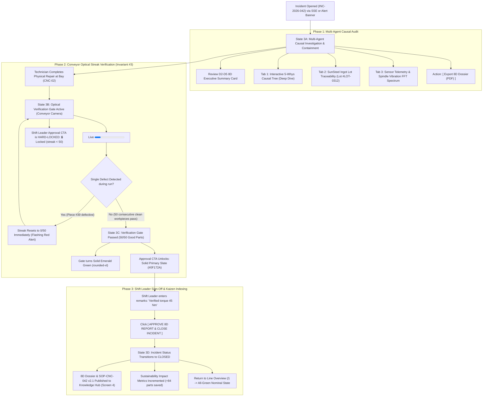

# Screen 3: Incident Workspace & 8D Approval

> **Route:** `/incidents/:id` (e.g. `/incidents/INC-2026-042`)  
> **Viewport:** Desktop `1440 × 900 px` / Tablet Landscape `1024 × 768 px`  
> **Primary Personas:** Shift Leader (John Tran) & Quality Assurance Engineer (Huong Pham)  
> **Single Job-to-be-Done (JTBD):** Product-Evidence Verification & 8D Incident Sign-Off. *(Ensures incidents close exclusively on physical product evidence, enforcing Invariant #3).*  
> **Design Standard:** [`docs/DESIGN.md`](../DESIGN.md) (shadcn/ui Light Mode)

---

## 1. End-to-End User Flow & UI Workflow

The Incident Workspace guides cross-functional roles through investigation, strict product-evidence verification (Invariant #3), and formal 8D closure:



---

## 2. Persona & Context

- **Shift Leader (John Tran):** Authorizes production line resumption. Must verify that finished workpieces are physically conforming before approving incident closure.
- **Quality Assurance Engineer (Huong Pham):** Audits multi-agent findings (Quality Inspector, Traceability, Process Analyst, Root Cause) and standardizes corrective actions into permanent SOPs.
- **Core Governance Rule (Invariant #3):** **Incidents close on product evidence only.** The approval button is hard-disabled until the optical camera verifies `50 consecutive clean workpieces` on the conveyor.

---

## 3. Progressive Disclosure Architecture (3 Tiers)

```
[Tier 1: Glance (1s)]   --> Incident ID & Status Pill + Live 50-Part Optical Streak Progress Bar
        │
        ▼
[Tier 2: Focus (5s)]    --> Live Batch Defect Rate + 8D Executive Summary + Shift Leader Approval CTA (Gated)
        │
        ▼
[Tier 3: Deep Dive]     --> 5-Whys Causal Tree Tab + Ingot Lot Traceability Tab + Spindle Vibration FFT Tab
```

### Page Header Component (Slot Top)
- **Title:** `Incident Workspace: INC-2026-042` (`text-2xl font-bold tracking-tight`)
- **Subtitle:** `Anomaly Bay: CNC-02 (Turning) • Tool T07 Flank Wear • Optical Streak Verification Active` (`text-sm text-muted-foreground`)
- **Trailing Action Slot:**
  - Status Pill Badge: `[ (o) VERIFYING 38/50 ]` (Secondary badge, emerald pulse)
  - `[ View BigQuery Logs ]` (Ghost button, `rounded-md`)
  - `[ Export 8D Dossier (PDF) ]` (Outline button, `rounded-md`)

### Tier 1: Glance (1-Second Reception)
- **Incident Status Badge:** Incident `INC-2026-042` with status pill badge `rounded-full` (`[ (o) VERIFYING 38/50 ]`).
- **Live Optical Verification Gate Card (`rounded-xl` Card, `bg-slate-50/50`):**
  - Animated Progress Bar (`<Progress>`, `h-3 rounded-full`, emerald fill): `38 / 50 Good Parts (76%)`.
  - Pass/Fail Indicator: Real-time visual pulse per passing workpiece.

### Tier 2: Focus (5-Second Reception)
- **Verification Health Metrics:**
  - Current Batch Defect Rate: `0.00%` (Nominal | UCL: `0.25%`).
  - Target Gate: `50 consecutive passed workpieces`.
  - Strict Rule: `Automatic streak reset on any single defect: ACTIVE`.
- **8D Executive Summary Card (`rounded-xl`):**
  - D2 Problem: `Flank wear on Tool T07 causing Ra 3.8 um roughness`.
  - D3 Containment: `14 defective parts quarantined from Lot B42-03`.
  - D4 Root Cause: `Supplier cast iron lot hardness HB240 (+15% nominal) accelerated tool wear`.
  - D5 Permanent Fix: `Insert replaced with WNMG-080408 (45 Nm) + dynamic feed scaling updated`.
- **Shift Leader Sign-Off Bar:**
  - Primary Action Button: `[ APPROVE 8D REPORT & CLOSE INCIDENT ]`
  - Gated Behavior: **Disabled** with lock indicator while `streak < 50`. Turns solid Slate dark (`#0F172A`) once `streak >= 50`.

### Tier 3: Deep Dive (On-Demand / Tabs & Drawers)
- **Interactive Multi-Agent Tabs (`rounded-xl` Card):**
  - **Tab 1: 5-Whys Root Cause Tree:** Interactive hierarchical causal nodes from surface roughness down to feed compensation rule omission.
  - **Tab 2: Ingot Lot Traceability:** Supplier SunSteel shipment date, heat number `#LOT-2026-0312`, Brinell hardness lab certs.
  - **Tab 3: Telemetry Analysis:** Spindle vibration FFT frequency spectrum, bearing load curves from BigQuery.
  - **Action: Export 8D Dossier:** One-click download of formal 8D report in PDF/JSON for customer quality audits.

---

## 4. User Stories & Acceptance Criteria

### User Story 3.1: Live Optical Streak Verification Gate (Tier 1 & Invariant #3)
> **As a** Shift Leader or QA Engineer,  
> **I want to** observe the real-time 50-consecutive-good-part streak bar as parts pass the conveyor optical camera,  
> **So that** line closure is grounded entirely on physical product evidence.

- **Acceptance Criteria:**
  - The `<Progress>` bar increments live via SSE as each workpiece clears the conveyor camera.
  - Current streak and percentage are displayed clearly (`38 / 50 parts`, 76%).
  - If a single defect is detected during the verification run, the streak counter resets to `0 / 50` immediately, and an audible/visual alert is triggered.

### User Story 3.2: 8D Summary & Gated Approval Sign-Off (Tier 2)
> **As a** Shift Leader,  
> **I want to** review the executive 8D summary and sign off on incident closure once the 50-part gate passes,  
> **So that** the incident is closed cleanly without paperwork bottlenecks while preserving standard work compliance.

- **Acceptance Criteria:**
  - The `[ Approve 8D Report & Close Incident ]` button remains strictly **disabled** until `verification_count >= 50`.
  - Once `50 / 50` parts pass, the button automatically unlocks into an active primary solid button (`rounded-md`).
  - Clicking approves the incident, changes state to `closed`, and exports the permanent fix into the Knowledge Hub.

### User Story 3.3: Multi-Agent Deep-Dive Causal Tabs (Tier 3)
> **As a** Quality Assurance Engineer,  
> **I want to** click through specialized tabs to inspect the 5-Whys tree, raw ingot traceability lot, and sensor telemetry,  
> **So that** I have complete auditability over the entire causal investigation.

- **Acceptance Criteria:**
  - The left column organizes findings into tabs: `[ 5-Whys Tree ]`, `[ Sensor Telemetry ]`, `[ Traceability & Supplier Lot ]`.
  - Switching tabs preserves context and does not disrupt the live verification counter.

---

## 5. Low-Fi ASCII Wireframe: Page Content Slot (with Persistent Left Sidebar)

> **Context:** Mounted within the Desktop Base Shell (`docs/wireframes/00_base_layout.md`). The persistent Left Sidebar provides navigation, while the right pane focuses strictly on Incident Workspace & 8D Approval content.

```text
+-----------------------+------------------------------------------------------------------------------------------+
|  KAIZEN AGENT         |  Cell Line 1  /  Incidents  /  INC-2026-042    Badge: [ (o) VERIFYING 38/50 ]  [User v]  |
|  Cell Line 1: Turning |  <-- TOP HEADER BAR (h-14) ------------------------------------------------------------+ |
+-----------------------+                                                                                          |
|                       |  +-- PAGE HEADER (<div class="flex items-center justify-between pb-4 border-b">) ------+  |
|  OPERATIONAL LOOP     |  |  Incident Workspace: INC-2026-042              [ BigQuery Logs ] [ Export 8D (PDF) ]|  |
|  [#] Line Overview    |  |  Bay 4 (CNC-02) • Tool T07 Flank Wear • Optical Streak Verification Active           |  |
|  [T] Tech Copilot     |  +------------------------------------------------------------------------------------+  |
|  [!] Incidents (1) *  |                                                                                          |
|                       |  === TIER 1 (GLANCE): LIVE OPTICAL VERIFICATION GATE (rounded-xl) =====================  |
|  KNOWLEDGE LOOP       |  +------------------------------------------------------------------------------------+  |
|  [?] Knowledge & ESG  |  | Verification Gate: Conveyor Optical Inspection (Workpiece: Housing-B42)            |  |
|  [@] SOP Change Log   |  | Progress: [====================================----------------] 38 / 50 Good (76%) |  |
|                       |  | Batch Defect Rate: 0.00% (Nominal) | Gate: 50 consecutive passed | Reset on Defect |  |
|                       |  +------------------------------------------------------------------------------------+  |
|                       |                                                                                          |
|                       |  === TIER 3 (DEEP DIVE): SYNTHESIS (60%) ==  === TIER 2 (FOCUS): 8D SIGN-OFF (40%) ===  |
|                       |  +----------------------------------------+  +----------------------------------------+  |
|                       |  | Tabs: [ 5-Whys* ] [ Telemetry ] [ Lot ]|  | Incident: INC-042 | Severity: Major    |  |
|                       |  |                                        |  | D1 Team: J. Tran, T. Le, H. Pham       |  |
|                       |  | (1) Why: Surface roughness Ra 3.8 um?  |  | D2 Problem: T07 flank wear -> 1.42% err|  |
|                       |  |     --> Tool T07 insert edge worn out  |  | D3 Containment: Quarantined 14 pieces  |  |
|                       |  | (2) Why: Did tool wear accelerate?     |  | D4 Root Cause: Lot hardness HB240(+15%)|  |
|                       |  |     --> Spindle vibration rose to 2.84g|  | D5 Corrective: WNMG-080408, 45 Nm      |  |
|                       |  | (3) Why: Vibration rose during cut?    |  | D6 Verification: 38/50 parts passed    |  |
|                       |  |     --> Cutting resistance up 32%      |  | D7 Prevention: Revise SOP-CNC-042 table|  |
|                       |  | (4) Why: Cutting resistance rose?      |  +----------------------------------------+  |
|                       |  |     --> Lot #LOT-0312 hardness HB240   |  | SHIFT LEADER APPROVAL SIGN-OFF         |  |
|                       |  | (5) Root Cause: Feed rule lacked       |  | Remarks: [ Verified torque 45 Nm.    ] |  |
|                       |  |     dynamic hardness compensation      |  | [🔒 APPROVE 8D & CLOSE INCIDENT ]      |  |
|                       |  |                                        |  |   *(Unlocks at 50/50 clean parts)      |  |
|                       |  +----------------------------------------+  +----------------------------------------+  |
|-----------------------|                                                                                          |
| (o) Live Connected    |                                                                                          |
| Shift A (06:00-14:00) |                                                                                          |
| John Tran (Lead)      |                                                                                          |
+-----------------------+------------------------------------------------------------------------------------------+
  ^--- PERSISTENT LEFT SIDEBAR                               ^--- PAGE CONTENT SLOT (<main class="p-6">)

```

---

## 6. UI States & Edge Cases

| State | UI Behavior |
|---|---|
| **Verifying (`streak < 50`)** | Verification progress bar shows emerald progression; Approve button is disabled with tooltip: `"Locked: Requires 50 consecutive clean parts"`. |
| **Defect during Verification** | Progress bar flashes red and resets to `0 / 50`. Notification banner warns: `"Streak reset: Defect detected on piece #39"`. |
| **Streak Achieved (`50 / 50`)** | Gate turns solid green; badge updates to `VERIFIED (50/50)`; Approve button activates with solid high-contrast Slate styling. |
| **Approved & Closed** | Status changes to `CLOSED`; 8D Report is permanently locked and synced to the Kaizen Knowledge Hub. |
