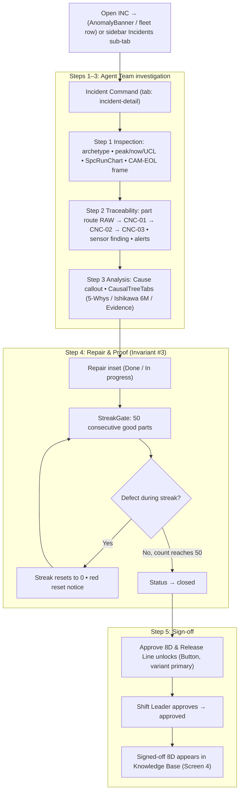

# Screen 3: Incident Command — 5-Step Investigation & 8D Sign-Off

> **Tab:** `incident-detail` (sidebar "Incidents"; one closable sub-tab per opened incident)  
> **Viewport:** Desktop `1440 × 900 px`  
> **Primary Personas:** Shift Leader (John Tran) & Quality Assurance Engineer (Huong Pham)  
> **Single Job-to-be-Done (JTBD):** Product-Evidence Verification & 8D Incident Sign-Off. *(Ensures incidents close exclusively on physical product evidence, enforcing Invariant #3).*  
> **Design Standard:** [`docs/DESIGN.md`](../DESIGN.md) (Lumina Slate liquid glass)  
> **Terminology:** Unified **Agent Team** across all pages and documentation.

---

## 1. End-to-End User Flow & UI Workflow



---

## 2. Persona & Context

- **Shift Leader (John Tran):** Authorizes production line resumption. Must verify that finished workpieces are physically conforming before signing off on 8D closure.
- **Quality Assurance Engineer (Huong Pham):** Audits Agent Team findings (Quality Inspector, Traceability, Process Analyst, Root Cause) and standardizes corrective actions into permanent SOPs.
- **Core Governance Rule (Invariant #3):** **Incidents close on product evidence only.** The approval button stays locked until `verification_count >= verification_target` (50 consecutive clean workpieces).

---

## 3. Progressive Disclosure Architecture (3 Tiers)

```
[Tier 1: Glance (1s)]   --> Breadcrumb #INC chip + title + StatusReasonBanner + step circles (done / active / pending) + StepRail
        │
        ▼
[Tier 2: Focus (5s)]    --> The single open (current) StepSection + pinned "Approve 8D & Release Line" button state
        │
        ▼
[Tier 3: Deep Dive]     --> Expand other steps • <details> sensor history / documents • CausalTreeTabs • EightDReportCard • AgentAttribution
```

### Page Header
- **Breadcrumb:** `Line Overview / #INC-…` (accent mono chip).
- **Title:** `{Defect} on {machine}` (`PageTitle`, 24px on this page).
- **Meta line:** product, end-of-line, opened time, open/resolved duration.
- **StatusReasonBanner** (escalated / error / dismissed only; tones in DESIGN §3.4).
- **Section header:** `Investigation steps` with an `Expand all` / `Collapse all` link.

### Step Sections
Each step is a collapsible `StepSection` (DESIGN §3.9). Only the current step is open by default; each step ends with `AgentAttribution` (collapsible agent trail showing which agent produced the evidence).

1. **Inspection**
   - Defect archetype.
   - Stats: peak / now / UCL.
   - `SpcRunChart` (60 parts, UCL shading).
   - CAM-EOL frame with a defect box and what the camera saw.
2. **Traceability**
   - Part route `RAW → CNC-01 → CNC-02 → CNC-03`, fault node in red.
   - Machine sensor finding.
   - `SensorHistoryChart` inside a `<details>` (3 lines, threshold and onset markers).
   - `TelemetryAlertsPanel` (threshold alerts).
3. **Analysis**
   - Dark ink `Cause` callout.
   - `CausalTreeTabs` (`SegmentedControl`: 5-Whys / Ishikawa 6M / Evidence, each with a mono count). Why-tree: numbered 24px dots on an accent connector, red ★ dot on the root cause.
   - Confidence chip.
4. **Repair & Proof**
   - Repair inset with `Done` / `In progress` chip.
   - `StreakGate`: 25-column proof grid, target 50 consecutive good parts, mono `count/target`, red reset notice.
   - `Documents` (work order, SOP proposal) in a `<details>`.
5. **Sign-off**
   - Pinned **`Approve 8D & Release Line`** (`Button`, variant `primary`). `locked` state with `count/target` until `verification_count >= 50` (Invariant #3).
   - `EightDReportCard`: 36px accent icon tile, 8 mini progress ticks, D1–D8 list (`Tag` variant `inverse`; done items get a green tick), download button.
   - Lesson learned.
   - Impact stats: cost, scrap, CO₂e, downtime.
   - Product-evidence rule note.

### StepRail
- Fixed right-side 28px glass pill with one state-coloured dot per step; the step in view stretches to 16px; dark tooltip on hover. Hidden below 768px.

---

## 4. Low-Fi ASCII Wireframe: Incident Command (Desktop 1440px)

```text
 ╭──────────────────────╮  ╭────────────────────────────╮               (●) 1 Active Anomaly  ╭ ⌘K Search… ╮ (♪) John Tran (JT)
 │ [K] KAIZEN AGENT     │  │ Cell Line 1 / Incidents    │                                     ╰────────────╯
 │ ╭ Cell Line 1 …    ╮ │  ╰────────────────────────────╯
 │ ╰──────────────────╯ │
 │ OPERATIONAL LOOP     │  Line Overview / [#INC-…]                                                                                     ╭─╮
 │ ▣ Line Overview      │  Tool wear scratch on CNC-02                         <-- PageTitle 24px                                       │●│ 1
 │ ⚠ Incidents      *   │  Housing-B42 · end-of-line CAM-EOL · opened 09:40 · open 12m                                                  │●│ 2
 │   │ #INC-… ×         │                                                                                                               │●│ 3
 │                      │  INVESTIGATION STEPS                                                              Expand all                  │█│ 4 <- in view
 │ KNOWLEDGE LOOP       │  ╭─(✓)─ Inspection ── summary… ───────────────────────────────────────────── [Done] ⌄ ╮                       │○│ 5
 │ ▶ Tech Walkthroughs  │  ╰────────────────────────────────────────────────────────────────────────────────────╯                       ╰─╯
 │ ▤ Knowledge Base     │  ╭─(✓)─ Traceability ── summary… ──────────────────────────────────────────── [Done] ⌄ ╮                    StepRail
 │ ☰ SOP Change Log     │  ╰────────────────────────────────────────────────────────────────────────────────────╯                    (28px)
 │                      │  ╭─(✓)─ Analysis ── summary… ─────────────────────────────────────────────── [Done] ⌄ ╮
 │                      │  ╰────────────────────────────────────────────────────────────────────────────────────╯
 │                      │  ╔═(④)═ Repair & Proof ── summary… ───────────────────────── (●) Verifying ⌃ ═╗  <-- active: accent border + 4px ring
 │                      │  ║ ╭ Repair inset: insert replaced, torque 45 Nm                 [Done] ╮                  ║
 │                      │  ║ ╰─────────────────────────────────────────────────────────────────────╯                  ║
 │                      │  ║ STREAKGATE                                                         38/50 (mono)          ║
 │                      │  ║ ■■■■■■■■■■■■■■■■■■■■■■■■■                                                                ║
 │                      │  ║ ■■■■■■■■■■■■■▣□□□□□□□□□□□   <-- done #22b573 · next cell pulses accent                    ║
 │                      │  ║ ▸ Documents (work order · SOP proposal)                                                  ║
 │                      │  ║ ▸ Agent trail                                                                            ║
 │                      │  ╚════════════════════════════════════════════════════════════════════════════════════════╝
 │                      │  ╭─(5┄)─ Sign-off ── summary… ──────────────────────────────────────── [🔒 Waiting] ⌄ ╮  <-- pending: dashed, .7 opacity
 │                      │  │  [ 🔒 Approve 8D & Release Line · 38/50 ]  (Button locked → primary at 50/50)       │
 │                      │  │  ╭ 8D report  ▮▮▮▮▮▯▯▯   D1 … D8                                     [↓] ╮              │
 │                      │  │  ╰──────────────────────────────────────────────────────────────────────╯              │
 │ (●) 24 ms  [Shift A] │  │  Lesson learned · Impact: cost · scrap · CO₂e · downtime · product-evidence rule note │
 │ (JT) John Tran       │  ╰────────────────────────────────────────────────────────────────────────────────────╯
 ╰──────────────────────╯
```

---

## 5. UI States & Edge Cases

| State | UI Behavior |
|---|---|
| **Investigating (steps 1–3)** | Current step open with accent ring and pulsing active label; later steps pending (dashed circle, 0.7 opacity, `Waiting` + lock). |
| **Verifying (`count < 50`)** | Step 4 open; StreakGate fills done cells, next cell pulses; Step 5 button locked showing `count/target`. |
| **Defect during verification** | Streak resets to 0; StreakGate shows the red reset notice. Invariant #3 still holds. |
| **Closed (`count >= 50`)** | Status `closed`; Step 4 marked Done; `Approve 8D & Release Line` unlocks as `Button` variant `primary`. |
| **Approved** | Shift Leader approval accepted only on a `closed` incident; the signed-off 8D appears in the Knowledge Base (Screen 4). |
| **Escalated / error / dismissed** | `StatusReasonBanner` shows the reason with its tone (escalated amber-brown, error dark red, dismissed slate). |
| **Narrow window (< 768px)** | StepRail hidden; steps remain a single column. |
