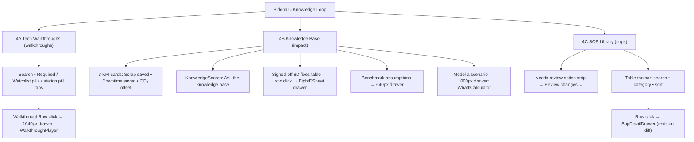

# Screen 4: Knowledge Loop — Tech Walkthroughs, Knowledge Base & SOP Library

> **Tabs:** `walkthroughs` (sidebar "Tech Walkthroughs") • `impact` (sidebar "Knowledge Base") • `sops` (sidebar "SOP Change Log")  
> **Viewport:** Desktop `1440 × 900 px`  
> **Primary Personas:** Plant Manager (David Vu), Continuous Improvement (Kaizen) Lead, ESG Lead  
> **Single Job-to-be-Done (JTBD):** Institutional Memory Search & ESG Sustainability Quantification. *(Not for active line control; dedicated to long-term organizational learning and ESG reporting).*  
> **Design Standard:** [`docs/DESIGN.md`](../DESIGN.md) (Lumina Slate liquid glass)  
> **Source:** PR #105 `dashboard_frontend/src/components/views/TechWalkthroughsView.tsx`, `KaizenImpactView.tsx`, `SopLibraryView.tsx` + `components/knowledge/*`  
> **Terminology:** Unified **Agent Team** across all pages and documentation.

**Label notes (as implemented in PR #105):**
- The sidebar label "SOP Change Log" opens a page titled **"SOP Library"**.
- Tab id `impact` is labelled **"Knowledge Base"** (sidebar and page title).

---

## 1. End-to-End User Flow & UI Workflow



---

## 2. Persona & Context

- **Plant Manager (David Vu):** Reports manufacturing productivity, safety, and ESG compliance to executive management. Needs concrete figures on scrap reduced, downtime saved, and carbon emissions avoided.
- **Continuous Improvement (Kaizen) Lead:** Ensures the factory continuously learns from defects. Needs to query verified fixes and prevent recurring mistakes across machine cells.
- **Cognitive Requirement:** Must instantly communicate measurable ESG impact (Tier 1) while providing semantic search into historical 8D fixes (Tier 2 & 3).

---

## 3. Progressive Disclosure Architecture (3 Tiers)

```
[Tier 1: Glance (1s)]   --> Knowledge Base 3 KPI cards • Walkthrough recertification strip • SOP "Needs review" strip
        │
        ▼
[Tier 2: Focus (5s)]    --> KnowledgeSearch + Signed-off 8D fixes table • station sections • SOP table
        │
        ▼
[Tier 3: Deep Dive]     --> SideDrawers: EightDSheet • WalkthroughPlayer • SopDetailDrawer • WhatIfCalculator • Benchmark assumptions
```

---

## 4A. Tech Walkthroughs (`walkthroughs`)

- **Page header:** `.page-title` `Tech Walkthroughs`; subtitle `Short repair videos grouped by machine station · tap a video to play`; button `[ Upload Tech Capture ]` (`.btn-dark`).
- **Tier 1:** monthly recertification strip (progress `4/5`, next item due).
- **Tier 2:**
  - 48px search field; `Required` and `Watchlist` toggle pills (`.pill-lg`); station pill tabs with icons (CNC Milling, Vision QA · CAM-EOL, Injection Molding · IM-05, Wash Line, Electrical & Safety).
  - One `.glass` section per station: header (34px icon tile, title, count and total duration) + `WalkthroughRow`s (104×58 thumbnail with play overlay, title 650 / 0.95rem, meta, duration, 52px save toggle).
- **Tier 3:** a row opens a 1040px `SideDrawer` with `WalkthroughPlayer` (16:9 stage radius 18, play button, progress track with chapter ticks, chapter buttons — active = white with accent left border — and gate rows).

```text
 Tech Walkthroughs                                                                                     [■ Upload Tech Capture ■]
 Short repair videos grouped by machine station · tap a video to play

 ╭─ Recertification ─────────────────────────────────────────────────────────────────────────────────────────────────────────────╮
 │ Monthly recertification   ▬▬▬▬▬▬▬▬▬▬▬▬▬▬▬▬▬▬▭▭▭▭  4/5   · next item due …                                                     │
 ╰────────────────────────────────────────────────────────────────────────────────────────────────────────────────────────────────╯
 ╭ 🔍 Search walkthroughs…                                                       ╮  ( Required )  ( Watchlist )
 ╰───────────────────────────────────────────────────────────────────────────────╯
 (■ CNC Milling ■) ( Vision QA · CAM-EOL ) ( Injection Molding · IM-05 ) ( Wash Line ) ( Electrical & Safety )

 ╭─ [▣] CNC Milling · N videos · total mm:ss ────────────────────────────────────────────────────────────────────────────────────╮
 │ ╭────────╮ Insert change & torque check                                                          mm:ss   ( ☆ )               │
 │ │  ▶     │ meta…                                                                                                              │
 │ ╰────────╯                                                                                                                    │
 │ ──────────────────────────────────────────────────────────────────────────────────────────────────────────────────────────── │
 │ ╭────────╮ …                                                                                     mm:ss   ( ☆ )               │
 ╰────────────────────────────────────────────────────────────────────────────────────────────────────────────────────────────────╯
        Tier 3: row → SideDrawer 1040px → WalkthroughPlayer (16:9, chapters, gate rows)
```

---

## 4B. Knowledge Base (`impact`)

- **Page header:** `.page-title` `Knowledge Base`; subtitle `Past 8D fixes signed off on Cell Line 1 — and the scrap, downtime and CO₂ they saved.`
  - `[ Benchmark assumptions ]` (`.btn`) → 640px drawer (`<details>` with a definition grid).
  - `[ Model a scenario ]` (`.btn-dark`) → 1000px drawer with `WhatIfCalculator` (`/api/impact/*`).
- **Tier 1:** 3 KPI cards, values in mono and coloured:
  - Scrap saved (accent).
  - Downtime saved (amber `#b4710a`).
  - CO₂ offset (green `#0e8a43`).
- **Tier 2:**
  - `KnowledgeSearch` glass card: `Ask the knowledge base`, inset chat input, dark Search button, suggestion pills, result rows with source chips — green = Verified 8D fix, accent = SOP, neutral = Walkthrough.
  - Table **`Signed-off 8D fixes`**: 8D · Problem · Root cause · Fix · Proof · CO₂ · Signed off (chip).
- **Tier 3:** a row opens the `EightDSheet` drawer (past 8D).
- **Data:** ESG ledger stored in `localStorage`.

```text
 Knowledge Base                                                              [ Benchmark assumptions ] [■ Model a scenario ■]
 Past 8D fixes signed off on Cell Line 1 — and the scrap, downtime and CO₂ they saved.

 ╭─ SCRAP SAVED ───────────────────╮ ╭─ DOWNTIME SAVED ────────────────╮ ╭─ CO₂ OFFSET ────────────────────╮
 │ {n} parts   (mono, accent)      │ │ {n} h   (mono, amber #b4710a)   │ │ {n} kg  (mono, green #0e8a43)   │
 ╰─────────────────────────────────╯ ╰─────────────────────────────────╯ ╰─────────────────────────────────╯

 ╭─ Ask the knowledge base ──────────────────────────────────────────────────────────────────────────────────────────────────────╮
 │ ╭ Ask about a defect, part code or SOP…                                                                  ╮ [■ Search ■]       │
 │ ╰────────────────────────────────────────────────────────────────────────────────────────────────────────╯                    │
 │ ( suggestion ) ( suggestion ) ( suggestion )                                                                                  │
 │ [Verified 8D fix]  result…        [SOP]  result…        [Walkthrough]  result…                                                │
 ╰────────────────────────────────────────────────────────────────────────────────────────────────────────────────────────────────╯

 ╭─ Signed-off 8D fixes ─────────────────────────────────────────────────────────────────────────────────────────────────────────╮
 │ 8D        PROBLEM              ROOT CAUSE              FIX                    PROOF            CO₂       SIGNED OFF          │
 │ INC-…     Tool T07 flank wear  …                       Insert WNMG-080408     50/50 parts      {n} kg    (● Signed off)      │
 ╰────────────────────────────────────────────────────────────────────────────────────────────────────────────────────────────────╯
        Tier 3: row → EightDSheet drawer
```

---

## 4C. SOP Library (`sops`)

- **Page header:** `.page-title` `SOP Library`; subtitle `{N} active procedures · click a row…`; buttons `[ Export CSV ]` (`.btn`), `[ New Procedure ]` (`.btn-dark`).
- **Tier 1:** `Needs review` action strip: solid accent chip, SOP code, revision reason, `Review changes →`.
- **Tier 2:** glass table card with toolbar (search, category select, sort select). Columns:
  - SOP (mono; red if safety-critical)
  - Procedure (lock icon if safety, plus category)
  - Machine/Station
  - Rev
  - Updated
  - chevron
- **Tier 3:** a row opens `SopDetailDrawer`: SOP summary, metrics, tags (`TagChip`), revision diff (additions green, deletions red strikethrough).

```text
 SOP Library                                                                                  [ Export CSV ] [■ New Procedure ■]
 {N} active procedures · click a row…

 ╭─ action-strip ────────────────────────────────────────────────────────────────────────────────────────────────────────────────╮
 │ [■ Needs review ■]  SOP-CNC-…  revision reason…                                                         Review changes →     │
 ╰────────────────────────────────────────────────────────────────────────────────────────────────────────────────────────────────╯
 ╭─ .glass table ────────────────────────────────────────────────────────────────────────────────────────────────────────────────╮
 │ ╭ 🔍 Search procedures… ╮   [ Category ▾ ]   [ Sort ▾ ]                                                                       │
 │ SOP            PROCEDURE                          MACHINE/STATION      REV      UPDATED                                       │
 │ SOP-CNC-…      Insert change & torque  · Tooling  CNC-02               v…       …                                       ›     │
 │ SOP-…(red)     🔒 Lockout procedure    · Safety   All                  v…       …                                       ›     │
 ╰────────────────────────────────────────────────────────────────────────────────────────────────────────────────────────────────╯
        Tier 3: row → SopDetailDrawer: summary • metrics • tags • revision diff (+ green / ~~− red~~)
```

---

## 5. UI States & Edge Cases

| State | UI Behavior |
|---|---|
| **Ledger source** | Knowledge Base KPIs and the Signed-off 8D fixes table read from the browser's `localStorage` ESG ledger, so values are per browser, not shared across users. |
| **New 8D signed off** | After approval on Screen 3, the ledger gains a row in `Signed-off 8D fixes` and the 3 KPI cards increment. |
| **Knowledge search results** | Result rows carry a source chip: green Verified 8D fix, accent SOP, neutral Walkthrough. |
| **Walkthrough filters** | `Required` / `Watchlist` pills and station tabs narrow the station sections; below 640px the walkthrough duration is hidden. |
| **SOP needs review** | The `Needs review` strip links to the SOP's revision diff in `SopDetailDrawer`. |
| **Safety-critical SOP** | SOP code shown in red; procedure carries a lock icon. |
| **Narrow window** | Below 1100px impact two-column layouts collapse to one column; below 900px ESG KPIs stack 3 → 1. |
