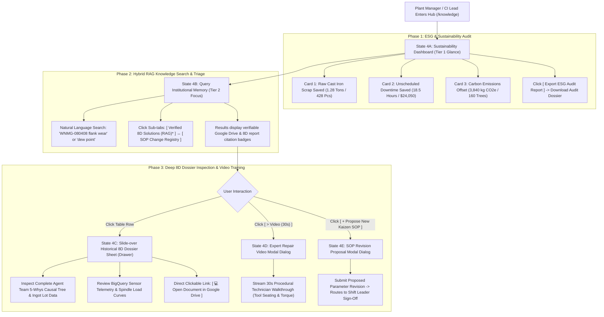

# Screen 4: Kaizen Knowledge & Sustainability Hub

> **Route:** `/knowledge` (Knowledge & ESG Hub) & `/knowledge?tab=sops` (SOP Change Log)  
> **Viewport:** Desktop `1440 × 900 px`  
> **Primary Personas:** Plant Manager (David Vu), Continuous Improvement (Kaizen) Lead, ESG Lead  
> **Single Job-to-be-Done (JTBD):** Institutional Memory Search & ESG Sustainability Quantification. *(Not for active line control; dedicated to long-term organizational learning and ESG reporting).*  
> **Design Standard:** [`docs/DESIGN.md`](../DESIGN.md) (shadcn/ui Light Mode)  
> **Terminology:** Unified **Agent Team** across all pages and documentation.

---

## 1. End-to-End User Flow & UI Workflow

The Knowledge & Sustainability Hub powers organizational learning, hybrid RAG defect queries, and verifiable ESG auditing:



---

## 2. Persona & Context

- **Plant Manager (David Vu):** Reports manufacturing productivity, safety, and ESG compliance to executive management. Needs concrete figures on scrap reduced, downtime saved, and carbon emissions avoided.
- **Continuous Improvement (Kaizen) Lead:** Ensures the factory continuously learns from defects. Needs to query verified fixes and prevent recurring mistakes across machine cells.
- **Cognitive Requirement:** Must instantly communicate measurable ESG impact (Tier 1) while providing powerful semantic RAG search into historical 8D dossiers (Tier 2 & 3).

---

## 3. Progressive Disclosure Architecture (3 Tiers)

```
[Tier 1: Glance (1s)]   --> 3 Sustainability KPI Metric Cards (Scrap Saved, Downtime Saved, CO₂ Offset)
        │
        ▼
[Tier 2: Focus (5s)]    --> RAG Search Input & Category Chips + Verified Solutions Table & Drive Badges
        │
        ▼
[Tier 3: Deep Dive]     --> Slide-over Historical 8D Dossier Drawer + SOP Video Walkthrough Modal
```

### Page Header Component (Slot Top)
- **Title:** `Kaizen Knowledge & Sustainability Hub` (`text-2xl font-bold tracking-tight`)
- **Subtitle:** `Institutional 8D organizational memory, SOP registry, and cumulative ESG footprint.` (`text-sm text-muted-foreground`)
- **Trailing Action Slot:**
  - `[ Export ESG Audit Report ]` (Ghost button, `rounded-md`)
  - `[ + Propose New Kaizen SOP ]` (Outline button, `rounded-md`)

### Tier 1: Glance (1-Second Reception)
- **Top 3 Sustainability KPI Cards (`rounded-xl`, `border bg-card shadow-sm`):**
  - **Raw Cast Iron Saved:** `1.28 Tons` (`428 Parts avoided`) — `+34% vs prior month`.
  - **Unscheduled Downtime Saved:** `18.5 Hours` (`+$24,050 financial value`) — `94.2% availability`.
  - **Carbon Emissions Offset:** `3,840 kg CO₂e` avoided from scrap remelting — `Equivalent to 160 trees`.

### Tier 2: Focus (5-Second Reception)
- **Sub-tab Navigation (`rounded-lg`, `bg-muted p-1`):**
  - `[ Verified 8D Solutions (RAG) * ]` (`/knowledge`)
  - `[ SOP Revision Registry (Change Log) ]` (`/knowledge?tab=sops`)
- **RAG Knowledge Search Bar (`rounded-xl` Card, `p-4`):**
  - Search Input: `"Q Search past anomalies, tooling codes (e.g. WNMG), 5-Whys, or SOPs..."`
  - Category Filter Chips (`rounded-full`): `[All (24)]`, `[Tool Wear (11)]`, `[Thermal Drift (6)]`, `[Spindle Alignment (4)]`, `[Supplier Lots (3)]`.
- **Verified Solutions Table (`rounded-xl` Card):**
  - Columns: Defect Symptom, Machine & Tool, Validated Root Cause, Permanent Fix / SOP, Source Provenance, Impact / Video.
  - Source Badges: `[ 💻 Google Drive ]` (Direct link) or `[ 8D Archive ]`.
  - Quick Video Walkthrough CTA: `[ > Video (30s) ]`.

### Tier 3: Deep Dive (On-Demand / Slide-Over Sheet & Modal)
- **Historical 8D Dossier Drawer (`<Sheet>`):**
  - Clicking any table row opens a full slide-over panel containing:
    - Original incident metadata (`INC-2026-042`, date, shift leader sign-off).
    - Full Agent Team 5-Whys deduction tree with Agent Team evidence logs.
    - Attached raw BigQuery telemetry snapshots.
    - Updated Standard Operating Procedure link (`SOP-CNC-042 v2.1`).
    - Direct Google Drive file link: `💻 Competition | AI Builder Cup / Manuals / CNC_Lathe_Operation.docx`.
- **ESG Calculation Methodology Dialog:**
  - Explains carbon emissions conversion factor (`3.0 kg CO₂e per kg scrap cast iron avoided`).

---

## 4. Low-Fi ASCII Wireframe: Knowledge & ESG Hub (Desktop 1440px)

```text
+-----------------------+--------------------------------------------------------------------------------------------------------------------------------+
|  KAIZEN AGENT         | Cell Line 1 / Knowledge & ESG Hub  [ Scenario: CNC Tool Wear v ]  [⚡ Inject Defect]  [↺ Reset]  [⏱ Baseline]  [David Vu (Mgr) v]      |
|  Cell Line 1: Turning | <-- TOP HEADER BAR (h-14) ----------------------------------------------------------------------------------------------------+ |
+-----------------------+                                                                                                                                |
|                       | +-- PAGE HEADER (<div class="flex items-center justify-between pb-4 border-b">) ---------------------------------------------+ |
|  OPERATIONAL LOOP     | | Kaizen Knowledge & ESG Hub                                                [ Export ESG Report ] [ + Propose Kaizen SOP ]     | |
|  [#] Line Overview    | | Institutional 8D organizational memory, SOP registry, and cumulative ESG footprint                                         | |
|  [T] Tech Copilot     | +----------------------------------------------------------------------------------------------------------------------------+ |
|  [!] Incidents (1)    |                                                                                                                                |
|                       | === TIER 1 (GLANCE): 3 SUSTAINABILITY KPI METRIC CARDS (rounded-xl) ========================================================== |
|  KNOWLEDGE LOOP       | +-- ESG: SCRAP AVOIDED --+  +-- ESG: DOWNTIME SAVED -+  +-- ESG: CO2 REDUCED -----+                                            |
|  [?] Knowledge & ESG* | | Raw Cast Iron Saved    |  | Stoppages Saved        |  | Prevented Remelt        |                                            |
|  [@] SOP Change Log   | |   1.28 Tons (428 Pcs)  |  |   18.5 Hours ($24,050) |  |   3,840 kg CO2e         |                                            |
|                       | |   (^) +34% vs prior mo |  |   (^) 94.2% avail      |  |   Equiv. 160 trees      |                                            |
|                       | +------------------------+  +------------------------+  +-------------------------+                                            |
|                       |                                                                                                                                |
|                       | === TIER 2 (FOCUS): SUB-TABS & RAG KNOWLEDGE SEARCH (rounded-xl) ============================================================ |
|                       | Sub-tabs: [ (•) Verified 8D Solutions (RAG) ]  [ ( ) SOP Revision Registry (Change Log) ]                                      |
|                       | +----------------------------------------------------------------------------------------------------------------------------+ |
|                       | | [ Q Search past anomalies, tooling codes (e.g. WNMG-080408), 5-Whys, or SOPs...                                 ] [Search] | |
|                       | | Filters: (x) All (24)  ( ) Tool Wear (11)  ( ) Thermal (6)  ( ) Spindle (4)  ( ) Material (3)                              | |
|                       | +----------------------------------------------------------------------------------------------------------------------------+ |
|                       |                                                                                                                                |
|                       | === TIER 2 (FOCUS): VERIFIED KAIZEN SOLUTIONS TABLE (rounded-xl) ============================================================ |
|                       | +----------------------------------------------------------------------------------------------------------------------------+ |
|                       | | Anomaly Symptom  | Machine/Tool | Validated Root Cause  | Permanent Fix / SOP  | Source Provenance     | Video / Actions     | |
|                       | +------------------+--------------+-----------------------+----------------------+-----------------------+---------------------+ |
|                       | | Flank Wear VB>0.3| CNC-02 / T07 | Lot hardness HB 240   | WNMG-080408 (45 Nm)  | [💻 Google Drive Doc] | [> 30s SOP Video]   | |
|                       | | High Roughness   | Lathe Cell   | Lack of feed scaling  | SOP-CNC-042 v2.1     | INC-2026-042 Dossier  | [ View 8D Sheet ]   | |
|                       | +------------------+--------------+-----------------------+----------------------+-----------------------+---------------------+ |
|                       | | Thermal Drift    | CNC-01 / Main| Coolant chiller flow  | Threshold set 14L/min| [💻 Google Drive Doc] | [> 30s SOP Video]   | |
|                       | | Z-axis Drift     | Mill Cell    | Filter debris buildup | SOP-CHL-008 v1.4     | INC-2026-038 Dossier  | [ View 8D Sheet ]   | |
|                       | +------------------+--------------+-----------------------+----------------------+-----------------------+---------------------+ |
|                       | | Short Fill Cav #3| IM-05 / M03  | Material dryer dew pt | Replace dryer filter | [💻 Google Drive Doc] | [> 30s SOP Video]   | |
|                       | | Sink Marks ABS   | Molding Cell | Dew pt rose to -18 °C | SOP-IM-019 v2.0      | INC-2026-029 Dossier  | [ View 8D Sheet ]   | |
|                       | +----------------------------------------------------------------------------------------------------------------------------+ |
|-----------------------|                                                                                                                                |
| (o) Live Connected    | === TIER 3 (DEEP DIVE): HISTORICAL 8D DOSSIER SLIDE-OVER SHEET (Opens on row click) ========================================= |
| Shift A (06:00-14:00) | | [Slide-over Sheet]: Complete 5-Whys tree + BigQuery telemetry + Google Drive link + Full SOP Document                      | |
| David Vu (Plant Mgr)  | +----------------------------------------------------------------------------------------------------------------------------+ |
+-----------------------+--------------------------------------------------------------------------------------------------------------------------------+
  ^--- PERSISTENT LEFT SIDEBAR                               ^--- PAGE CONTENT SLOT (<main class="p-6">)
```

---

## 5. UI States & Edge Cases

| State | UI Behavior |
|---|---|
| **Query Search In-Flight** | Search input displays subtle animated spinner; results table dims slightly during hybrid vector retrieval. |
| **No Exact Semantic Match** | Table displays nearest neighbor matches with similarity confidence score (e.g., `"No exact match for 'T99'. Showing closest tool: 'T07'"`). |
| **New 8D Solution Indexed** | When an incident is approved in Screen 3, gentle toast notification alerts the hub: `"SOP-CNC-042 v2.1 has been indexed into the Knowledge Hub."` |
| **Google Drive File Access** | Clicking Google Drive badge opens the live document in Google Workspace preview with read-only permissions. |
