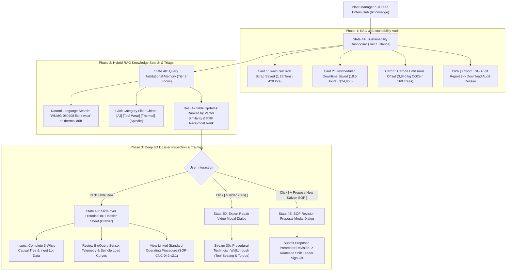

# Screen 4: Kaizen Knowledge & Sustainability Hub

> **Route:** `/knowledge`  
> **Viewport:** Desktop `1440 × 900 px`  
> **Primary Personas:** Plant Manager (David Vu), Continuous Improvement (Kaizen) Lead, ESG Lead  
> **Single Job-to-be-Done (JTBD):** Institutional Memory Search & ESG Sustainability Quantification. *(Not for active line control; dedicated to long-term knowledge retention and ESG reporting).*  
> **Design Standard:** [`docs/DESIGN.md`](../DESIGN.md) (shadcn/ui Light Mode)

---

## 1. End-to-End User Flow & UI Workflow

The Knowledge & Sustainability Hub powers long-term organizational learning, hybrid RAG defect queries, and verifiable ESG auditing:



---

## 2. Persona & Context

- **Plant Manager (David Vu):** Reports manufacturing productivity, safety, and ESG compliance to executive management. Needs concrete figures on scrap reduced, downtime saved, and carbon emissions avoided.
- **Continuous Improvement (Kaizen) Lead:** Ensures the factory continuously learns from defects. Needs to query verified fixes and prevent recurring mistakes across machine cells.
- **Cognitive Requirement:** Must instantly communicate measurable ESG impact (Tier 1) while providing powerful semantic RAG search into historical 8D dossiers (Tier 2 & 3).

---

## 3. Progressive Disclosure Architecture (3 Tiers)

```
[Tier 1: Glance (1s)]   --> 3 Sustainability KPI Metric Cards (Scrap Saved, Downtime Saved, CO₂ Offset)
        │
        ▼
[Tier 2: Focus (5s)]    --> RAG Search Input & Category Chips + Verified Kaizen Solutions Table
        │
        ▼
[Tier 3: Deep Dive]     --> Slide-over Historical 8D Dossier Drawer + SOP Video Walkthrough Modal
```

### Page Header Component (Slot Top)
- **Title:** `Kaizen Knowledge & Sustainability Hub` (`text-2xl font-bold tracking-tight`)
- **Subtitle:** `Institutional 8D organizational memory, SOP registry, and cumulative ESG footprint.` (`text-sm text-muted-foreground`)
- **Trailing Action Slot:**
  - `[ Export ESG Audit Report ]` (Ghost button, `rounded-md`)
  - `[ + Propose New Kaizen SOP ]` (Outline button, `rounded-md`)

### Tier 1: Glance (1-Second Reception)
- **Top 3 Sustainability KPI Cards (`rounded-xl`, `border bg-card shadow-sm`):**
  - **Raw Cast Iron Saved:** `1.28 Tons` (`428 Parts avoided`) — `+34% vs prior month`.
  - **Unscheduled Downtime Saved:** `18.5 Hours` (`+$24,050 financial value`) — `94.2% availability`.
  - **Carbon Emissions Offset:** `3,840 kg CO₂e` avoided from scrap remelting — `Equivalent to 160 trees`.

### Tier 2: Focus (5-Second Reception)
- **RAG Knowledge Search Bar (`rounded-xl` Card, `p-4`):**
  - Search Input: `"Q Search past anomalies, tooling codes (e.g. WNMG), 5-Whys, or SOPs..."`
  - Category Filter Chips (`rounded-full`): `[All (24)]`, `[Tool Wear (11)]`, `[Thermal Drift (6)]`, `[Spindle Alignment (4)]`, `[Supplier Lots (3)]`.
- **Verified Solutions Table (`rounded-xl` Card):**
  - Columns: Defect Symptom, Machine & Tool, Validated Root Cause, Permanent Fix / SOP, Impact / Video.
  - Quick Video Walkthrough CTA: `[ > Video (30s) ]`.

### Tier 3: Deep Dive (On-Demand / Slide-Over Sheet & Modal)
- **Historical 8D Dossier Drawer (`<Sheet>`):**
  - Clicking any table row opens a full slide-over panel containing:
    - Original incident metadata (`INC-2026-042`, date, shift leader sign-off).
    - Full 5-Whys tree with multi-agent evidence logs.
    - Attached raw BigQuery telemetry snapshots.
    - Updated Standard Operating Procedure link (`SOP-CNC-042 v2.1`).
- **ESG Calculation Methodology Dialog:**
  - Explains carbon emissions conversion factor (`3.0 kg CO₂e per kg scrap cast iron avoided`).

---

## 4. User Stories & Acceptance Criteria

### User Story 4.1: Instant Sustainability Impact Quantification (Tier 1)
> **As a** Plant Manager or ESG Lead,  
> **I want to** see aggregate sustainability savings in scrap metal, downtime, and carbon emissions at a single glance,  
> **So that** I can report tangible environmental and financial returns from the Kaizen multi-agent system.

- **Acceptance Criteria:**
  - The 3 KPI cards display precise metrics: Scrap avoided (`1.28 Tons / 428 Parts`), Downtime saved (`18.5 Hours / $24,050`), and Carbon emissions offset (`3,840 kg CO₂e`).
  - Monthly trend indicators compare savings against prior periods.

### User Story 4.2: Natural Language RAG Anomaly Retrieval (Tier 2)
> **As a** Manufacturing or Process Engineer,  
> **I want to** search past anomalies using natural language queries,  
> **So that** I immediately retrieve validated root causes and tool replacement codes without digging through archives.

- **Acceptance Criteria:**
  - Search input connects to Vertex AI Search & Google Drive RAG tool (`backend/tools/rag_search_tool.py`).
  - Search results display concise cards or table rows featuring verified root cause, tooling part number (`WNMG-080408`), and updated SOP reference.
  - Category filter chips allow one-click filtering by anomaly classification.

### User Story 4.3: Deep Historical 8D Dossier Inspection (Tier 3)
> **As a** Continuous Improvement Lead,  
> **I want to** click any solution row to inspect the full 8D investigation dossier and watch expert repair videos,  
> **So that** I can audit historical standard work and train junior operators.

- **Acceptance Criteria:**
  - Clicking a row opens a slide-over Sheet without navigating away from the search view.
  - Video trigger opens a clean dialog modal playing the 30-second expert technician walkthrough.

---

## 5. Low-Fi ASCII Wireframe: Page Content Slot (with Persistent Left Sidebar)

> **Context:** Mounted within the Desktop Base Shell (`docs/wireframes/00_base_layout.md`). The persistent Left Sidebar provides navigation, while the right pane focuses strictly on Knowledge Hub & ESG Sustainability content.

```text
+-----------------------+------------------------------------------------------------------------------------------+
|  KAIZEN AGENT         |  Cell Line 1  /  Knowledge & ESG Hub           Plant: Haiphong Smart Cell      [User v]  |
|  Cell Line 1: Turning |  <-- TOP HEADER BAR (h-14) ------------------------------------------------------------+ |
+-----------------------+                                                                                          |
|                       |  +-- PAGE HEADER (<div class="flex items-center justify-between pb-4 border-b">) ------+  |
|  OPERATIONAL LOOP     |  |  Kaizen Knowledge & ESG Hub             [ Export ESG Report ] [ + Propose Kaizen ] |  |
|  [#] Line Overview    |  |  Institutional 8D memory, SOP change registry, and cumulative ESG footprint         |  |
|  [T] Tech Copilot     |  +------------------------------------------------------------------------------------+  |
|  [!] Incidents  (1)   |                                                                                          |
|                       |  === TIER 1 (GLANCE): 3 SUSTAINABILITY KPI METRIC CARDS (rounded-xl) ===================  |
|  KNOWLEDGE LOOP       |  +-- ESG: SCRAP AVOIDED --+  +-- ESG: DOWNTIME SAVED -+  +-- ESG: CO2 REDUCED -----+     |
|  [?] Knowledge & ESG* |  | Raw Cast Iron Saved    |  | Stoppages Saved        |  | Prevented Remelt        |     |
|  [@] SOP Change Log   |  |   1.28 Tons (428 Pcs)  |  |   18.5 Hours ($24,050) |  |   3,840 kg CO2e         |     |
|                       |  |   (^) +34% vs prior mo |  |   (^) 94.2% avail      |  |   Equiv. 160 trees      |     |
|                       |  +------------------------+  +------------------------+  +-------------------------+     |
|                       |                                                                                          |
|                       |  === TIER 2 (FOCUS): RAG KNOWLEDGE SEARCH & CATEGORY CHIPS (rounded-xl) ================  |
|                       |  +------------------------------------------------------------------------------------+  |
|                       |  | [ Q Search past anomalies, tooling codes (e.g. WNMG), 5-Whys, or SOPs... ] [Search]|  |
|                       |  | Filters: (x) All (24) ( ) Tool Wear (11) ( ) Thermal (6) ( ) Alignment (4)         |  |
|                       |  +------------------------------------------------------------------------------------+  |
|                       |                                                                                          |
|                       |  === TIER 2 (FOCUS): VERIFIED KAIZEN SOLUTIONS TABLE (rounded-xl) ====================  |
|                       |  +------------------------------------------------------------------------------------+  |
|                       |  | Anomaly Symptom  | Machine/Tool | Validated Root Cause  | Permanent Fix / SOP  |Video |  |
|                       |  +------------------+--------------+-----------------------+----------------------+------+  |
|                       |  | Flank Wear VB>0.3| CNC-02 / T07 | Lot hardness HB 240   | WNMG-080408 (45 Nm)  |[>Vid]|  |
|                       |  | High Roughness   | Lathe Cell   | Lack of feed scaling  | SOP-CNC-042 v2.1     |      |  |
|                       |  +------------------+--------------+-----------------------+----------------------+------+  |
|                       |  | Thermal Drift    | CNC-01 / Main| Coolant chiller flow  | Threshold set 14L/min|[>Vid]|  |
|                       |  | Z-axis Drift     | Mill Cell    | Filter debris buildup | SOP-CHL-008 v1.4     |      |  |
|                       |  +------------------+--------------+-----------------------+----------------------+------+  |
|                       |  | Optical False Pos| Conv-01      | Part tilt on belt     | Guide rail shim+1.5mm|[>Vid]|  |
|                       |  | Vision Gate Tag  | Inspection   | Ambient LED bleed     | SOP-CNV-012 v3.0     |      |  |
|                       |  +------------------------------------------------------------------------------------+  |
|-----------------------|                                                                                          |
| (o) Live Connected    |  === TIER 3 (DEEP DIVE): HISTORICAL 8D DOSSIER SLIDE-OVER SHEET (Opens on row click)==  |
| Shift A (06:00-14:00) |  | [Slide-over Sheet]: Complete 5-Whys tree + BigQuery telemetry + Full SOP Document |  |
| David Vu (Plant Mgr)  |  +------------------------------------------------------------------------------------+  |
+-----------------------+------------------------------------------------------------------------------------------+
  ^--- PERSISTENT LEFT SIDEBAR                               ^--- PAGE CONTENT SLOT (<main class="p-6">)

```

---

## 6. UI States & Edge Cases

| State | UI Behavior |
|---|---|
| **Query Search In-Flight** | Search input displays a subtle animated spinner; results table dims slightly during hybrid vector retrieval. |
| **No Exact Semantic Match** | Table displays nearest neighbor matches with similarity confidence score (e.g., `"No exact match for 'T99'. Showing closest tool: 'T07'"`). |
| **New 8D Solution Indexed** | When an incident is approved in Screen 3, a gentle toast notification alerts the hub: `"SOP-CNC-042 v2.1 has been indexed into the Knowledge Hub."` |
