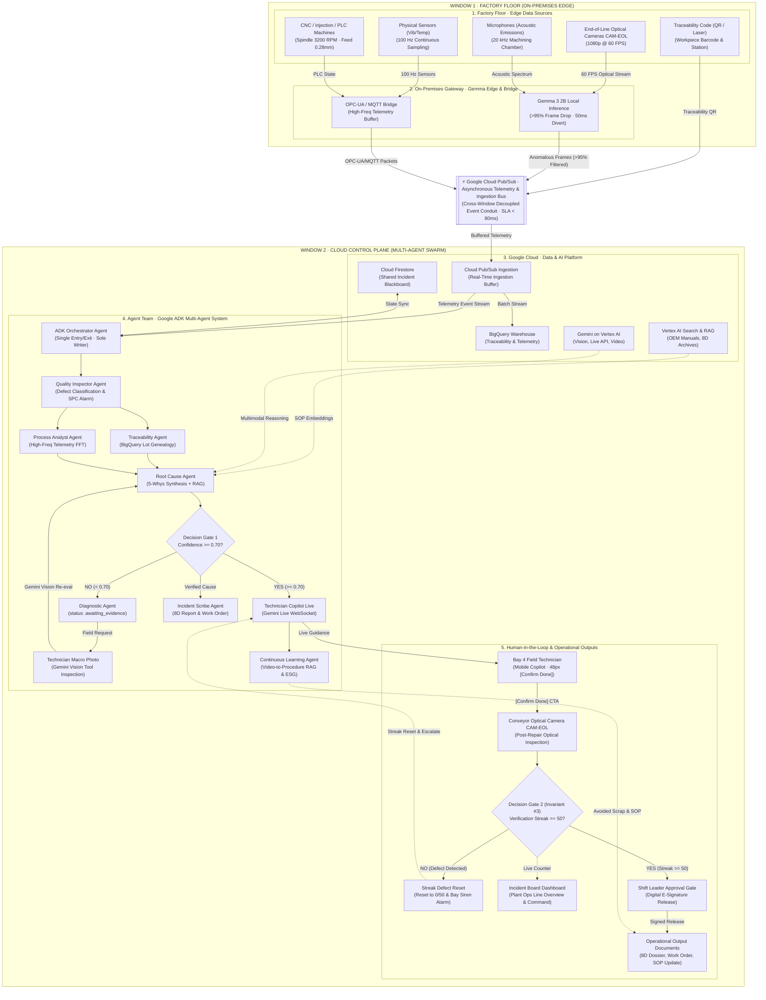
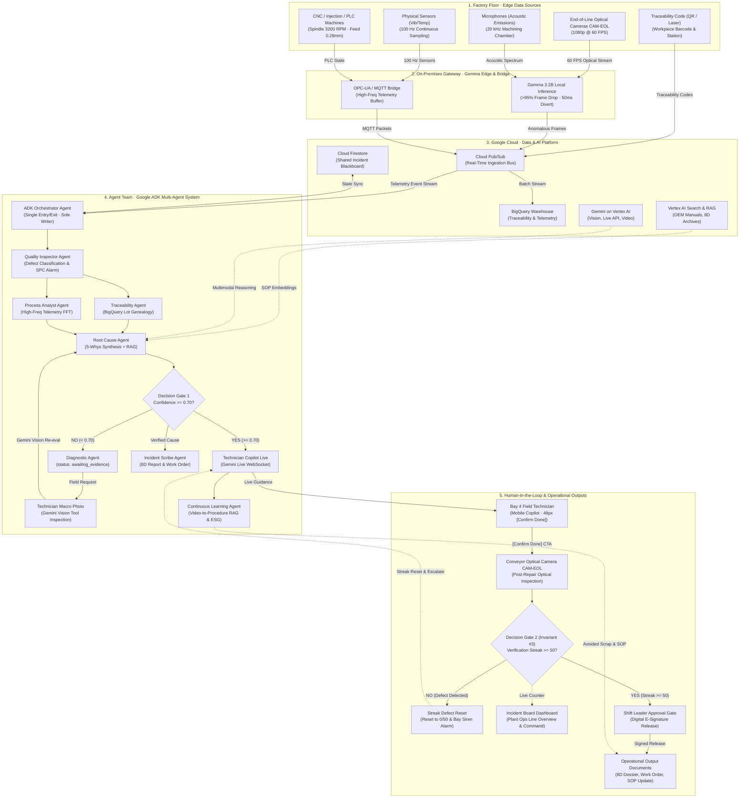

# System Topology Workflow Wireframe & Architecture Specification

> **Feature Tickets:** `TKT-045` / `FEAT-SYSTEM-TOPOLOGY-WORKFLOW-REDESIGN` ([#211](https://github.com/vanduc2514/hackathon-builder-cup-manufacturing-anomaly/issues/211)), `TKT-050` / `[UI/UX] Design Visual Boundaries for Window 1 vs Window 2, Phase Stepper Bar & Calm Tech Alert Glow` ([#225](https://github.com/vanduc2514/hackathon-builder-cup-manufacturing-anomaly/issues/225))  
> **GitHub Issues:** [#225](https://github.com/vanduc2514/hackathon-builder-cup-manufacturing-anomaly/issues/225) (Linked to [#211](https://github.com/vanduc2514/hackathon-builder-cup-manufacturing-anomaly/issues/211), [#218](https://github.com/vanduc2514/hackathon-builder-cup-manufacturing-anomaly/issues/218), [#220](https://github.com/vanduc2514/hackathon-builder-cup-manufacturing-anomaly/issues/220))  
> **Target Viewport:** Desktop Primary `1440 × 900 px` (Responsive Tablet/Mobile `< 1024 px`)  
> **Primary Personas:** Shift Leader, Plant Operations Manager, Automation & Systems Architect  
> **Design Standard:** [`docs/DESIGN.md`](../DESIGN.md) (Lumina Slate — Liquid Glass, Light Mode)  
> **Core Architectural Paradigms:** Two-Window Decoupled Model, Product-First Reactive Swarm, Top-to-Bottom Vertical Execution Flow, Tier 1 Glance Phase A/B/C/D Zones on the Flow, Dual Decision Gates with Condition Blocks, Calm Tech Breathing Alert Glow, Invariant #3 Strict Enforcement.

> **Update [#251](https://github.com/vanduc2514/hackathon-builder-cup-manufacturing-anomaly/issues/251) (2026-10-17) — built on the current production base, 4 targeted changes only:** (1) detached Phase Stepper Bar replaced by inline phase pills A/B/C/D sitting on the flow line; (2) demo controls removed from the header (Scenario dropdown, Incident button, Simulate Ripple) and from the drawer (Simulate Trigger) — the header shows real factory telemetry; (3) hover/focus highlights a node's in/out arrows and dims the rest, and both gates branch into separate condition blocks; (4) SideDrawer decluttered (no route strings, JSON payload or logs). Canvas layout, sidebar, minimap, zoom controls and Lumina Slate tokens are unchanged.

> **Update #251 · round 2 (2026-10-17) — user feedback on the round-1 mock:** (1) the small inline pills were not enough: Phase A/B/C/D are now **labelled dashed zones drawn around their nodes on the workflow** (like the subgraphs in `docs/kaizen-agent-architecture.svg`), each with a legend (letter, name, one-line scope, status chip); (2) hover/focus highlights **only the arrows** — cards never glow, lift or dim; (3) drawer *Comes from* / *Goes to* carry direction arrows (`←` / `→`) on the labels and on every chip; (4) vertical spacing increased (48–56 px between rows, 56 px between layers); (5) every arrow has a fixed orthogonal route — no shared segments, no crossings, never through a card, legend or header; (6) default arrows are darker (`#334155`, 2.6 px). Supporting reorders: Layer 1 = Cameras · Microphones · CNC · Sensors · Tags; Layer 3 row 1 = BigQuery · Pub/Sub · Firestore (Pub/Sub on the centre spine); both gates put **YES on the left, NO on the right**; Diagnostic Agent and Technician Photo are centred under the NO branch; Layer 5 rows = [Technician · Verify camera] → Gate 2 → [Shift Leader · Streak Reset] → [Output Docs · Incident Board]. The Pub/Sub conduit between the windows is now a real hop (Gemma, Bridge and Tags → conduit → Cloud Pub/Sub).

> **Update #251 · round 3 (2026-10-17) — drawer feedback:** (1) **Preview is visual, not a spec list:** every node has its own pure-SVG illustration (camera = viewfinder with defect bounding box and scan line; Pub/Sub = publishers → topic lane with moving message packets → subscriptions; BigQuery = day-partitioned table with the suspect lot rows highlighted; plus Firestore doc tree, RAG ranked citations, Gemini multimodal → JSON, SPC p-chart, genealogy trace, evidence request, wear photo, voice copilot, checklist, dashboard, sign-off, 8D cards, …). Specs (resolution, rate, latency) appear only as up to 3 small badges under the picture. (2) **ADK Orchestrator preview is an orchestration diagram:** the Orchestrator hub in the centre with spokes to Phase A, B, C and D, each phase box coloured like its zone and showing the live phase status; active phases get an animated dashed spoke. (3) **Live telemetry removed** from the drawer. (4) **Comes from / Goes to merged into How it works:** the separate chip section is gone; How it works is now a graph `all inputs → this node → all outputs`, every input/output is a ≥ 44 px button that re-opens the drawer on that node.

> **Update #251 · round 4 (2026-10-17) — polish:** (1) arrows are lighter: default `#64748b` (Slate 500) at `2px`, every state uses the same `2px`; (2) hover/focus **only changes the colour** to indigo `#4338ca` — width and arrowhead size never change; (3) branch colours (kept to three): positive paths (Gate YES → Phase C, Streak ≥ 50 → Shift Leader) are emerald `#16a34a`; negative paths take the colour of the box they lead to — the Gate 1 NO loop (→ Diagnostic → Technician Photo → back to RCA) is amber `#d97706`, the Gate 2 Defect loop (→ Streak Reset → back to Verify) is red `#dc2626`; all other arrows stay neutral slate; (4) badges under WINDOW 1 / WINDOW 2 and the header telemetry chips are removed; (5) the overview card (*Top-to-Bottom Multi-Agent Execution Graph · 26 Components · 2 Decision Gates · 5 Architecture Layers · Invariant #3 Protected*) is removed; (6) the Minimap is light glass, pinned to the bottom-right corner of the canvas while the page scrolls, and drawn from the real layout (windows, layers, phase zones, cards, gates) with a viewport rectangle that follows scroll, pan and zoom; tap it to jump; (7) canvas top padding is 92 px so the floating controls (now 44 × 44 px) never cover Window 1's *Factory Floor Console ↗*.

> **Update #251 · round 5 (2026-10-17) — cleanup + arrow audit:** (1) **Export Graph JSON and Reset View are removed from the header** — the header shows only the breadcrumb and the status pill (fit/zoom stay in the floating canvas controls); (2) **card vs container contrast:** layer/phase containers are a tinted frosted glass (`rgba(238,241,251,.78)` → `rgba(232,236,248,.72)`), node cards are solid `#fff` with a hairline border `rgba(15,23,42,.09)` and a soft two-step shadow, so a card never blends into its container; (3) **arrows audited against `docs/kaizen-agent-architecture.svg` and the current code** (`backend/agents/orchestrator.py`, `backend/edge/gateway/mqtt_bridge.py`) — see §5.1c. Arrows now follow the real workflow: Phase B is sequential QA → Traceability → Process Analyst → RCA; the Gate 1 NO loop is Technician Photo (`awaiting_evidence`) → Copilot Diagnostic → back to RCA; the Gate 2 Defect loop is Streak Reset → **reopen investigation at Traceability** (not back to Verify); Gate 2 YES → Continuous Learning → BigQuery (impact metrics); Orchestrator → Vertex RAG (new knowledge entry); Firestore → Incident Board (read-only); Bridge → Gemma (conveyor frames). Read-only tool lookups (BigQuery, RAG, Gemini) are shown as **Tools** chips on each agent card instead of arrows (AGENTS.md Invariant #2). Supporting reorders: Layer 3 row 1 = Firestore · Pub/Sub · BigQuery; Gate 2 puts **NO on the left, YES on the right** (Gate 1 keeps YES left) so branch lanes never cross. 37 edges, 0 overlap / crossing / card hit / diagonal in all six states.

> **Update #251 · round 6 (2026-10-17) — highlight keeps the arrow's own hue:** on hover/focus, arrows that already carry a colour switch to a **brighter tone of the same colour** instead of indigo: emerald `#16a34a` → `#22c55e`, amber `#d97706` → `#f59e0b`, red `#dc2626` → `#ef4444`, active indigo `#4f46e5` → `#6366f1` (line and arrowhead). Only neutral slate arrows (`#64748b`) highlight in indigo `#4338ca`. Width stays 2px; unrelated arrows still fade to 0.28.

> **Update #251 · round 7 (2026-10-17) — container contrast + no idle badges:**
> 1. **Three clear depth steps: window shell → layer container → card.**
>    - Window 2's shell is a deeper indigo tint (`rgba(214,222,252,.86)` → `rgba(206,215,250,.82)`, border `rgba(79,70,229,.42)`, inner top highlight).
>    - The Layer 3–5 containers inside it are lighter frosted glass (`rgba(246,247,254,.94)` → `rgba(239,242,252,.92)`) with an indigo hairline `rgba(79,70,229,.16)` and a soft lift shadow.
>    - Window 1 gets the same treatment in slate: shell `rgba(226,232,240,.82)`, layers `rgba(248,250,252,.95)` with a slate hairline.
>    - Cards stay solid `#fff`.
> 2. **No "Idle" badges.** Any node, phase zone or window that is just waiting renders **no status chip at all**. This covers:
>    - the static HTML (`hidden`, empty);
>    - the JS reset, and `setNodeStatus(id, 'idle')` with no label;
>    - `PHASE_STATES`;
>    - the Window 2 chip;
>    - the drawer chip.
>
>    The removed labels are "Idle", "Standby", "Queued" and "Standby Nominal". Badges appear only when they carry a real state or reading, such as Active, Detected, Streaming, 42 / 50, Locked, Paused or Draft.

> **Update #251 · round 8 (2026-10-17) — minimal header:** the header title is now just `System Topology` (the `Cell Line 1 /` prefix and the old suffix "& Execution Graph (Vertical Flow)" are removed, and the page title is `Kaizen · System Topology`). The status pill (`#header-status-pill`, e.g. "Line Health Nominal") is removed from the header in every state, along with its CSS and all six `headerPill` updates in `applyScenario`. The incident state is still visible on the canvas, through the phase-zone chips, the Window 2 chip and the arrow colours.

> **Update #251 · round 9 (2026-10-17) — header matches the other pages:** The header has no white bar. It is a single floating **header crumb pill**, the same as `.header-crumb` in `apps/web` (TopHeader). The pill reads `Cell Line 1` (muted), then `/` (faint), then **System Topology** (ink, 650). It is 44 px tall, with a 999 px radius, `--glass-bg-strong`, `--glass-border`, `blur(20px) saturate(180%)` and `--glass-shadow` + `--glass-highlight`. This supersedes the round 8 title-only variant. The status pill, Export Graph JSON and Reset View stay removed.

---

## 1. Executive Summary & Design Rationale

The previous System Topology interface presented system components as horizontal swimlanes (`grid-template-columns: repeat(4, 1fr)`), which did not align with shop-floor cognitive intuition where physical production and reactive swarm incidents flow sequentially through time from **Top to Bottom**.

Following user and product design feedback, this redesign transforms the page into a complete **5-Layer Industrial Architecture Execution Pipeline** matching [`docs/kaizen-agent-architecture.mmd`](../kaizen-agent-architecture.mmd):
1. **5-Layer Continuous Vertical Execution Flow:** Replaces simplified swimlanes with the complete 5 architectural layers of the Kaizen industrial manufacturing platform:
   - **Layer 1: Factory Floor · Edge Data Sources** (CNC / Injection Machines, End-of-Line Optical Cameras CAM-EOL, Vibration/Temp Sensors, Chamber Microphones, Traceability QR/Laser Marking).
   - **Layer 2: On-Premises Gateway · Gemma Edge & Bridge** (Gemma 3 2B Local Inference with >95% frame pre-filtering & 50ms rejector, Industrial OPC-UA / MQTT 100Hz telemetry bridge).
   - **Layer 3: Google Cloud · Data & AI Platform** (Cloud Pub/Sub real-time bus, BigQuery lot genealogy warehouse, Cloud Firestore reactive blackboard, Vertex AI Search / RAG defect library, Gemini 2.5 foundation models).
   - **Layer 4: Agent Team · Google ADK Multi-Agent System** (ADK Orchestrator single entry/exit & sole blackboard writer, Quality Inspector Agent, Traceability Agent, Process Analyst Agent, Root Cause Agent, Diagnostic Agent, Technician Photo Gemini Vision, Technician Copilot Live, Incident Scribe Agent, Continuous Learning Agent).
   - **Layer 5: Human-in-the-Loop & Operational Outputs** (Field Technician Mobile Copilot App, Post-repair Conveyor Optical Inspection Camera CAM-EOL, Streak Defect Reset & Bay Siren Alarm, Incident Board Dashboard, Shift Leader E-Signature Release Approval Modal, Operational Output Documents: 8D Report, Work Order, SOP Update, ESG Impact Card).
2. **Dual Decision Gates (Decision Diamonds):** Explicitly surfaces the AI uncertainty threshold (**Gate 1**: `Confidence >= 0.70?`) with a Diagnostic Loop return path, and the shop-floor physical proof gate (**Gate 2 / Invariant #3**: `Streak >= 50 clean parts`) with an automatic defect reset loop to 0/50.
3. **Decluttered SideDrawer (Tier 3, on demand):** Clicking any of the 26 components or 2 decision gates opens the SideDrawer with only three blocks, top to bottom (#251 r3): **How it works** (a mini graph `all inputs → this node → all outputs`; each input/output is a ≥ 44 px button that jumps to that node; plus one-sentence JTBD), a **visual preview** per node type (pure SVG illustration — viewfinder, packet flow, partitioned table, SPC chart, orchestration hub, … — with at most 3 small spec badges underneath), and one primary 48 px CTA to the real production surface (`Open Technician App`, `Open Confidence Gate`, `Open Release Gate`, …). No route strings, JSON payload, spec tables or log streams.
4. **Ergonomic Canvas Controls & Orthogonal Flowchart Routing:** Replaces soft Bezier curves with crisp, high-contrast orthogonal step connectors (`right-angled step routing`) and enlarged $8 \times 8$ px arrowhead markers. Default connectors use solid slate (`#64748b`, 2px, #251 r4) for immediate readability on `#eef1fb`, switching to animated pulsed dashed lines during active execution. Includes intuitive zoom/pan navigation (Zoom In, Zoom Out, Reset 100%, Fit-to-View), a live vertical Minimap preview, and full glove-friendly touch target compliance ($\ge 44 \times 44$ px).
5. **Top-Most System Architecture Navigation:** Positions the independent `System Architecture` sidebar section (containing `System Topology`) at the very top of the desktop sidebar navigation (above `Operational Loop` and `Knowledge Loop`), highlighting system observability and multi-agent execution architecture as the primary structural anchor of the Kaizen platform.
6. **Arrow-only Edge Highlighting (#251 r2):** Hovering or focusing any component changes only the arrows: connected incoming and outgoing edges are drawn on top in a highlight colour — neutral slate arrows switch to indigo `#4338ca`, coloured arrows switch to a brighter tone of their own colour (emerald → `#22c55e`, amber → `#f59e0b`, red → `#ef4444`, active indigo → `#6366f1`, #251 r6); same 2px width, colour change only and unrelated edges fade to `opacity: 0.28`. Cards are never highlighted, lifted or dimmed; only a clicked card keeps the `selected` outline while its drawer is open. Highlighting walks through gates and their condition blocks so the full branch path lights up. Keyboard focus (Tab, Enter/Space) gives the same highlight as hover.
7. **Header Shows Real Factory Telemetry (no demo controls):** The Scenario dropdown, Incident button and Simulate Ripple are removed from the Top Header. The header keeps only the crumb pill `Cell Line 1 / System Topology` (same `.header-crumb` as the other web pages, #251 r9) (#251 r4: telemetry chips and overview toolbar card removed; #251 r5: Export Graph JSON and Reset View removed; #251 r8: "& Execution Graph (Vertical Flow)" suffix and the Line Health status pill removed). Demo states for design review are reached only through the URL param `?state=nominal|detecting|low_confidence|streak_verifying|streak_reset|approved`, never through visible UI.
8. **Two-Window Visual Demarcation (Physical Edge vs Cloud Swarm Containers):**
   Partitions the 5 architectural layers into two distinct visually bounded containers to eliminate cognitive confusion between on-premises real-time execution and cloud-based AI reasoning:
   - **Window 1 Container (`.window-boundary-card.window-1-boundary`):** Encapsulates Layer 1 (Physical Edge Data Sources: CNC-02, EOL Cameras, Sensors Vib/Temp, Microphones, Traceability QR) and Layer 2 (On-Premises Gateway: Gemma 3 2B edge inference, 50ms pneumatic rejector, OPC-UA/MQTT bridge). Styled with high-contrast industrial slate border (`1.5px solid rgba(71, 85, 105, 0.45)`), cool slate backdrop (`rgba(248, 250, 252, 0.65)`), no badge row under the title (#251 r4), and a dedicated Quick-Launch Deep Link button (`Factory Floor Console ↗` linking to Window 1 `:3002`).
   - **Window 2 Container (`.window-boundary-card.window-2-boundary`):** Encapsulates Layer 3 (Google Cloud Data & AI Platform: Pub/Sub, BigQuery, Firestore Blackboard, Vertex RAG, Gemini 2.5), Layer 4 (Google ADK Multi-Agent Team + Gate 1), and Layer 5 (Human-in-the-Loop & Operational Outputs + Gate 2 / Invariant #3). Styled with subtle cloud indigo tint (`rgba(99, 102, 241, 0.04)`), indigo border (`rgba(99, 102, 241, 0.38)`), and no badge row under the title (#251 r4).
   - **Cross-Boundary Conduit (`.cross-window-bridge`):** Clearly delineates the asynchronous Google Cloud Pub/Sub event and ingestion bus connecting Layer 2 edge egress to Layer 3 cloud ingress with an SLA < 80ms and decoupled buffer reliability.
9. **Phase A/B/C/D Zones on the Workflow (Tier 1 Glance, #251 r2):**
   The detached Phase Stepper Bar is gone and the round-1 pills are replaced by labelled dashed zones drawn around the nodes of each phase, inside the layer cards:
   - **Phase A · Detection & Gatekeeper** (danger tint): Quality Inspector.
   - **Phase B · Tracing & RCA** (warning tint): Traceability, Process Analyst, Root Cause, Gate 1 + condition blocks, Diagnostic loop.
   - **Phase C · Resolution** (info tint): Technician Copilot Live, Incident Scribe.
   - **Phase D · Learning** and **Phase D · Verification & Release** (success tint): Continuous Learning; Field Technician, Verify camera, Gate 2, Shift Leader, Streak Reset, Output Docs, Incident Board.
   Each zone legend (top-right, white plate, ≥ 44 px tall) shows the phase letter, name, one-line scope and a status chip (`active`, `completed`, `warning`, `danger`); an idle zone shows no chip (#251 r7). Phase D's state is shown on both D zones. An active/warning/danger zone gets a stronger tint and border.
10. **Calm Tech Alert Glow & Breathing Pulse Language:**
   Complies strictly with Principle 1 of `docs/DESIGN.md`: avoids harsh, disorienting strobe flashing or rapid blinks that induce shop-floor cognitive fatigue. Replaces aggressive alarms with gentle, sinusoidal radial breathing glow pulses (`box-shadow: 0 0 0 1px ..., 0 0 18px 2px ...` with 2.4s ease-in-out cycle), calibrated across four distinct semantic operational states: Neutral Slate (Nominal/Idle), Indigo Aura (Active Anomaly / In-Flight Processing), Amber Pulse (Diagnostic Loop / Low-Confidence Gate 1), and Crimson Beacon (Streak Defect Reset / Gate 2 Alarm). Includes full `prefers-reduced-motion: reduce` fallback.

---

## 2. End-to-End User Flow & UI Workflow (Top-to-Bottom)



---

## 2. End-to-End User Flow & UI Workflow (Top-to-Bottom)



---

## 3. Personas & Jobs-to-be-Done (JTBD)

| Persona | Operational Context | Primary JTBD on System Topology Screen |
|---|---|---|
| **Shift Leader** | Production floor supervision desk (27" display or tablet). | **JTBD-TOP-01:** Instantly glance down the vertical pipeline to assess the active bottleneck/stage in under 3 seconds; verify whether the incident is currently in Detection, Diagnostic Loop, Guided Repair, or Conveyor Streak Verification. |
| **Plant Ops Manager** | Morning Kaizen review & continuous improvement committee. | **JTBD-TOP-02:** Trace systemic performance, verify edge filter efficiency (>95% frame drop), and confirm Invariant #3 audit integrity for ISO 9001 compliance. |
| **Automation & Systems Architect** | Edge-to-cloud integration & reliability engineering. | **JTBD-TOP-03:** Inspect agent health status, node latencies, pub/sub throughput, and diagnose WebSocket or API edge connectivity failures. |
| **Bay-Side Technician** | Mobile terminal with safety gloves during repair. | **JTBD-TOP-04:** Check whether field evidence was ingested by the Root Cause Agent and see immediate feedback after pressing "Confirm Repair Done". |

---

## 5. Lumina Slate Token Mappings (Pure CSS)

| Token Name | Token Value | Applied UI Surface / Component |
|---|---|---|
| `--bg-app` | `#eef1fb` | Viewport backdrop & canvas pan area |
| `--ink` | `#0b1220` | Node titles, primary headers, active text |
| `--muted` | `#64748b` | Node sub-labels, metrics, inactive icons |
| `--hair` | `rgba(15, 23, 42, .07)` | Internal card dividers, table borders |
| `--hair-strong` | `rgba(15, 23, 42, .14)` | Node card resting border, canvas grid dots |
| `--accent` | `#5b5bf0` | Decision Diamond 1 border, active flow lines, selection outlines |
| `--accent-soft` | `rgba(91, 91, 240, .10)` | Active node background tints, selected chips |
| `--danger` | `#e5484d` | Phase A badge, anomaly alert pill, reject paths |
| `--warning` | `#f5a524` | Phase B badge, Diagnostic Loop border, low confidence pill |
| `--info` | `#3b82f6` | Phase C badge, Copilot Live status, streaming indicators |
| `--success` | `#12a150` | Phase D badge, Decision Diamond 2 border, streak progress fill |
| `--glass-bg` | `rgba(255, 255, 255, .65)` | Pipeline phase cards, floating controls |
| `--glass-bg-strong`| `rgba(255, 255, 255, .82)` | Node cards, SideDrawer background |
| `--glass-border` | `rgba(255, 255, 255, .78)` | Outer glass border with highlight reflection |
| `--glass-shadow` | `0 8px 24px -6px rgba(30, 41, 90, .08)` | Ambient card elevation |
| `--font-main` | `'Inter', sans-serif` | Body copy, technical specifications |
| `--font-display`| `'Geist', sans-serif` | Headers, node names, phase titles |
| `--font-mono` | `'JetBrains Mono', monospace` | Latencies, telemetry metrics, JSON blackboard payloads |

### 5.1. Orthogonal Step Connectors & High-Contrast Arrowhead Tokens

| Edge State / Element | Routing & Geometry | Visual Stroke / Token | Arrowhead Marker Token |
|---|---|---|---|
| **Default Resting Path** | Fixed orthogonal route per edge (see 5.1b) | Solid `2px` · `#64748b` (Slate 500, lighter in #251 r4) | `marker-arrow` (`8x8px`, `#64748b`, `refX="7"`, `refY="5"`) |
| **Hover / Focus Highlight** | Same route, drawn on top | Colour only: `#4338ca`, width unchanged (`2px`); unrelated edges `opacity: 0.28` | `marker-arrow-highlight` (`8x8px`, `#4338ca`) |
| **Branch Positive (resting, #251 r4)** | Gate YES → Phase C, Streak ≥ 50 → Shift Leader | Solid `2px` · `#16a34a` (`.branch-yes`) | `marker-arrow-yes` (`8x8px`, `#16a34a`) |
| **Branch Negative (resting, #251 r4)** | Gate 1 NO loop (→ Diagnostic → Photo → RCA) / Gate 2 Defect loop (→ Streak Reset → Verify) | Solid `2px` · colour of the target box: `#d97706` (`.branch-no-warning`) / `#dc2626` (`.branch-no-danger`) | `marker-arrow-warning` / `marker-arrow-danger` |
| **Active Processing Path**| Orthogonal step with animated dash offset | Dashed `2px` (`8 5`) · `#4f46e5` (`flowDash 1.2s`) | `marker-arrow-active` (`8x8px`, `#4f46e5`) |
| **Completed / Verified Path**| Orthogonal step solid line | Solid `2px` · `#16a34a` (Green 600) | `marker-arrow-completed` (`8x8px`, `#16a34a`) |
| **Decision Branch YES (state)** | Orthogonal step bus routing through central alley | Dashed `2px` (`8 5`) · `#16a34a` | `marker-arrow-yes` (`8x8px`, `#16a34a`) |
| **Decision Branch NO (state)** | Orthogonal step branching to Diagnostic Agent | Dashed `2px` (`8 5`) · `#d97706` (Amber 600) | `marker-arrow-warning` (`8x8px`, `#d97706`) |
| **Reject / Reset Loop** | Orthogonal outer margin step (`M x1 y1 H xTrack V y2 H x2`) | Dashed `2px` (`8 5`) · `#dc2626` (Red 600) | `marker-arrow-danger` (`8x8px`, `#dc2626`) |
| **Feedback Loopback** | Right-margin orthogonal routing into RCA right port | Dashed `2.4px` (`8 5`) · `#4f46e5` | `marker-arrow-active` (`8x8px`, orient left) |

### 5.1b. Arrow Routing Rules (#251 r2)

- Every edge has its own fixed orthogonal route (`ROUTES` in the mock); no two arrows share a segment or cross, and no arrow passes through a card, gate block, zone legend, layer header or window header. Verified by an automated geometry check in all six states.
- Each layer card has a 48 px side gutter. Long hops use side lanes in that gutter: **L1/R1** 18 px outside the content edge, **L2/R2** 32 px, **L3/R3** 46 px (outer). Lanes on one side are nested or disjoint in y so they never cross (#251 r5). Lane use: Cameras → Gemma (L2), Microphones → Gemma (L1), Tags → conduit (R1), Orchestrator → Vertex RAG (L1), Copilot ↔ Field Technician (L1), Streak Reset → Traceability (L2), Firestore → Incident Board (L3), Copilot Diagnostic → RCA re-run (R1), Streak ≥ 50 → Continuous Learning (R1), Continuous Learning → BigQuery (R2).
- Short hops drop straight down: Firestore ↔ Orchestrator (CX − 14) and Pub/Sub → Orchestrator (CX + 14) use a centre channel between RAG and Gemini.
- Phase B is a sequential chain (QA → Traceability → Process Analyst → RCA, numbered 1–3) as in `incident_workflow`; YES → Copilot and YES → Scribe (both `4.`, parallel) leave the YES block at two different x positions.
- Bidirectional edges (Firestore ↔ Orchestrator, Copilot ↔ Technician) carry an arrowhead at both ends; the drawer lists the other end as both input and output.
- Gates: Gate 1 has YES on the left, NO on the right; Gate 2 is mirrored (NO left, YES right, #251 r5) so the reopen lane (left) and the learn lane (right) never cross. Branch arrows enter each condition block at its centre.

### 5.2. Two-Window Container Architecture & Visual Boundary Specification

To clearly separate the physical machine floor and edge execution runtime from the cloud multi-agent control plane, the 5 layers are enveloped into two industrial glass containers:

| Container Element | Selector / CSS Token | Visual Styling & Surface Spec | Enclosed Subsystems & Badges |
|---|---|---|---|
| **Window 1 Container** | `.window-boundary-card.window-1-boundary` | `background: rgba(248, 250, 252, 0.65);`<br/>`border: 1.5px solid rgba(71, 85, 105, 0.45);`<br/>`border-radius: 20px;`<br/>`padding: 20px 24px;` | **Layer 1** (Physical Edge Data Sources) + **Layer 2** (On-Prem Gateway & Gemma 3 SLM).<br/>No badge row (#251 r4). |
| **Window 1 Header Tag** | `.window-1-pill` | `background: rgba(71, 85, 105, 0.12);`<br/>`color: #1e293b; font-weight: 700;` | `WINDOW 1 · FACTORY FLOOR (ON-PREMISES EDGE)` |
| **Quick-Launch CTA** | `.btn-quick-launch` | `background: #1e293b; color: #ffffff;`<br/>`height: 36px; padding: 0 14px;`<br/>`border-radius: 8px; font-weight: 600;` | Label: `Factory Floor Console ↗`<br/>Direct deep-link to Window 1 Standalone Console (`:3002`). Touch target ≥ 44 × 44 px. |
| **Cross-Window Bridge** | `.cross-window-bridge` | `background: rgba(255, 255, 255, 0.72);`<br/>`border: 1.5px dashed rgba(91, 91, 240, 0.40);`<br/>`margin: 24px auto; max-width: 920px;` | **Google Cloud Pub/Sub Conduit**.<br/>Asynchronous decoupling bridge with 100 Hz telemetry buffering, anomalous frame ingest, and < 80ms SLA. |
| **Window 2 Container** | `.window-boundary-card.window-2-boundary` | `background: rgba(240, 244, 255, 0.60);`<br/>`border: 1.5px solid rgba(99, 102, 241, 0.38);`<br/>`border-radius: 20px;`<br/>`padding: 20px 24px;` | **Layer 3** (GCP Data & AI) + **Layer 4** (ADK Multi-Agent Team) + **Layer 5** (Human-in-the-Loop & Verification).<br/>No badge row (#251 r4). |
| **Window 2 Header Tag** | `.window-2-pill` | `background: rgba(99, 102, 241, 0.12);`<br/>`color: #4338ca; font-weight: 700;` | `WINDOW 2 · CLOUD CONTROL PLANE (AI AGENT SWARM)` |

### 5.3. Phase A/B/C/D Zones (Tier 1 Glance) Specification — #251 r2

Phase zones replace both the old stepper bar and the round-1 pills. They are plain blocks in the flow (no overlay layer), so they scroll and zoom with the nodes:

```text
 ┌ Layer 4 ─────────────────────────────────────────────────────────┐
 │                 [ ADK Orchestrator ]                               │
 │ ┌ ─ ─ ─ ─ ─ ─ ─ ─ ─ ─ ─ ─ ─ ─ ─ ─ ─ ─ ─ ─ (A) Phase A · Detection ─┐ │
 │ │               [ Quality Inspector ]                             │ │
 │ └ ─ ─ ─ ─ ─ ─ ─ ─ ─ ─ ─ ─ ─ ─ ─ ─ ─ ─ ─ ─ ─ ─ ─ ─ ─ ─ ─ ─ ─ ─ ─ ┘ │
 │ ┌ ─ ─ ─ ─ ─ ─ ─ ─ ─ ─ ─ ─ ─ ─ ─ ─ ─ ─ (B) Phase B · Tracing & RCA ─┐ │
 │ │ [ Traceability ]   [ Process Analyst ]                          │ │
 │ │            [ Root Cause ] → < Gate 1 > → [YES] [NO] → loop       │ │
 │ └ ─ ─ ─ ─ ─ ─ ─ ─ ─ ─ ─ ─ ─ ─ ─ ─ ─ ─ ─ ─ ─ ─ ─ ─ ─ ─ ─ ─ ─ ─ ─ ┘ │
 │   … (C) Resolution · (D) Learning                                  │
 └───────────────────────────────────────────────────────────────────┘
```

| Zone | Wraps | Tint token | States |
|---|---|---|---|
| **A · Detection & Gatekeeper** | Quality Inspector | `--danger` | `idle`, `completed` |
| **B · Tracing & RCA** | Traceability, Process Analyst, Root Cause, Gate 1, YES/NO blocks, Diagnostic Agent, Technician Photo | `--warning` | `idle`, `active`, `warning` (< 0.70), `completed` |
| **C · Resolution** | Copilot Live, Incident Scribe | `--info` | `idle`, `completed` |
| **D · Learning** | Continuous Learning | `--success` | same as D below |
| **D · Verification & Release** | All of Layer 5 (Technician → Gate 2 → sign-off / reset → outputs) | `--success` | `idle`, `active` (42/50), `danger` (0/50 reset), `completed` (50/50) |

- **Zone surface:** `1.5px dashed` phase colour at 50 %, tint 3.5 % (7 % + stronger border when active), `--radius-lg`.
- **Legend:** top-right so incoming arrows enter on the left/centre; white plate, 32 px letter disc in the phase colour, name + scope, status chip; ≥ 44 px tall.

### 5.1c. Arrow Audit vs Architecture & Code (#251 r5)

Sources: `docs/kaizen-agent-architecture.mmd/.svg` (Arch), `backend/agents/orchestrator.py` `incident_workflow` + `backend/edge/gateway/mqtt_bridge.py` (Code), this mock (Topology).

| # | Arrow | Arch | Code | Topology |
|---|---|---|---|---|
| 1 | Cameras → Gemma | ✓ | ✓ conveyor frames → edge filter | ✓ |
| 2 | Microphones → Gemma | ✓ | — (no audio path yet) | ✓ (per Arch) |
| 3 | Sensors → Gemma | ✓ | Sensors → MQTT Bridge | Sensors → Bridge (per Code) |
| 4 | Machines/PLC → Bridge | ✓ | ✓ | ✓ |
| 5 | Bridge → Gemma | ✓ | ✓ conveyor frames → `edge_station.inspect` | ✓ (new r5) |
| 6 | Gemma → Pub/Sub (defective only) | ✓ | ✓ quality events | ✓ via conduit |
| 7 | Bridge → Pub/Sub (anomalous telemetry + trace) | — | ✓ `publish_telemetry`/`publish_traceability` | ✓ via conduit |
| 8 | Tags → Pub/Sub | ✓ | ✓ | ✓ via conduit |
| 9 | Pub/Sub → BigQuery | ✓ | ✓ | ✓ |
| 10 | Pub/Sub → Orchestrator (defect / SPC) | ✓ | ✓ `start_incident` | ✓ |
| 11 | Firestore ↔ Orchestrator (sole writer) | ✓ | ✓ workflow nodes write Blackboard | ✓ bidir |
| 12 | Orchestrator → QA (0) | ✓ | ✓ | ✓ |
| 13 | QA → TRA → PA → RCA (1–3) | ORCH → each | sequential | ✓ sequential chain (Orchestrator role in Layer 4 note) |
| 14 | RCA → Gate 1 | implicit | ✓ `rca_gate` | ✓ |
| 15 | Gate 1 NO → field evidence → Copilot diagnostic → RCA | ✓ (dashed via ORCH) | ✓ `wait_for_evidence` → `diagnostic_agent` → `root_cause` | ✓ Photo → Diagnostic → RCA (reordered r5) |
| 16 | Gate 1 YES → Copilot ∥ Scribe (4) | ✓ | ✓ parallel | ✓ |
| 17 | Copilot ↔ Technician | ✓ | ✓ Gemini Live | ✓ bidir |
| 18 | Technician → Verify → Gate 2 (5) | ✓ ORCH → QA verify | ✓ `verify_repair` → `verification_gate` | ✓ |
| 19 | Gate 2 NO → Streak Reset → reopen | — | ✓ `reopen_investigation` → Traceability | ✓ → Traceability (was → Verify) |
| 20 | Gate 2 YES → Close + Learn (6) | ✓ ORCH → LEARN | ✓ `close` → `continuous_learning` | ✓ (new r5) |
| 21 | Learn → BigQuery (impact metrics) | ✓ | ✓ | ✓ (new r5) |
| 22 | Orchestrator → RAG (new knowledge) | ✓ | ✓ | ✓ (new r5) |
| 23 | Gate 2 YES → Shift Leader → Output Docs | ✓ ORCH ↔ LEAD, ORCH → OUT | ✓ approve on `closed` only | ✓ |
| 24 | Firestore → Incident Board (read-only) | ✓ | ✓ SSE reads Blackboard | ✓ (new r5, was Gate 2 → Board) |
| 25 | Agents ↔ BigQuery / RAG / Gemini | ✓ tool edges | ✓ read-only tools | **Tools chips** on cards, not arrows (Invariant #2) |

Removed in r5 (not in Arch or Code): QA → PA, TRA → RCA, RAG → RCA, Gemini → RCA (now tool chips), Copilot → Learn "Repair Recording", Gate 2 → Incident Board, Streak Reset → Verify. The Incident Scribe has no outgoing arrow, as in Arch (drafts return to the Orchestrator).

### 5.3b. Gate Condition Blocks

Each decision gate branches into two separate, labelled condition blocks instead of text labels on the arrows:

| Gate | Condition block | Goes to |
|---|---|---|
| **Gate 1 · Confidence** | `≥ 0.70` (green) | Phase C: Copilot Live + Incident Scribe |
| | `< 0.70` (amber) | Technician Photo (`awaiting_evidence`) → Copilot Diagnostic → re-run RCA |
| **Gate 2 · Verification** | `Streak ≥ 50` (green) | Close Incident → Continuous Learning + Shift Leader Approval |
| | `Defect` (red) | Streak reset 0/50 → red dashed loop back to **Traceability** (reopen investigation, Phase B) |

Blocks are cards like any node: hover/focus highlights their in/out arrows only, click opens the gate drawer. Gate 1 puts the **YES block on the left and NO on the right**; Gate 2 is mirrored (**NO left, YES right**, #251 r5) to keep branch lanes from crossing.

### 5.4. Calm Tech Alert Glow & Breathing Pulse Specification

In strict alignment with **Principle 1 (Calm Technology & Signal-to-Noise Ratio)** of `docs/DESIGN.md`, no rapid blinking, flashing strobe lights, or harsh neon borders are permitted on the shop floor. The alert system uses smooth, hardware-accelerated sinusoidal radial breathing glow pulses:

| Alert State / Channel | Accent Token | Breathing Keyframe Definition | Operational Context & Behavior |
|---|---|---|---|
| **Nominal Standby** | `--slate-700` (`#334155`) | `@keyframes calmNominalRest` (Static `0 0 0 1px #cbd5e1`) | Line operates within nominal 3σ limits. Zero distraction. |
| **Active Anomaly / In-Flight** | `--accent` (`#5b5bf0`) | `@keyframes calmBreathingIndigo`<br/>`0%: box-shadow: 0 0 0 1px rgba(91,91,240,0.3), 0 0 8px rgba(91,91,240,0.15);`<br/>`50%: box-shadow: 0 0 0 1.5px rgba(91,91,240,0.6), 0 0 20px 4px rgba(91,91,240,0.28);`<br/>`100%: box-shadow: 0 0 0 1px rgba(91,91,240,0.3), 0 0 8px rgba(91,91,240,0.15);`<br/>Duration: `2.4s ease-in-out infinite`. | Triggered upon SPC UCL breach or active RCA multi-agent reasoning. Subtle, soft aura indicating computation. |
| **Low Confidence / Diagnostic**| `--warning` (`#f5a524`) | `@keyframes calmBreathingAmber`<br/>`0%: box-shadow: 0 0 0 1px rgba(245,165,36,0.35), 0 0 10px rgba(245,165,36,0.18);`<br/>`50%: box-shadow: 0 0 0 2px rgba(245,165,36,0.7), 0 0 22px 4px rgba(245,165,36,0.30);`<br/>Duration: `2.0s ease-in-out infinite`. | Triggered when Gate 1 confidence < 0.70. Indicates awaiting field technician evidence without panic. |
| **Critical Streak Reset / Alarm**| `--danger` (`#e5484d`) | `@keyframes calmBreathingCrimson`<br/>`0%: box-shadow: 0 0 0 1.5px rgba(229,72,77,0.4), 0 0 12px rgba(229,72,77,0.2);`<br/>`50%: box-shadow: 0 0 0 2.5px rgba(229,72,77,0.85), 0 0 26px 6px rgba(229,72,77,0.38);`<br/>Duration: `1.8s ease-in-out infinite`. | Triggered when Gate 2 detects a defect during streak verification (drops to 0/50). Bay siren activated. |

- **Reduced Motion Fallback:** Under `@media (prefers-reduced-motion: reduce)`, all pulsing `@keyframes` are deactivated and automatically degrade to static, non-animating high-contrast colored borders.

---

## 6. Canvas Ergonomics & Touch Compliance

| Control Element | Visual Dimensions | Minimum Touch Hit Area | Glove Ergonomics Specification |
|---|---|---|---|
| **Zoom In Button** | $40 \times 40$ px | **$44 \times 44$ px** | Secondary glass button with 1px border; high-contrast icon. |
| **Zoom Out Button** | $40 \times 40$ px | **$44 \times 44$ px** | Dedicated hit target padding, prevents accidental misclicks. |
| **Zoom Reset Button** | $40 \times 40$ px | **$44 \times 44$ px** | Center alignment, resets transform matrix to scale(1.0) & translate(0,0). |
| **Fit to View Button** | $40 \times 40$ px | **$44 \times 44$ px** | Automatically calculates bounding box of all 4 vertical phases. |
| **Minimap Toggle** | $40 \times 40$ px | **$44 \times 44$ px** | Shows/hides the floating minimap (light glass, pinned bottom-right, drawn from the real layout, tap to jump — #251 r4). |
| **Topology Node Card** | $360 \times 104$ px | Full card area | Entire card acts as interactive tap target to open SideDrawer. |
| **Decision Diamond** | Full width card | Full card area | Ample tap area; distinct diamond visual cue with branch indicators. |
| **Gate Condition Block** | $180 \times 44$ px | **$44$ px touch target** | Tap opens the gate drawer; hover/focus highlights the branch path. |
| **Drawer How-it-works Node** | $44$ px height | **$44$ px touch target** | Input / output button in the How it works graph; tap jumps to that node (#251 r3). |
| **Drawer Primary CTA** | Full width × $48$ px | **$48$ px** | Single bottom CTA to the real production surface. |
| **Drawer Close CTA** | $44 \times 44$ px | **$44 \times 44$ px** | Prominent top-right floating circle button. |
| **Quick-Launch CTA** | $180 \times 36$ px | **$44$ px touch target** | Quick launch to Standalone Factory Floor Console (`:3002`). |
| **Inline Phase Pill** | $~120 \times 28$ px | **$44$ px touch target** | Sits on the flow line; 1-tap jump to its layer. |

---

## 7. Four-Phase Continuous Vertical Workflow & Decision Gates Detail

### Phase A: Detection & Ingestion (Top)
- **Node A1 (Camera / Optical Station · Gemma 3 Edge):** Gemma 3 2B running locally on edge IPC at conveyor exit. Filters >95% nominal video frames; triggers 50ms pneumatic rejector on defect detection.
- **Node A1b (Factory Physical Signals · Sensors & PLC Edge Gateway):** Ingests high-frequency CNC spindle vibration (3200 RPM), bearing temperatures, motor current, and hydraulic pressure via OPC-UA / MQTT (100 Hz sampling); forwards conveyor frames to the Gemma edge filter and only anomalous telemetry + traceability events to Pub/Sub. The Process Analyst reads the stored time-series from BigQuery as a tool.
- **Node A2 (Pub/Sub Ingestion & ADK Orchestrator):** Ingests defect frames and machine telemetry into Cloud Pub/Sub; triggers SPC UCL breach anomaly event and creates incident blackboard session in Firestore.
- **Node A3 (Quality Inspector Agent):** Evaluates SPC Upper Control Limit (UCL 3.0%) across sliding 100-part window. Triggers formal anomaly ticket when Nelson Rule 1 or 2 is violated.

### Phase B: Tracing & Root Cause Analysis
- Phase B runs **sequentially**: QA → Traceability → Process Analyst → Root Cause (r5).
- **Node B1 (Traceability Agent):** Queries BigQuery Lot genealogy graph; correlates workpiece barcode with raw billet heat and CNC tool serial number.
- **Node B2 (Process Analyst Agent):** Fetches high-frequency spindle vibration RMS and motor load; detects statistical drift prior to defect onset.
- **Node B3 (Root Cause Agent):** Synthesizes lot genealogy, telemetry drift, and Vertex AI Search (RAG) 8D archives to form a 5-Whys causal tree.
- **Decision Diamond 1 (`Confidence >= 0.70?`):**
  - **Path YES ($\ge 0.70$):** High certainty in causal analysis; transitions downward to Phase C for field execution.
  - **Path NO ($< 0.70$):** Insufficient data or contradictory telemetry; sets `status = awaiting_evidence` and requests a field photo from the technician (**Technician Photo**); the **Copilot Diagnostic** sub-agent reads the photos and its diagnostic evidence re-runs the Root Cause Agent.

### Phase C: Resolution & Field Intervention
- **Node C1 (Technician Copilot Live):** Bidirectional Gemini Live WebSocket audio/video stream providing hands-free step-by-step tool replacement and calibration guidance.
- **Node C2 (Incident Scribe Agent):** Automatically compiles draft 8D incident report, generates maintenance work order, and prepares revised SOP documentation.
- **Node C3 (Bay Technician Physical Confirmation):** Technician completes physical bay repair and taps the primary 48px "Confirm Repair Completed" CTA. Transitions incident to `status: verifying`.

### Phase D: Verification, Learning & Governance (Bottom)
- **Node D1 (Conveyor Optical Camera Inspection):** Exit inspection camera resumes optical inspection of newly machined workpieces.
- **Decision Diamond 2 (Invariant #3: `Streak >= 50 clean parts?`):**
  - **Path NO (Defect Encountered):** Counter immediately resets to `0/50` and the Orchestrator **reopens the investigation at the Traceability Agent** (Phase B), matching `reopen_investigation` in the workflow.
  - **Path YES (50 consecutive clean workpieces):** Invariant #3 certified; incident transitions to `closed`.
- **Node D2 (Continuous Learning Agent & Impact Engine):** Runs after close; calculates ESG metrics (scrap avoided in kg, kWh saved, USD material preserved) → BigQuery (impact metrics); the Orchestrator commits the new knowledge entry to Vertex RAG.
- **Node D3 (Shift Leader Approval Gate):** Shift leader reviews completed 8D dossier and applies digital E-Signature. Incident status permanently transitions to `approved`.

---

## 8. Deep Component Visual Interactivity & Flow Tracing

To provide technicians and systems engineers with intuitive situational awareness without visual overload, each component on the Topology canvas supports deep visual interactivity:

| Interaction Event | Visual & Behavioral Feedback | Shop-Floor Ergonomics |
|---|---|---|
| **Hover on Node / Gate** | **Arrows only (#251 r2):** connected incoming/outgoing edges switch to `.edge-highlighted` (colour only: `#4338ca` + indigo arrowhead, same 2px width, raised above other edges — #251 r4); non-connected edges fade to `opacity: 0.28`. The card itself and all other cards keep their normal look — no glow, lift, ring or dimming. | Clear visual tracing of data provenance without clicking. |
| **Click / Select Node** | Keeps a `selected` accent outline on the clicked card only and locks its arrow highlight while the Tier 3 `TopologyNodeDrawer` is open. Neighbours are not ringed. | Glove-friendly hit target covers entire node card ($360 \times 104\text{ px}$). |
| **Click Decision Gate** | Selects Diamond Gateway (`decision-gate-1` or `decision-gate-2`), highlights incoming upstream metrics and outgoing branch conduits. Opens gate decision logic in Drawer. | Diamond card touch target $580 \times 80\text{ px}$. |
| **Keyboard Focus on Node / Gate / Block** | Tab moves focus between cards (`tabindex=0`, `role=button`); focus gives the same arrow-only highlight as hover; Enter/Space opens the drawer. | Works with a physical keypad / accessibility tools. |
| **Drawer: How it works graph (#251 r3)** | Three columns `Inputs → This node → Outputs`; curved connectors fan in from every input to the node and fan out to every output, with an arrowhead at each target. Inputs/outputs are buttons (icon + name); the Pub/Sub conduit is skipped so the real neighbour is shown; nodes with no input/output show a dashed `Entry point` / `End of flow`. Tap re-opens the drawer on that neighbour and moves the highlight to it. Replaces the old *Comes from / Goes to* chips. | Walk the flow one hop at a time without closing the drawer. |
| **Drawer: Preview (#251 r3)** | Pure-SVG illustration per node type (light glass, tokens only; gentle motion — scan line, moving packets, dashed flow — disabled under `prefers-reduced-motion`). ADK Orchestrator shows the hub-and-spoke diagram to Phases A–D with live status. Up to 3 spec badges sit under the picture. No Live telemetry section. | Understand the node at a glance, numbers stay secondary. |
| **Drawer: Primary CTA** | Opens the real production surface for this node (toast shows the surface name only). | One 48 px action, nothing else competes. |
| **Canvas Background Click** | Clears active selection, closes SideDrawer, and restores all SVG connectors to standard scenario opacity. | Ergonomic one-touch dismiss on touchscreens. |

---

## 9. Low-Fi ASCII Wireframe: Desktop Layout (1440 × 900 px)

```text
+-----------------------------------------------------------------------------------------------------------------------------+
| [KAIZEN] Plant Ops · ( Cell Line 1 / System Topology )                                                                 |
+-----------------------------------------------------------------------------------------------------------------------------+
|                                                                                                                             |
|  ╔═══════════════════════════════════════════════════════════════════════════════════════════════════════════════════════╗  |
|  ║  WINDOW 1 · FACTORY FLOOR (ON-PREMISES EDGE)                        [ Quick-Launch: Factory Floor Console ↗ (:3002) ] ║  |
|  ║ ───────────────────────────────────────────────────────────────────────────────────────────────────────────────────── ║  |
|  ║   LAYER 1: FACTORY FLOOR · EDGE DATA SOURCES                                                                          ║  |
|  ║   +-----------------+ +-----------------+ +-----------------+ +-----------------+ +-----------------+                 ║  |
|  ║   | CNC / Injection | | EOL Cameras CAM | | Sensors Vib/Tmp | | Microphones     | | Traceability QR |                 ║  |
|  ║   | 3200 RPM Spndle | | 1080p @ 60 FPS  | | 100 Hz Sampling | | Acoustic 20 kHz | | Lot Part Marking|                 ║  |
|  ║   +--------+--------+ +--------+--------+ +--------+--------+ +--------+--------+ +--------+--------+                 ║  |
|  ║            │                   │                   │                   │                   │                          ║  |
|  ║            │ (PLC State)       │ (60 FPS Stream)   │ (100 Hz Data)     │ (Acoustic Feed)   │ (Workpiece Barcode)      ║  |
|  ║            ▼                   ▼                   ▼                   ▼                   │                          ║  |
|  ║   LAYER 2: ON-PREMISES GATEWAY · GEMMA EDGE & PROTOCOL BRIDGE                              │                          ║  |
|  ║   +---------------------------------------------+      +---------------------------------------------+                ║  |
|  ║   | Gemma 3 2B Edge Vision Inference            |      | Industrial OPC-UA / MQTT Protocol Gateway   |                ║  |
|  ║   | >95% Frame Drop · 50ms Pneumatic Rejector   |      | High-Frequency Telemetry Buffer (100 Hz)    |                ║  |
|  ║   +----------------------+----------------------+      +----------------------+----------------------+                ║  |
|  ║                          │                                                    │                    │                  ║  |
|  ║                          │ (Anomalous Defect Frames)                          │ (Telemetry Stream) │                  ║  |
|  ╚══════════════════════════╪════════════════════════════════════════════════════╪════════════════════╪══════════════════╝  |
|                             │                                                    │                    │                     |
|                             ▼                                                    ▼                    ▼                     |
|  ╔═══════════════════════════════════════════════════════════════════════════════════════════════════════════════════════╗  |
|  ║  ⚡ CROSS-WINDOW CONDUIT: GOOGLE CLOUD PUB/SUB ASYNCHRONOUS INGESTION BUS                                            ║  |
|  ║  Decoupled 100 Hz Telemetry & Anomalous Defect Frames Stream · Ingestion SLA < 80ms · Zero Drop Reliability           ║  |
|  ╚══════════════════════════╤═══════════════════════════════════════════════════════════════════════════════════════════╝  |
|                             │                                                                                               |
|                             ▼ (Event Stream Ingest)                                                                         |
|  ╔═══════════════════════════════════════════════════════════════════════════════════════════════════════════════════════╗  |
|  ║  WINDOW 2 · CLOUD CONTROL PLANE (AI AGENT SWARM)                                  [ Status: Swarm Active Processing ] ║  |
|  ║ ───────────────────────────────────────────────────────────────────────────────────────────────────────────────────── ║  |
|  ║   LAYER 3: GOOGLE CLOUD · DATA & AI PLATFORM                                                                          ║  |
|  ║   +-----------------+ +-----------------+ +-----------------+ +-----------------+ +-----------------+                 ║  |
|  ║   | Cloud Pub/Sub   | | BigQuery Lots   | | Cloud Firestore | | Vertex AI Search| | Gemini 2.5 Pro  |                 ║  |
|  ║   | Ingestion Bus   | | Genealogy Wareh | | Shared Blackbrd | | RAG 8D & Manuals| | Multimodal AI   |                 ║  |
|  ║   +--------+--------+ +--------+--------+ +--------+--------+ +--------+--------+ +--------+--------+                 ║  |
|  ║            │                   │                   │                   │                   │                          ║  |
|  ║            ▼ (Trigger Anomaly) │                   │                   │                   │                          ║  |
|  ║   LAYER 4: AGENT TEAM · GOOGLE ADK MULTI-AGENT SYSTEM                      │                   │                          ║  |
|  ║   +---------------------------------------------+                          │                   │                          ║  |
|  ║   | [0] ADK Orchestrator Agent (Single Entry)   |                          │                   │                          ║  |
|  ║   | Sole blackboard writer · Session dispatcher |                          │                   │                          ║  |
|  ║   +----------------------+----------------------+                          │                   │                          ║  |
|  ║                          ▼                                                 │                   │                          ║  |
|  ║   +---------------------------------------------+                          │                   │                          ║  |
|  ║   | [1] Quality Inspector Agent                 |                          │                   │                          ║  |
|  ║   | SPC UCL 3.0% Breach (Actual: 4.8%)          |                          │                   │                          ║  |
|  ║   +--------+----------------------------+-------+                          │                   │                          ║  |
|  ║            │                            │                                  │                   │                          ║  |
|  ║            ▼                            ▼                                  │                   │                          ║  |
|  ║   +-----------------+          +-----------------+                         │                   │                          ║  |
|  ║   | Traceability Ag |          | Process Analyst |                         │                   │                          ║  |
|  ║   | Workpiece B42   |          | Spindle RMS 2.84|                         │                   │                          ║  |
|  ║   +--------+--------+          +--------+--------+                         │                   │                          ║  |
|  ║            │                            │                                  │                   │                          ║  |
|  ║            └────────────────┬───────────┘                                  │                   │                          ║  |
|  ║                             ▼                                              │                   │                          ║  |
|  ║   +------------------------------------------------------------------------+-------------------+                      ║  |
|  ║   | [6] Root Cause Agent (5-Whys Synthesis + RAG OEM Manuals)                                  |                      ║  |
|  ║   | Finding: Spindle bearing wear & tool insert chipping T07                                   |                      ║  |
|  ║   +-------------------------------------+------------------------------------------------------+                      ║  |
|  ║                                         │                                                                             ║  |
|  ║                                         ▼                                                                             ║  |
|  ║                       /───────────────────────────────────\                                                          ║  |
|  ║                      /           DECISION GATE 1          \                                                         ║  |
|  ║                     <     Causal Confidence >= 0.70?       >                                                         ║  |
|  ║                      \        (Actual Score: 0.89)        /                                                          ║  |
|  ║                       \─────────────────┬─────────────────/                                                           ║  |
|  ║               [ <0.70 → Diagnostic ]    │            [ ≥0.70 → Phase C ]                                              ║  |
|  ║        ┌────────────────────────────────┘            └──────────────────────────────────┐                             ║  |
|  ║        ▼                                                                                ▼                             ║  |
|  ║   +---------------------------------------------+      +---------------------------------------------+                ║  |
|  ║   | [6b] Diagnostic Agent (status: awaiting)    |      | [7] Copilot Agent (Gemini Live)             |                ║  |
|  ║   | Dispatches macro photo order to mobile app  |      | Hands-free voice/video · 3-Step Guided Fix  |                ║  |
|  ║   +----------------------+----------------------+      +----------------------+----------------------+                ║  |
|  ║                          │                                                    │                                       ║  |
|  ║                          ▼ (Field Macro Capture)                              ▼                                       ║  |
|  ║   +---------------------------------------------+      +---------------------------------------------+                ║  |
|  ║   | [6c] Technician Photo (Gemini Vision)       |      | [8] Incident Scribe Agent (WorkOrder, 8D)   |                ║  |
|  ║   | Flank wear 0.92 -> Diagnostic -> re-run RCA |      | Auto-draft 8D dossier D1-D8 · WO-2026-8812  |                ║  |
|  ║   +---------------------------------------------+      +----------------------+----------------------+                ║  |
|  ║                                                                               │                                       ║  |
|  ║                                                                               ▼                                       ║  |
|  ║   LAYER 5: HUMAN-IN-THE-LOOP & OPERATIONAL OUTPUTS                                                                    ║  |
|  ║                                 +---------------------------------------------+                                       ║  |
|  ║                                 | [9] [Repair Done] · Bay Tech Confirmation   |                                       ║  |
|  ║                                 | Mobile 48px Primary CTA: "Confirm Done"     |                                       ║  |
|  ║                                 +----------------------+----------------------+                                       ║  |
|  ║                                                        │                                                              ║  |
|  ║                                                        ▼ (Repair Completed)                                           ║  |
|  ║                                 +---------------------------------------------+                                       ║  |
|  ║                                 | [10] Verify Repair (Optical Inspection)     |                                       ║  |
|  ║                                 | Exit CAM-EOL · Real-time Part Roughness Ra  |                                       ║  |
|  ║                                 +----------------------+----------------------+                                       ║  |
|  ║                                                        │                                                              ║  |
|  ║                                                        ▼                                                              ║  |
|  ║                                       /───────────────────────────────────\                                          ║  |
|  ║                                      /    VERIFICATION GATE (Streak>=50)  \                                         ║  |
|  ║                                     <      Streak >= 50 Clean Parts?       >                                         ║  |
|  ║                                      \     [████████████░░░░]  42 / 50     /                                          ║  |
|  ║                                       \────────────────┬──────────────────/                                           ║  |
|  ║                        [ Defect → Reopen   ]          │                 [ Streak≥50 → Close ]                        ║  |
|  ║               ┌────────────────────────────────────────┘                 │                                            ║  |
|  ║               ▼                                                          ▼                                            ║  |
|  ║   +---------------------------------------------+      +---------------------------------------------+                ║  |
|  ║   | STREAK RESET TO 0/50                        |      | [Close Incident] Continuous Learning Agent  |                ║  |
|  ║   | Escalate alarm · Sound bay Andon siren      |      | 48.5kg scrap saved · 112kWh · RAG commit    |                ║  |
|  ║   +-------------------+-------------------------+      +----------------------+----------------------+                ║  |
|  ║                       │                                                       │                                       ║  |
|  ║                       └─ (Reopen) ──> [B1] Traceability                      ▼                                       ║  |
|  ║                                                        +---------------------------------------------+                ║  |
|  ║                                                        | [12] Shift Leader Approval Gate             |                ║  |
|  ║                                                        | Digital E-Signature · [HARD LOCKED <= 49]   |                ║  |
|  ║                                                        +----------------------+----------------------+                ║  |
|  ║                                                                               │                                       ║  |
|  ║                                                                               ▼ (Digital E-Signature Signed)          ║  |
|  ║                                                        +---------------------------------------------+                ║  |
|  ║                                                        | STATUS: CLOSED & NOMINAL PRODUCTION RELEASE |                ║  |
|  ║                                                        +---------------------------------------------+                ║  |
|  ╚═══════════════════════════════════════════════════════════════════════════════╤═══════════════════════════════════════╝  |
|                                                                                  │                                          |
|                                                                                  ▼                                          |
|  [ Operational Outputs: 8D Incident Report #8D-2026-B42 · Work Order #WO-8812 · Knowledge Base SOP #SOP-CNC-42 Update ]     |
+-----------------------------------------------------------------------------------------------------------------------------+
```

---

## 8. Low-Fi ASCII Wireframe: Desktop Layout (1440 × 900 px)

```text
+-----------------------------------------------------------------------------------------------------------------------------+
| [K] KAIZEN AGENT   ( Cell Line 1 / System Topology )                                                                               |
+-----------------------------------------------------------------------------------------------------------------------------+
| CANVAS CONTROLS: [ + Zoom In ] [ - Zoom Out ] [ 100% Reset ] [ [ ] Fit View ] [ (M) Map ]   | Legend: [▼] Flow  [✓] Done  [○] Idle|
+-----------------------------------------------------------------------------------------------------------------------------+
|                                                                                                                             |
|   ╔═════════════════════════════════════════════════════════════════════════════════════════════════════════════════════╗   |
|   ║ PHASE A: DETECTION & INGESTION                                                          [ Lamp: RED / SPC Breach ]  ║   |
|   ║ ─────────────────────────────────────────────────────────────────────────────────────────────────────────────────── ║   |
|   ║   +---------------------------------------------+      +---------------------------------------------+              ║   |
|   ║   | [1] Camera / Optical Station (Gemma 3 Edge) |      | [1b] Factory Physical Signals (PLC Gateway) |              ║   |
|   ║   | Filters >95% normal frames; 50ms rejector   |      | 100 Hz CNC spindle vibration / temp / load  |              ║   |
|   ║   +----------------------+----------------------+      +----------------------+----------------------+              ║   |
|   ║                          │ (Defect Spike)                             │ (OPC-UA / MQTT Stream)                      ║   |
|   ║                          └──────────────────────┬─────────────────────┘                                             ║   |
|   ║                                                 ▼                                                                   ║   |
|   ║                               +---------------------------------------------+                                       ║   |
|   ║                               | [2] Pub/Sub Ingestion & ADK Orchestrator    |                                       ║   |
|   ║                               | SPC UCL Breach / Anomaly API Trigger Event  |                                       ║   |
|   ║                               +----------------------+----------------------+                                       ║   |
|   ║                                                      │                                                              ║   |
|   ║                                                      ▼ (Open Incident Blackboard)                                   ║   |
|   ║                               +---------------------------------------------+                                       ║   |
|   ║                               | [3] Quality Inspector Agent (ADK & SPC Gate)|                                       ║   |
|   ║                               | Defect: Roughness scratch · UCL: 3.0% breach|                                       ║   |
|   ║                               +----------------------+----------------------+                                       ║   |
|   ╚══════════════════════════════════════════════════════╪═════════════════════════════════════════════════════════════╝   |
|                                                                                   │                                         |
|                                                                                   ▼ (Trigger Anomaly & Telemetry Window)    |
|   ╔═══════════════════════════════════════════════════════════════════════════════╧═════════════════════════════════════╗   |
|   ║ PHASE B: TRACING & ROOT CAUSE ANALYSIS (RCA)                                            [ Lamp: AMBER / Diagnosing ]║   |
|   ║ ─────────────────────────────────────────────────────────────────────────────────────────────────────────────────── ║   |
|   ║         ┌─────────────────────────────────────────────────────────────┐                                             ║   |
|   ║         ▼                                                             ▼                                             ║   |
|   ║   +---------------------------------------------+      +---------------------------------------------+              ║   |
|   ║   | [4] Traceability Agent (BigQuery SQL)       |      | [5] Process Analyst Agent (Telemetry FFT)   |              ║   |
|   ║   | Lot genealogy: CNC-02 / Tool T07 / Heat 8849|      | Spindle vibration 2.84 mm/s · Load 78.6%    |              ║   |
|   ║   +----------------------+----------------------+      +----------------------+----------------------+              ║   |
|   ║                          │                                                    │                                     ║   |
|   ║                          └──────────────────────┬─────────────────────────────┘                                     ║   |
|   ║                                                 ▼ (Evidence Synthesis)                                              ║   |
|   ║                                 +---------------------------------------------+                                     ║   |
|   ║                                 | [6] Root Cause Agent (5-Whys + RAG Search)  |                                     ║   |
|   ║                                 | Flank wear on T07 · Brinell hardness surge  |                                     ║   |
|   ║                                 +----------------------+----------------------+                                     ║   |
|   ║                                                        │                                                            ║   |
|   ║                                                        ▼                                                            ║   |
|   ║                                       /─────────────────────────────────\                                           ║   |
|   ║                                      /    DECISION DIAMOND 1             \                                          ║   |
|   ║                                     <      Confidence >= 0.70?            >                                         ║   |
|   ║                                      \                                   /                                          ║   |
|   ║                                       \────────────────┬────────────────/                                           ║   |
|   ║                        [ <0.70 → Diagnostic ]          │                 [ ≥0.70 → Phase C ]                        ║   |
|   ║               ┌────────────────────────────────────────┘                 │                                          ║   |
|   ║               ▼                                                          │                                          ║   |
|   ║   +---------------------------------------------+                        │                                          ║   |
|   ║   | [6b] Diagnostic Agent (awaiting_evidence)   |                        │                                          ║   |
|   ║   | Dispatches macro photo order to mobile app  |                        │                                          ║   |
|   ║   +----------------------+----------------------+                        │                                          ║   |
|   ║                          │                                               │                                          ║   |
|   ║                          ▼ (Field Macro Capture)                         │                                          ║   |
|   ║   +---------------------------------------------+                        │                                          ║   |
|   ║   | [6c] Technician Photo (Gemini Vision)       |                        │                                          ║   |
|   ║   | Multimodal wear analysis · Flank wear 0.92  |                        │                                          ║   |
|   ║   +----------------------+----------------------+                        │                                          ║   |
|   ║                          │                                               │                                          ║   |
|   ║                          ├─ (Re-eval RCA) ──> [6] RCA                    │                                          ║   |
|   ║                          │                                               │                                          ║   |
|   ║                          └─ (Evidence Verified) ──> Connect to Phase C ─────┘                                          ║   |
|   ╚══════════════════════════════════════════════════════════════════════════╪══════════════════════════════════════════╝   |
|                                                                              │                                              |
|                                                                              ▼ (Verified Cause & Work Order ➔ Resolution)   |
|   ╔══════════════════════════════════════════════════════════════════════════╧══════════════════════════════════════════╗   |
|   ║ PHASE C: RESOLUTION & FIELD INTERVENTION                                                [ Lamp: BLUE / Repairing ]  ║   |
|   ║ ─────────────────────────────────────────────────────────────────────────────────────────────────────────────────── ║   |
|   ║         ┌─────────────────────────────────────────────────────────────┐                                             ║   |
|   ║         ▼                                                             ▼                                             ║   |
|   ║   +---------------------------------------------+      +---------------------------------------------+              ║   |
|   ║   | [7] Copilot Agent (Gemini Live)             |      | [8] Incident Scribe Agent (WorkOrder, 8D)   |              ║   |
|   ║   | Hands-free voice/video · 3-Step Guided Fix  |      | Auto-draft 8D dossier D1-D8 · WO-2026-8812  |              ║   |
|   ║   +----------------------+----------------------+      +----------------------+----------------------+              ║   |
|   ║                          │                                                    │                                     ║   |
|   ║                          └──────────────────────┬─────────────────────────────┘                                     ║   |
|   ║                                                 ▼                                                                   ║   |
|   ║                                 +---------------------------------------------+                                     ║   |
|   ║                                 | [9] [Repair Done] · Bay Tech Confirmation   |                                     ║   |
|   ║                                 | Mobile 48px Primary CTA: "Confirm Done"     |                                     ║   |
|   ║                                 +----------------------+----------------------+                                     ║   |
|   ╚════════════════════════════════════════════════════════╪════════════════════════════════════════════════════════════╝   |
|                                                            │                                                                |
|                                                            ▼ (Confirm Repair Completed)                                     |
|   ╔════════════════════════════════════════════════════════╧════════════════════════════════════════════════════════════╗   |
|   ║ PHASE D: VERIFICATION & LEARNING                                                        [ Lamp: GREEN / Verifying ] ║   |
|   ║ ─────────────────────────────────────────────────────────────────────────────────────────────────────────────────── ║   |
|   ║                                 +---------------------------------------------+                                     ║   |
|   ║                                 | [10] Verify Repair (Optical Inspection)     |                                     ║   |
|   ║                                 | Exit CAM-EOL · Real-time Part Roughness Ra  |                                     ║   |
|   ║                                 +----------------------+----------------------+                                     ║   |
|   ║                                                        │                                                            ║   |
|   ║                                                        ▼                                                            ║   |
|   ║                                       /─────────────────────────────────\                                           ║   |
|   ║                                      /    VERIFICATION GATE (Streak>=50) \                                          ║   |
|   ║                                     <     Streak >= 50 Clean Parts?       >                                         ║   |
|   ║                                      \     [████████████░░░░]  42 / 50   /                                          ║   |
|   ║                                       \────────────────┬────────────────/                                           ║   |
|   ║                        [ Defect → Reopen   ]          │                 [ Streak≥50 → Close ]                      ║   |
|   ║               ┌────────────────────────────────────────┘                 │                                          ║   |
|   ║               ▼                                                          ▼                                          ║   |
|   ║   +---------------------------------------------+      +---------------------------------------------+              ║   |
|   ║   | STREAK RESET TO 0/50                        |      | [Close Incident] Continuous Learning Agent  |              ║   |
|   ║   | Escalate alarm · Sound bay Andon siren      |      | 48.5kg scrap saved · 112kWh · RAG commit    |              ║   |
|   ║   +-------------------+-------------------------+      +----------------------+----------------------+              ║   |
|   ║                       │                                                       │                                     ║   |
|   ║                       └─ (Reopen) ──> [B1] Traceability                      ▼                                     ║   |
|   ║                                                        +---------------------------------------------+              ║   |
|   ║                                                        | [12] Shift Leader Approval Gate             |              ║   |
|   ║                                                        | Digital E-Signature · [HARD LOCKED <= 49]   |              ║   |
|   ║                                                        +----------------------+----------------------+              ║   |
|   ║                                                                               │                                     ║   |
|   ║                                                                               ▼ (Digital E-Signature Signed)        ║   |
|   ║                                                        +---------------------------------------------+              ║   |
|   ║                                                        | STATUS: CLOSED & NOMINAL PRODUCTION RELEASE |              ║   |
|   ║                                                        +---------------------------------------------+              ║   |
|   ╚═════════════════════════════════════════════════════════════════════════════════════════════════════════════════════╝   |
|                                                                                                                             |
+-----------------------------------------------------------------------------------------------------------------------------+
```

---

## 11. Low-Fi ASCII Wireframe: Mobile & Tablet Vertical Flowchart (< 1024 px)

```text
+-----------------------------------+
| [K] Cell Line 1 · Topology   (=)  |
| Incident #INC-2026-B42 · Active   |
+-----------------------------------+
| [TIER 1: PHASE PILLS ON FLOW]     |
| [✓ A] ──> (● B) ──> [  C] ──> [🔒 D]|
+-----------------------------------+
| ╔═══════════════════════════════╗ |
| ║ WINDOW 1: FACTORY FLOOR EDGE  ║ |
| ║ [ Quick-Launch Console ↗ ]    ║ |
| ║ · Layer 1: Edge Data Sources  ║ |
| ║ · Layer 2: On-Prem Gateway    ║ |
| ╚═══════════════════════════════╝ |
|                 │                 |
|                 ▼                 |
| [⚡ PUB/SUB ASYNC CONDUIT BUS]    |
|                 │                 |
|                 ▼                 |
| ╔═══════════════════════════════╗ |
| ║ WINDOW 2: CLOUD AI SWARM      ║ |
| ║ · Layer 3: GCP Data & AI      ║ |
| ║ · Layer 4: ADK Agent Swarm    ║ |
| ║   < Decision 1: Conf >= 0.70? > ║ |
| ║ · Layer 5: Human Verification ║ |
| ║   < Decision 2: Streak >= 50? > ║ |
| ║   [████████████░░░░] 42/50    ║ |
| ╚═══════════════════════════════╝ |
+-----------------------------------+
```

---

## 10. Low-Fi ASCII Wireframe: Mobile & Tablet Vertical Flowchart (< 1024 px)

```text
+-----------------------------------+
| [K] Cell Line 1 · Topology   (=)  |
| Incident #INC-2026-B42 · Active   |
+-----------------------------------+
| PHASE A: DETECTION & INGESTION    |
| [1] Edge Gateway (Gemma 3 2B)     |
|     42ms · 96.2% Frame Drop       |
|     │ (50ms Pneumatic Divert)     |
|     ▼                             |
| [2] Pub/Sub Ingestion             |
|     │ (UCL Breach Trigger)        |
|     ▼                             |
| [3] Quality Inspector Agent       |
|     SPC UCL 3.0% Breach (1.42%)   |
|     │                             |
|     ▼ (Trigger RCA)               |
+-----------------------------------+
| PHASE B: TRACING & RCA            |
| [4] Traceability Agent (BigQuery) |
|     Workpiece: Housing-B42-0941   |
| [5] Process Analyst (Vibration)   |
|     Spindle RMS: 2.84 mm/s        |
|     │                             |
|     ▼                             |
| [6] Root Cause Agent (5-Whys)     |
|     Confidence: 0.89 (>= 0.70)    |
|     │                             |
|     ▼                             |
| < Decision 1: Conf >= 0.70? >     |
| ├── YES ──> Phase C               |
| └── NO  ──> Diagnostic Agent      |
|             └──> Tech Photo       |
|                  └──> Phase C     |
+-----------------------------------+
| PHASE C: RESOLUTION & FIX         |
| [7] Tech Copilot (Gemini Live)    |
|     Hands-free audio / en-US      |
| [8] Incident Scribe (8D & SOP)    |
|     D1-D8 Drafted · WO-2026-8812  |
|     │                             |
|     ▼                             |
| [9] Bay Technician Confirm        |
|     [ CONFIRM REPAIR DONE (48px) ]|
|     │                             |
|     ▼ (Repair Done)               |
+-----------------------------------+
| PHASE D: VERIFICATION & GOVERNANCE|
| [10] Exit Optical Camera (CAM-EOL)|
|     │                             |
|     ▼                             |
| < Decision 2: Streak >= 50? >     |
| [████████████░░░░] 42/50 (84%)    |
| ├── Streak≥50 ──> Close & Sign    |
| └── Defect ─> 0/50 → [10] Verify  |
|     │                             |
|     ▼                             |
| [11] Continuous Learning (ESG)    |
| [12] Shift Leader E-Sign [LOCKED] |
+-----------------------------------+
```
- [x] **AC-TOP-21 (Window 1 vs Window 2 Visual Containers & Quick-Launch Deep Link):** The 5-layer topology is visually encapsulated into two distinct, high-contrast containers: Window 1 (`.window-boundary-card.window-1-boundary` covering Layer 1 Edge Sources and Layer 2 On-Premises Gateway with industrial slate border `rgba(71,85,105,0.45)` no badge row) and Window 2 (`.window-boundary-card.window-2-boundary` covering Layer 3 GCP Platform, Layer 4 ADK Swarm, and Layer 5 Verification with cloud indigo tint `rgba(99,102,241,0.04)` no badge row). Window 1 includes an ergonomic Quick-Launch button (`Factory Floor Console ↗`, touch target ≥ 44 × 44 px) linking directly to the standalone factory console on port `:3002`.
- [x] **AC-TOP-22 (Cross-Boundary Google Cloud Pub/Sub Telemetry & Ingestion Bridge):** A dedicated cross-window conduit element (`.cross-window-bridge`) is rendered between Window 1 and Window 2, clearly representing the asynchronous Google Cloud Pub/Sub telemetry stream and anomaly frames buffer with latency SLA (< 80ms) and decoupled message queue guarantees.
- [x] **AC-TOP-23 (Phase A/B/C/D Zones on the Workflow, #251 r2):** No detached stepper bar and no small pills. Phase A, B, C and D are labelled dashed zones around their nodes on the flow (D covers Learning and Verification & Release); each legend shows letter, name, scope and a status chip for `active`, `completed`, `warning` or `danger`, driven by the incident state; an idle zone has no chip (#251 r7).
- [x] **AC-TOP-24 (Calm Tech Breathing Alert Glow & Accessible Motion Language):** Active anomaly alerts and diagnostic states utilize soft, sinusoidal radial breathing glow keyframes (`@keyframes calmBreathingIndigo`, `calmBreathingAmber`, `calmBreathingCrimson`) conforming 100% to Principle 1 of `docs/DESIGN.md` (no rapid flashing or cognitive overload). Honors `@media (prefers-reduced-motion: reduce)` by automatically falling back to static high-contrast semantic borders.
- [x] **AC-TOP-25 (Zero-Collision Responsive Ergonomics & Pure CSS Token Binding):** All container margins (24px gap between Window 1 and Window 2, 16px minimum inner card padding) and text hierarchy rules prevent text clipping and container overflows. Built strictly with pure CSS tokens on `:root` without Tailwind or external UI dependencies.
- [x] **AC-TOP-25 (No Demo Controls in Production Surfaces, #251):** Header has no Scenario dropdown, Incident button or Simulate Ripple; drawer has no Simulate Trigger, Copy JSON or Inspect Logs. Header shows only the crumb pill `Cell Line 1 / System Topology`, styled like `.header-crumb` in `apps/web` (#251 r9). It has no telemetry chips, no overview toolbar card (#251 r4), no Export Graph JSON or Reset View (#251 r5), and no status pill or "Execution Graph" suffix (#251 r8). Demo states are only reachable through `?state=`.
- [x] **AC-TOP-26 (Hover/Focus Arrow Highlight & Gate Condition Blocks, #251 r2):** Hover or keyboard focus on any card highlights only its incoming/outgoing arrows (walking through gates, condition blocks and the Pub/Sub conduit); unrelated arrows fade, and no card is highlighted or dimmed. Gate 1: YES left, NO right; Gate 2 mirrored: NO left, YES right (#251 r5). Gate 1 branches into `≥ 0.70 → Phase C` and `< 0.70 → Technician Photo → Copilot Diagnostic → RCA`; Gate 2 branches into `Streak ≥ 50 → Close Incident` and `Defect → Streak Reset → reopen at Traceability`.
- [x] **AC-TOP-27 (Decluttered SideDrawer, #251 r3):** Drawer shows only How it works (graph `all inputs → this node → all outputs` with ≥ 44 px clickable input/output nodes, + 1 sentence), a per-type visual preview and one 48 px primary CTA. No Live telemetry section, no separate Comes from / Goes to chips, no route strings, JSON payload or logs.
- [x] **AC-TOP-29 (Visual Drawer Previews & Orchestration Diagram, #251 r3):** Every one of the 26 components and 2 gates has a pure-SVG visual preview (no text spec list as the main content); specs appear only as ≤ 3 small badges under the picture. Camera shows viewfinder + defect bounding box + scan line; Pub/Sub shows message packets flowing publisher → topic → subscriptions; BigQuery shows a partitioned table with the suspect lot rows highlighted. The ADK Orchestrator preview is a hub diagram (Orchestrator → Phase A/B/C/D) whose phase statuses follow the current incident state.
- [x] **AC-TOP-28 (Airy Spacing & Collision-free Routing, #251 r2):** Rows are 48 px apart (56 px between layers, 56 px column gap). Every arrow follows a fixed orthogonal route through gutters/lanes: no shared segments, no crossings, never through a card, gate block, legend or header — checked automatically in all six `?state=` views. Default arrows are `#64748b` at 2 px; every state keeps 2 px and hover only changes colour (#251 r4).
- [x] **AC-TOP-30 (Branch Colours, Minimap & Control Clearance, #251 r4):** Positive branch paths are emerald, negative paths take their target box colour (amber evidence loop, red Streak Reset → Traceability loop); all other arrows stay slate. The Minimap is light glass, pinned bottom-right of the canvas, drawn from the real layout with a viewport rectangle that follows scroll/pan/zoom. Floating controls are 44 × 44 px and never cover Window 1's *Factory Floor Console ↗*.
- [x] **AC-TOP-31 (Card Contrast & Arrow Fidelity, #251 r5):** Node cards are solid white with a hairline border and soft shadow over a tinted glass container, so cards never share the container background. Every arrow matches §5.1c: it exists in `docs/kaizen-agent-architecture.svg` and/or the current `incident_workflow` / MQTT bridge, with direction matching data flow; read-only tool lookups are Tools chips, not arrows. 37 edges, 0 overlap / crossing / card hit / diagonal in all six `?state=` views; 2 px styling unchanged.
- [x] **AC-TOP-32 (Hue-preserving Highlight, #251 r6):** Hover/focus never turns a coloured arrow blue: emerald, amber, red and active-indigo arrows highlight in a brighter tone of their own colour (line + arrowhead); only neutral slate arrows highlight in indigo `#4338ca`. Verified headless on nominal, detecting, low_confidence, streak_reset and approved.
- [x] **AC-TOP-33 (Container Depth & No Idle Badges, #251 r7):** Each window shell is visibly darker/tinted than the layer containers inside it (Window 2 indigo, Window 1 slate), and the layers are visibly darker than the white cards. No card, phase zone, window header or drawer ever shows an Idle / Standby / Queued badge; waiting elements have no chip, and chips appear only for real states or readings. Verified headless in all six `?state=` views.
